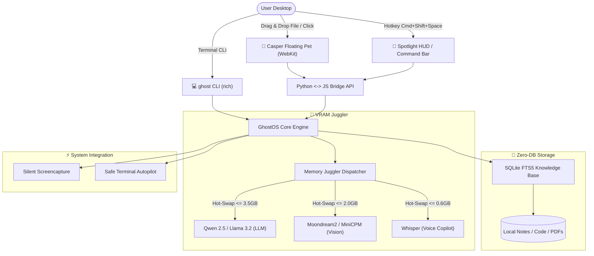

<div align="center">

```
      .---.
     /     \
    | () () |   G H O S T O S
     \  -  /    The Invisible, Featherweight, Offline Desktop AI Copilot
    /`---'\
   /       \    [ 100% Private • Dynamic VRAM Juggler • Zero-DB RAG • Casper Pet ]
  (_/^\_/\_/^)
```

[](https://opensource.org/licenses/MIT)
[](https://www.python.org/downloads/)
[]()
[]()
[]()
[]()

**A unified, offline desktop AI companion that runs seamlessly on low-spec laptops and base Apple Silicon Macs (4GB–8GB RAM) without Out-Of-Memory (OOM) crashes.**

[Quickstart](#-quickstart) • [Features](#-exclusive-features) • [Comparison](#-why-ghostos-vs-others) • [Architecture](#-architecture) • [CLI Usage](#-cli-usage)

</div>

---

### 💡 Why GhostOS?

Running local AI today is frustrating:
- **Heavyweight UI bloat:** Most AI desktop apps use Electron, burning **800MB–1.2GB of RAM** before an LLM is even loaded.
- **The Multi-Model OOM Trap:** Trying to run an LLM (3GB) + Vision model (2GB) + Whisper (1GB) simultaneously instantly crashes computers with 4GB–8GB RAM.
- **Overcomplicated RAG:** Most local document tools force you to run Docker containers, heavy vector DBs (Chroma/Qdrant), and hundreds of megabytes of Python dependencies.

**GhostOS solves this from first principles:**
1. **Casper Companion Pet & HUD:** Rendered via Apple's native WebKit (`WKWebView`) consuming just **~35MB RAM**.
2. **VRAM Juggler:** Dynamically hot-swaps between LLM, Vision, and Whisper on demand in <150ms. Peak VRAM never exceeds **3.5GB**.
3. **Zero-DB RAG:** Drop files onto Casper — indexed in milliseconds using pure **SQLite FTS5** without external databases.

---

### ✨ Exclusive Features

#### 1. 👻 Interactive Casper Desktop Pet
* A lightweight, translucent ghost that floats quietly on your screen.
* **"Casper Eats Files":** Drag and drop any PDF, code repository, markdown, or text file directly onto Casper. Casper opens his mouth, swallows the file, and indexes it into your local knowledge base instantly.
* **Visual Moods & States:**
  * 💤 `Idle`: Soft breathing float, 0% CPU footprint.
  * 🔮 `Thinking`: Neon aura glow, streaming neural generation.
  * 🎧 `Listening`: Casper wears glowing headphones, transcribing offline audio.
  * 🍕 `Eating`: Swallows dragged documents with suction animation.
  * ⚠️ `Alarm`: Visual alert for terminal command risks.
* Click Casper or press `Cmd+Shift+Space` to morph into the **Spotlight HUD**.

#### 2. 🧠 VRAM Juggler & KV-Cache Freezer
* Solves the VRAM bottleneck by enforcing a single active model in GPU/VRAM at a time.
* **KV-Cache Freezer:** When inactive or between queries, GhostOS compresses dialogue state to SSD in 15ms. Active VRAM drops to **0 MB**.
* **Context Vacuum:** Strips boilerplate, comments, and redundant stack frames, reducing prompt token count by **40–60%** before hitting the LLM.
* **Auto-Sleep:** Automatically frees all GPU memory after idle timeout so your laptop stays cool and battery lasts all day.

#### 3. 🦎 Memory Chameleon (Adaptive Power Profiles)
* Dynamically monitors battery state (`pmset`) and system RAM pressure:
  * 🍃 **ECO Mode:** Triggers on battery or RAM > 82%. Context capped at 1024 tokens, 2 CPU threads, 60s auto-sleep, 30 FPS pet.
  * ⚖️ **Balanced Mode:** Context 2048 tokens, 4 threads, 180s auto-sleep.
  * ⚡ **Performance Beast:** On AC power and free RAM > 50%. Context 4096 tokens, full Apple Metal GPU acceleration.

#### 4. 📋 Phantom Clipboard Inspector
* Sub-millisecond pattern-matcher for copied text without waking up heavy neural nets.
* Instant 1-click contextual actions:
  * 🚨 Stack trace -> **💡 Explain & Fix Error**
  * ✨ Raw JSON -> **✨ Format & Validate JSON**
  * 🔍 SQL -> **🔍 Explain Query & Indexing**
  * ⚡ Code snippet -> **⚡ Explain & Refactor**

#### 5. 🛡️ Anti-Hallucination Ghost Lens
* Verifies generated terminal commands against native macOS BSD utilities.
* Automatically patches common LLM hallucinations (e.g. converts GNU `sed -i` to macOS BSD `sed -i ''`, `grep -P` to `grep -E`, checks binary existence via `which`).

#### 6. 🕒 Ghost Time Machine (Session Journal)
* Tracks touched workspace files and git modifications without heavy background daemons.
* Generates instant daily work summaries and smart **1-click Git Commit messages**.

#### 7. 🎮 Casper RPG Evolution System
* Gamified companion that grows with your work:
  * Gain XP for feeding files (+15 XP), running commands (+25 XP), asking questions (+10 XP).
  * Unlocks evolutions and visual accessories:
    * Level 1: 🌱 *Apprentice Wisp*
    * Level 3: 🕶️ *Code Specter* (Unlocks Cyberpunk Visor)
    * Level 5: 📖 *Grand Scribe* (Unlocks Magic Spellbook)
    * Level 6: 👑 *Void Sentinel* (Unlocks Golden Crown)

---

### 📊 Why GhostOS vs. Others?

| Feature | GhostOS 👻 | Jan.ai / LM Studio | Ollama | AnythingLLM |
| :--- | :---: | :---: | :---: | :---: |
| **GUI Memory Footprint** | **~35 MB** (Native WebKit) | ~850 MB (Electron) | None (CLI only) | ~1.1 GB (Electron + DB) |
| **Desktop Pet Companion** | **Yes (Casper RPG)** | No | No | No |
| **Drag & Drop RAG Ingestion**| **Yes (Drop onto Pet)** | Manual upload | Manual import | Manual upload |
| **Dynamic VRAM Swapping** | **Yes (VRAM Juggler)** | ❌ OOM on low VRAM | Manual CLI | ❌ OOM on low VRAM |
| **KV-Cache Disk Freezer** | **Yes (0 MB idle VRAM)**| No | No | No |
| **Context Vacuum (Pruning)** | **Yes (Saves 40-60%)** | No | No | No |
| **Adaptive Battery Profiles**| **Yes (Chameleon Mode)**| No | No | No |
| **Phantom Clipboard Copilot**| **Yes (1-click actions)**| No | No | No |
| **Anti-Hallucination Lens** | **Yes (macOS BSD patch)**| No | No | No |
| **Time Machine / Commit Gen**| **Yes (Built-in)** | No | No | No |
| **External DB Requirement** | **Zero (SQLite FTS5)** | Varies | None | Requires Vector DB / Chroma |
| **Works 100% Offline** | **Yes** | Yes | Yes | Mostly |

---

### 🏗️ Architecture



---

### 🚀 Quickstart

#### 1. Clone & Install
```bash
git clone https://github.com/your-username/ghostos.git
cd ghostos
pip install -e .
```

#### 2. Launch Casper Desktop Pet & HUD
```bash
ghost pet
```
*Casper will float on your screen. Drag any file onto him, or click him to open the HUD!*

#### 3. Or use from Terminal (CLI)
```bash
# Instant question
ghost "Why does Python raise RecursionError and how to fix it?"

# Feed a document or code directory to Casper
ghost eat ~/Documents/my_notes.txt
ghost eat ./src/

# Search indexed knowledge
ghost rag search "database migration"

# Inspect current active screen
ghost screen

# Generate and safely run a terminal task
ghost exec "find all files larger than 100MB"

# Check VRAM Juggler memory diagnostics
ghost status
```

---

### ⌨️ Keyboard Shortcuts

| Shortcut | Action |
| :--- | :--- |
| `Cmd + Shift + Space` / Click Ghost | Toggle Spotlight HUD |
| `Escape` | Minimize back to Floating Casper |
| `Enter` | Submit query |
| `Drag & Drop File` | Feed document to Casper (Instant RAG) |

---

### 🔒 100% Privacy Pledge

GhostOS is designed for paranoid privacy:
- **No Telemetry:** We collect zero analytics, zero user data, zero cookies.
- **No Cloud Fallbacks:** Every inference runs entirely on your local CPU or Metal/GPU.
- **Air-Gapped Ready:** Works with your Wi-Fi completely turned off.

---

### 🤝 Contributing

Contributions are welcome! Feel free to submit issues, pull requests, or custom Casper skins.

```bash
# Run unit tests
python3 -m unittest discover tests
```

---

### 📄 License

MIT License © 2026 GhostOS Contributors. Free for personal and commercial use.
