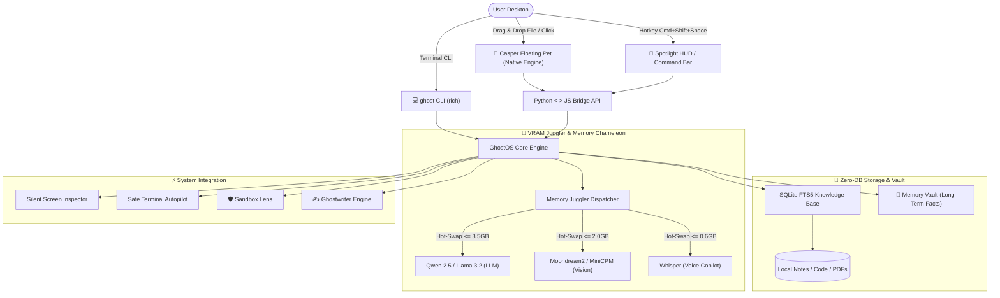

<div align="center">

```
      .---.
     /     \
    | () () |   G H O S T O S
     \  -  /    The Invisible, Featherweight, Offline Desktop AI Copilot
    /`---'\
   /       \    [ 100% Private • Dynamic VRAM Juggler • Zero-DB RAG • Casper Pet ]
  (_/^\_/\_/^)
```

# 👻 GhostOS
### The Featherweight, Offline AI Assistant & Desktop Companion

<p align="center">
  <b>🌐 Language Select / Выбор языка / Тілді таңдау / 语言选择:</b><br>
  <a href="README.md"><b>English</b></a> •
  <a href="docs/README_RU.md"><b>Русский</b></a> •
  <a href="docs/README_KK.md"><b>Қазақша</b></a> •
  <a href="docs/README_ZH.md"><b>简体中文</b></a> •
  <a href="docs/README_ES.md"><b>Español</b></a> •
  <a href="docs/README_DE.md"><b>Deutsch</b></a> •
  <a href="docs/README_FR.md"><b>Français</b></a> •
  <a href="docs/README_JA.md"><b>日本語</b></a> •
  <a href="docs/README_PT.md"><b>Português</b></a>
</p>

[](https://pypi.org/project/ghostos-ai/)
[](https://www.producthunt.com/products/ghostos?launch=ghostos)
[](https://github.com/GhostOS-ai/GhostOS)
[](https://opensource.org/licenses/MIT)
[](https://github.com/GhostOS-ai/GhostOS)
[](mailto:GhostOS@kib.best)
[]()
[]()
[]()
[]()

**A unified, ultra-lightweight desktop AI companion that runs effortlessly on low-spec laptops and base Apple Silicon Macs (4GB–8GB RAM) without Out-Of-Memory (OOM) crashes.**

[Quickstart](#-quickstart) • [Features](#-exclusive-killer-features) • [Comparison](#-why-ghostos-vs-others) • [Architecture](#-architecture) • [CLI Cheatsheet](#-cli-cheatsheet) • [Privacy Pledge](#-100-paranoid-privacy-pledge)

</div>

---

### 💡 Why GhostOS?

Running local AI today is frustrating and bloated:
- **Electron RAM Bloat:** Most local AI desktop apps (LM Studio, Jan, AnythingLLM) burn **800MB–1.2GB of RAM** on the UI alone before a single neural weight is loaded into memory.
- **The Multi-Model OOM Trap:** Trying to run an LLM (3GB) + Vision model (2GB) + Whisper (1GB) simultaneously crashes any device with 4GB–8GB RAM.
- **Overcomplicated RAG Stacks:** Document chat tools force users to install Docker containers, heavy vector databases (Chroma/Qdrant), and gigabytes of bloated Python dependencies.

**GhostOS solves this from first principles:**
1. **Casper Companion Pet & HUD:** Rendered via native system web engines (WebKit on macOS, Edge WebView2 on Windows, WebKitGTK on Linux) consuming just **~35MB RAM**.
2. **Dynamic VRAM Juggler:** Dynamically hot-swaps between LLM, Vision, and Whisper on demand in <150ms. Peak VRAM never exceeds **3.5GB**.
3. **Zero-DB RAG:** Drop files onto Casper — indexed in milliseconds using pure **SQLite FTS5** with zero external database dependencies.
4. **100% Local & Private:** Zero telemetries, zero cloud fallbacks. Fully functional air-gapped with Wi-Fi switched off.

---

### ✨ Exclusive Killer Features

#### 1. 👻 Casper: The Living Desktop Pet
* A quiet, translucent porcelain ghost that floats gently over your workspace.
* **"Casper Eats Files":** Drag & drop any PDF, code repository, notes, or spreadsheet directly onto Casper. Casper opens his mouth, swallows the file, and indexes it into your local knowledge base instantly (+15 XP!).
* **Visual Moods & Reactive States:**
  * 💤 `Idle`: Weightless floating animation, 0% CPU footprint.
  * 🔮 `Thinking`: Ethereal sapphire aura, streaming local neural tokens.
  * 🎧 `Listening`: Casper wears glowing headphones, capturing offline meetings.
  * 🍕 `Eating`: Document suction animation with real-time XP gain.
  * ⚠️ `Alarm`: Visual security warning when a dangerous shell command is detected.
* Single-click for quick phrases & interactions; double-click or press `Cmd+Shift+Space` / `Ctrl+Shift+Space` to morph into the **Spotlight HUD**.

#### 2. ✍️ Ghostwriter (AI Inline Completion in Any App)
* Highlight text anywhere (Word, Telegram, browser, IDE, terminal) $\rightarrow$ press hotkey $\rightarrow$ transform instantly:
  * ✨ `polish`: Professional, crisp, and concise rewrite.
  * 🤝 `polite`: Diplomatic, respectful business tone.
  * 📝 `grammar`: Fixes spelling and grammar mistakes with zero conversational fluff.
  * 🎯 `summarize`: Distills text down to 2-3 key takeaways.
  * 🌐 `translate`: Instant translation into English, Russian, Kazakh, Chinese, etc.
  * 🛠️ `code_fix`: Automatically diagnoses and fixes bugs in code snippets.
* Use from CLI: `ghost write --mode polite "draft message"` or rewrite clipboard in 1 click!

#### 3. 🧠 Memory Vault (Cross-Session Context Graph)
* Local SQLite knowledge graph that permanently stores personal context across restarts.
* Casper automatically remembers your developer stack, favorite languages, and active projects.
* Injects personal context into queries with **0 KB extra VRAM** and 0% background CPU footprint.
* CLI: `ghost vault list`, `ghost vault remember tech_stack "Python, Rust, Apple Silicon"`.

#### 4. 🛡️ Terminal Sandbox Lens (Destructive Command Protection)
* Deep safety inspection for shell commands before execution.
* Intercepts and blocks destructive operations (`rm -rf /`, `mkfs`, raw `dd`, `DROP DATABASE`, `format C:`).
* Explains risks in plain human language and suggests safe alternatives before running.
* Interactive audit: `ghost sandbox "rm -rf /"`.

#### 5. 📅 Daily Standup & Conventional Commit Crafter
* Analyzes daily workspace file modifications, git diffs, and session commits.
* Generates ready-to-share Daily Standup reports for Slack / Telegram (*"What I accomplished", "What I'm working on", "Blockers"*).
* Automatically crafts semantic Conventional Commits (`feat(...)`, `fix(...)`, `refactor(...)`).
* CLI: `ghost standup`.

#### 6. 🎙️ Auto-Minutes Meeting Copilot
* 100% private offline secretary for Zoom, Google Meet, and voice notes.
* Generates structured markdown meeting minutes with **Executive Overview**, **Key Decisions**, and **Action Items with Deadlines**.
* Whisper model hot-swaps in only for the 5-second transcription window and immediately frees VRAM.

#### 7. 🦎 Memory Chameleon (Adaptive Power Profiles)
* Dynamically monitors battery state and system RAM pressure:
  * 🍃 **ECO Mode:** Triggers on battery or RAM > 82%. Context capped at 1024 tokens, 2 CPU threads, 60s auto-sleep, 30 FPS pet.
  * ⚖️ **Balanced Mode:** Context 2048 tokens, 4 threads, 180s auto-sleep.
  * ⚡ **Performance Beast:** On AC power and free RAM > 50%. Context 4096 tokens, full GPU acceleration.

#### 8. 🎮 Casper RPG Evolution System
* Gamified companion that grows with your work:
  * Gain XP for feeding files (+25 XP), running commands (+25 XP), asking questions (+10 XP).
  * Unlocks evolutions and visual accessories (Cyberpunk Visor, Magic Spellbook, Golden Crown).

#### 9. 🎨 Casper Wardrobe (Visual Themes & Skins)
* Launch Casper in distinct aesthetic themes designed for dark mode and modern workstations:
  * 💎 `glass`: Default translucent Apple porcelain moonlight aesthetic.
  * ⚡ `cyberpunk`: Vibrant neon cyan body with radioactive magenta aura.
  * 👑 `gold`: Radiant royal gold aura and drop-shadows.
  * 🟢 `matrix`: Terminal hacker phosphor-green glow.
* CLI: `ghost pet --skin cyberpunk` or switch with 1 click from the Menu Bar!

#### 10. 🍕 Casper Feeder (Physical Drag-and-Drop Ingestion)
* Drag & drop any code file (`.py`, `.js`, `.ts`, `.json`), log, or PDF directly onto Casper.
* Triggers interactive chewing wobble animation (`@keyframes ghostChewWobble`) and cheerful thought bubbles.
* Ingests files into Zero-DB RAG without opening complex upload modals.

#### 11. 👻 Native macOS Menu Bar Controller
* Lightweight native `NSStatusBar` menu bar icon living right in your macOS status bar (`ghost bar` or `ghost pet --tray`).
* 1-click Casper toggle, wardrobe skin switcher, model selector, and instant VRAM flush with **0 KB background bloat**.

#### 12. 🔍 Instant Spotlight HUD
* Fast, centered floating command bar (`ghost spot`) for instant distraction-free questions and terminal autopilot commands. Press `Esc` to instantly dismiss.

#### 13. 🤖 Local Model & Hardware Acceleration Catalog
* Scans local Ollama backends, detects downloaded models with footprints in GB, identifies hardware tier (**Apple Silicon Metal MPS**, **NVIDIA CUDA**, or **CPU**), and suggests lightweight models for 4GB–8GB RAM setups (`ghost models`).

---

### 📊 Why GhostOS vs. Others?

| Feature | GhostOS 👻 | Jan.ai / LM Studio | Ollama | AnythingLLM |
| :--- | :---: | :---: | :---: | :---: |
| **GUI Memory Footprint** | **~35 MB** (Native Engine) | ~850 MB (Electron) | None (CLI only) | ~1.1 GB (Electron + DB) |
| **Desktop Pet Companion** | **Yes (Casper RPG)** | ❌ No | ❌ No | ❌ No |
| **Drag & Drop RAG Ingestion**| **Yes (Drop onto Pet)** | ❌ Manual upload | ❌ Manual import | ❌ Manual upload |
| **Dynamic VRAM Swapping** | **Yes (VRAM Juggler)** | ❌ OOM on low VRAM | ❌ Manual CLI | ❌ OOM on low VRAM |
| **KV-Cache Disk Freezer** | **Yes (0 MB idle VRAM)**| ❌ No | ❌ No | ❌ No |
| **Context Vacuum (Pruning)** | **Yes (Saves 40-60%)** | ❌ No | ❌ No | ❌ No |
| **Adaptive Battery Profiles**| **Yes (Chameleon Mode)**| ❌ No | ❌ No | ❌ No |
| **Inline AI Ghostwriter** | **Yes (Any desktop app)**| ❌ No | ❌ No | ❌ No |
| **Terminal Sandbox Lens** | **Yes (Safety protection)**| ❌ No | ❌ No | ❌ No |
| **Daily Standup / Commit Crafter**| **Yes (Built-in)** | ❌ No | ❌ No | ❌ No |
| **External DB Requirement** | **Zero (SQLite FTS5)** | Varies | None | Requires Vector DB / Chroma |
| **Cross-Platform (macOS/Win/Linux)** | **Yes** | Yes | Yes | Yes |
| **Works 100% Offline** | **Yes** | Yes | Yes | Mostly |

---

### 🚀 Quickstart

#### 1. Instant Installation

**macOS & Linux (One-line terminal installer):**
```bash
curl -fsSL https://raw.githubusercontent.com/GhostOS-ai/GhostOS/main/install.sh | bash
```
*(On macOS, this automatically sets up `/Applications/GhostOS.app` with Casper's native Retina icon in Launchpad and Spotlight).*

**Or install via Python pip:**
```bash
pip install --upgrade ghostos-ai
```

#### 2. Launch Casper Desktop Pet & HUD
```bash
ghost pet
```
*Or on macOS: launch `GhostOS` directly from Spotlight (`Cmd + Space`), Launchpad, or double-click `/Applications/GhostOS.app`!*

#### 3. Or use directly from Terminal (CLI)
```bash
# Instant question with zero setup
ghost "Why does Python raise RecursionError and how to fix it?"

# Launch Casper Desktop Pet (with wardrobe skins & native menu bar)
ghost pet --skin cyberpunk --tray

# Launch centered Spotlight HUD
ghost spot

# Launch native macOS Menu Bar controller
ghost bar

# Inspect local models & hardware acceleration
ghost models

# Feed a document or source directory to Casper (Zero-DB RAG)
ghost eat ~/Documents/my_notes.txt
ghost eat ./src/

# Inline AI Ghostwriter (rewrites clipboard or given text)
ghost write --mode polite "can you fix this asap"
ghost write --mode grammar

# Long-term Memory Vault
ghost vault remember tech_stack "Python, Rust, Apple Silicon"
ghost vault list

# Daily Standup Report & Semantic Commit Crafter
ghost standup

# Terminal Sandbox Safety Lens
ghost sandbox "rm -rf /"

# Search indexed knowledge
ghost rag search "database migration"

# Inspect current active screen
ghost screen

# Generate and safely run a terminal task
ghost exec "find all files larger than 100MB"

# Check VRAM Juggler memory diagnostics
ghost status
```

---

### ⌨️ Keyboard Shortcuts

| Shortcut | Action |
| :--- | :--- |
| `Cmd + Shift + Space` / `Ctrl + Shift + Space` | Toggle Spotlight HUD |
| `Click Ghost` | Talk with Casper / Pet reaction |
| `Double Click Ghost` | Open Quick Command HUD |
| `Escape` | Minimize back to Floating Casper |
| `Enter` | Submit query |
| `Drag & Drop File` | Feed document to Casper (Instant RAG) |

---

### 🏗️ Architecture



---

### 🔒 100% Paranoid Privacy Pledge

GhostOS is engineered with privacy as a foundational constraint:
- **Zero Telemetry:** No analytics, no phone-home pings, no user tracking.
- **Zero Cloud Fallbacks:** Every neural calculation runs locally on your device's CPU/GPU.
- **Air-Gapped Ready:** Works with your Wi-Fi completely disabled.

---

### 🤝 Contributing

Contributions are warmly welcomed! Feel free to submit issues, pull requests, or custom Casper skins.

```bash
# Run full unit test suite (44+ tests)
python3 -m unittest discover tests
```

---

### 📄 License & Authorship

- **Author:** [KIB.best](https://github.com/GhostOS-ai/GhostOS)
- **Email:** [GhostOS@kib.best](mailto:GhostOS@kib.best)
- **License:** MIT License © 2026 KIB.best. Free for personal and commercial use.
