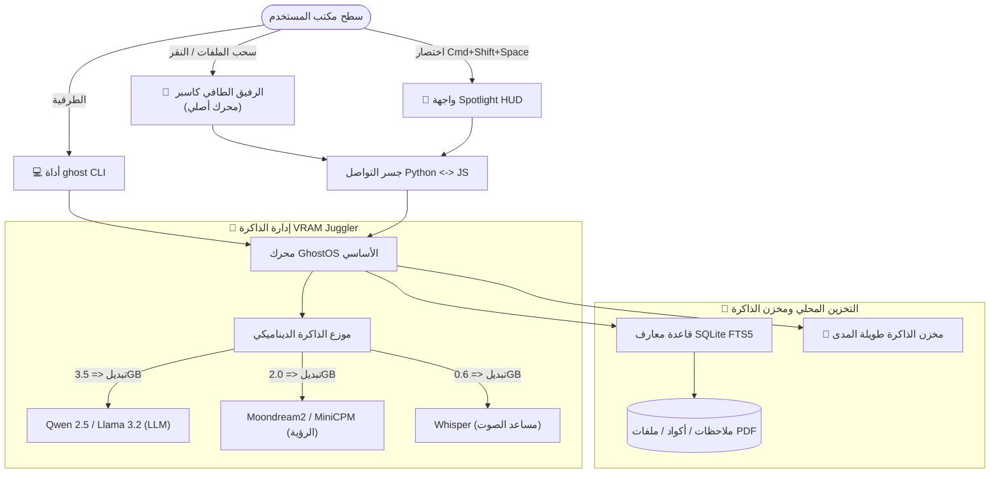

<div align="center">

```
      .---.
     /     \
    | () () |   G H O S T O S   v 2 . 1
     \  -  /    الرفيق الذكي فائق الخفة واستوديو البرمجة المستقل
    /`---'\
   /       \    [ 100% خاص • دماغ هجين محلي وسحابي • استوديو ChatGPT • أقل من 35MB RAM ]
  (_/^\_/\_/^)
```

# 👻 GhostOS v2.1
### الرفيق المكتبي الذكي فائق الخفة واستوديو البرمجة المستقل (Hybrid Brain)

<p align="center">
  <b>🌐 اختيار اللغة / Language Select / Выбор языка / Тілді таңдау:</b><br>
  <a href="../README.md"><b>English</b></a> •
  <a href="README_RU.md"><b>Русский</b></a> •
  <a href="README_KK.md"><b>Қазақша</b></a> •
  <a href="README_ZH.md"><b>简体中文</b></a> •
  <a href="README_ES.md"><b>Español</b></a> •
  <a href="README_DE.md"><b>Deutsch</b></a> •
  <a href="README_FR.md"><b>Français</b></a> •
  <a href="README_JA.md"><b>日本語</b></a> •
  <a href="README_PT.md"><b>Português</b></a> •
  <a href="README_AR.md"><b>العربية</b></a> •
  <a href="README_HI.md"><b>हिन्दी</b></a>
</p>

[](https://pypi.org/project/ghostos-ai/)
[](https://github.com/GhostOS-ai/GhostOS/releases/latest)
[](https://www.producthunt.com/products/ghostos?launch=ghostos)
[](https://github.com/GhostOS-ai/GhostOS)
[](https://opensource.org/licenses/MIT)
[](https://github.com/GhostOS-ai/GhostOS)
[](mailto:GhostOS@kib.best)
[]()
[]()
[]()
[]()

**مساعد ذكي مكتبي موحد فائق الخفة، يعمل بسلاسة تامة على الحواسيب المحمولة والأجهزة الأساسية (4GB–8GB RAM) دون أي أعطال ناتجة عن نفاد الذاكرة (OOM).**

[البدء السريع](#-البدء-السريع) • [الميزات الحصرية](#-الميزات-الحصرية) • [المقارنة](#-لماذا-ghostos-مقارنة-بالبدائل) • [الهيكلية التقنية](#-الهيكلية-التقنية) • [دليل سطر الأوامر](#-أوامر-cli-والاختصارات) • [عهد الخصوصية](#-عهد-الخصوصية-المطلقة-100)

</div>

---

### 💡 لماذا تم ابتكار GhostOS؟

تشغيل الذكاء الاصطناعي محلياً اليوم يعاني من 3 مشكلات حاسمة:
1. **استنزاف الذاكرة عبر Electron:** تستهلك معظم تطبيقات الذكاء الاصطناعي (LM Studio, Jan, AnythingLLM) ما بين **800 إلى 1200 ميجابايت من الذاكرة العشوائية** للواجهة فقط قبل تحميل وزن واحد من أوزان النموذج.
2. **فخ النماذج المتعددة (OOM):** محاولة تشغيل نموذج لغوي (3GB) + نموذج رؤية (2GB) + نموذج Whisper (1GB) في آن واحد تؤدي إلى انهيار أي جهاز بذاكرة 4GB–8GB.
3. **تعقيد أنظمة RAG:** تجبر الأدوات المستخدمين على تشغيل حاويات Docker وقواعد بيانات متجهية ضخمة (Chroma, Qdrant) مع تنزيل غيغابايت من التبعيات.

**يقدم GhostOS الحل الجذري من المبادئ الأولى:**
- **الرفيق كاسبر وواجهة HUD الأصلية:** مبني على محركات الويب الأصلية للنظام (WebKit على macOS، Edge WebView2 على Windows، WebKitGTK على Linux)، مستهلكاً فقط **~35MB RAM**.
- **مبدل الذاكرة الديناميكي (Dynamic VRAM Juggler):** يستبدل النماذج النشطة في أقل من 150 ملي ثانية. استهلاك الذاكرة لا يتجاوز أبداً **3.5GB**.
- **نظام Zero-DB RAG:** اسحب أي ملف وأفلته فوق كاسبر — تتم الفهرسة فورياً في أجزاء من الثانية باستخدام **SQLite FTS5** الخالص دون قواعد بيانات خارجية.
- **100% محلي وخاص:** دون أي جمع للبيانات، دون خوادم سحابية، ويعمل بكفاءة كاملة حتى مع فصل الإنترنت تماماً.

---

### ✨ الميزات الحصرية

#### 🌟 جديد في v2.1: الدماغ الهجين (Hybrid Brain) ومحور مزودي الذكاء الاصطناعي
* **مبدل موحد للنماذج ومزودي السحابة:** التبديل بسلاسة بين:
  * 👻 **محرك Ghost المدمج:** يعمل 100% دون اتصال بالإنترنت، استهلاك أقل من 35MB RAM.
  * 🦙 **Ollama المحلي:** اكتشاف تلقائي للنماذج: `qwen2.5:1.5b`، `qwen2.5-coder:7b`، `llama3.2:3b`، `deepseek-r1:1.5b`، `mistral`.
  * ✨ **Google Gemini:** تكامل REST مباشر وسريع لنماذج `gemini-2.5-flash`، `gemini-1.5-flash`، `gemini-1.5-pro` (حدود مجانية سخية عبر Google AI Studio).
  * 🧠 **سحابة OpenAI:** دعم نماذج `gpt-4o`، `gpt-4o-mini`، `o1`، `o3-mini` مع تشفير وتخزين محلي للمفاتيح.
  * ⚡ **DeepSeek AI:** دعم كامل لنموذج `deepseek-chat` (V3) ونموذج التفكير `deepseek-reasoner` (R1).
  * 🟣 **Anthropic Claude:** دعم مباشر لنماذج `claude-3-5-sonnet` و `claude-3-5-haiku`.
  * 🖥️ **مخصص / LM Studio:** أي نقطة نهاية متوافقة مع OpenAI (`http://localhost:1234/v1`، vLLM، LocalAI).
* **زر الإعدادات السريعة في الشريط العلوي `[ ⚙️ API ]`:** نافذة منبثقة بنقرة واحدة لإدخال مفاتيح API، تبديل النماذج، واختبار الاتصال فورياً.
* **إدارة المحادثات المتعددة بأسلوب ChatGPT:**
  * حفظ تلقائي للمحادثات في `~/.ghostos/studio_sessions.json`.
  * شريط جانبي يعرض المحادثات الحقيقية، عناوين تلقائية، تواريخ، وتبديل سلس دون فقدان السياق مع خيار الحذف بنقرة واحدة.
* **شخصيات ذكاء اصطناعي متخصصة (التبديل بنقرة واحدة):**
  * 👻 **كاسبر (Casper):** رفيق ذكي، مرح، وموجز لسطح المكتب.
  * 💻 **GhostCode:** مهندس برمجيات محترف متخصص في الهيكلية، الكود النظيف، والاختبارات.
  * ✍️ **Ghostwriter:** كاتب محترف لصياغة التوثيق، رسائل البريد، والمقالات.
  * 🧠 **Deep Think:** وضع التفكير التحليلي العميق مع تتبع خطوات المنطق.
  * 🌐 **Web Live:** مساعد متصل بالإنترنت في الوقت الفعلي للطقس، أسعار الصرف، والبحث.
* **بطاقات التفكير العميق القابلة للطي (CoT):**
  * عرض أنيق لخطوات التفكير `<think>...</think>` (نماذج DeepSeek-R1 و OpenAI reasoning) داخل بطاقات زجاجية متوهجة قابلة للطي.

#### 0. ⚡ GhostCode: المساعد البرمجي المستقل واستوديو ChatGPT (v2.0)
* **دورة هندسة البرمجيات المستقلة:** بديل محلي وخاص بالكامل لأدوات Claude Code و Cursor. يضع خططاً تفصيلية، يحلل المستودعات، يقرأ ويعدل الملفات بدقة عبر **Unified Diffs**، وينفذ أوامر الطرفية الآمنة مع تتبع Git.
* **قوالب مشاريع جاهزة للإنتاج بنقرة واحدة:**
  * `FastAPI`: خدمة خلفية غير متزامنة مع نماذج Pydantic، وسيط CORS، واختبارات وحدة.
  * `Telegram Bot`: تطبيق بوت تليجرام حديث غير متزامن بهيكلية نظيفة.
  * `HTML / React Landing`: صفحة هبوط عصرية وجذابة بتصميم Glassmorphism.
  * `Python CLI Tool`: أداة سطر أوامر متكاملة مع معالج وسائط واختبارات.
* **استوديو سطح المكتب المقسم (`ghost studio`):**
  * **شريط جانبي قابل للطي:** سجل الجلسات والمشاريع، التبديل الفوري بين وضع الدردشة ووضع البرمجة.
  * **شاشة تدفق الوكيل:** تعرض أفكار الوكيل وخطوات التنفيذ لحظة بلحظة.
  * **مساحة العمل التفاعلية:** مستكشف ملفات المشروع، محرر كود مباشر، عارض الفروق الملون، وطرفية تفاعلية (`zsh`).

#### 1. 👻 كاسبر: الرفيق المكتبي التفاعلي
* طيف شفاف رقيق يطفو بسلاسة فوق نوافذ العمل.
* **«كاسبر يلتهم الملفات»:** اسحب أي ملف PDF أو كود برمجي وأسقطه فوق كاسبر لتتم فهرسته فورياً (+15 XP!).
* **حالات وتعبيرات تفاعلية:**
  * 💤 `الخمول`: طفو انسيابي دون أي استهلاك للـ CPU.
  * 🔮 `التفكير`: هالة ياقوتية مضيئة أثناء توليد الرد محلياً.
  * 🎧 `الاستماع`: يرتدي سماعات مضيئة أثناء تسجيل الاجتماعات.
  * 🍕 `الالتهام`: حركة سحب المستندات مع كسب نقاط الخبرة.
  * ⚠️ `التحذير`: تنبيه بصري عند اكتشاف أمر نظام خطر.
* نقرة واحدة للمحادثات السريعة؛ نقر مزدوج أو اختصار `Cmd+Shift+Space` لفتح واجهة **Spotlight HUD**.

#### 2. ✍️ Ghostwriter (إكمال ذكي داخل أي تطبيق)
* حدد النص في أي تطبيق (Word, Telegram, المتصفح, المحرر) $\rightarrow$ اضغط الاختصار $\rightarrow$ تحويل فوري:
  * ✨ `polish`: صياغة احترافية ودقيقة.
  * 🤝 `polite`: نبرة مهذبة ودبلوماسية للعمل.
  * 📝 `grammar`: تصحيح فوري للأخطاء النحوية والإملائية.
  * 🎯 `summarize`: تلخيص النص في نقاط رئيسية.
  * 🌐 `translate`: ترجمة فورية لجميع اللغات المدعومة.
  * 🛠️ `code_fix`: فحص الكود البرمجي وإصلاح الأخطاء تلقائياً.

#### 3. 🧠 Memory Vault (مخزن الذاكرة طويلة المدى)
* رسم بياني محلي للمعلومات في SQLite يحفظ سياقك واهتماماتك عبر الجلسات.
* يتذكر كاسبر تلقائياً لغات البرمجة المفضلة والمشاريع النشطة دون أي استهلاك إضافي للـ VRAM.

#### 4. 🛡️ Terminal Sandbox Lens (عدسة الحماية الطرفية)
* فحص أمني دقيق لأوامر سطر الأوامر قبل تشغيلها لمنع الأوامر التدميرية (`rm -rf /` وغيرها).

#### 5. 📅 Daily Standup & Commit Crafter
* يحلل تعديلات الملفات اليومية ويصيغ تقارير الإنجاز اليومية ورسائل Git وفق معيار Conventional Commits.

#### 6. 🎙️ Auto-Minutes Meeting Copilot
* سكرتير اجتماعات خاص ومحلي 100% يسجل الاجتماعات ويلخص القرارات والمهام المطلوبة.

#### 7. 🦎 Memory Chameleon (أوضاع استهلاك الطاقة المتكيفة)
* يراقب حالة البطارية والذاكرة ويعدل حجم السياق وعدد الأنوية تلقائياً للحفاظ على طاقة الجهاز.

---

### 📊 لماذا GhostOS مقارنة بالبدائل؟

| الميزة | GhostOS 👻 | Jan.ai / LM Studio | Ollama | AnythingLLM |
| :--- | :---: | :---: | :---: | :---: |
| **استهلاك الواجهة للذاكرة** | **~35 MB** (محرك أصلي) | ~850 MB (Electron) | لا يوجد (طرفية فقط) | ~1.1 GB (Electron + DB) |
| **مهندس برمجي مستقل (GhostCode)** | **نعم (مدمج v2.0)** | ❌ لا | ❌ لا | ❌ لا |
| **استوديو مقسم (ChatGPT / Cursor)** | **نعم (1160x780)** | ❌ لا | ❌ لا | ❌ لا |
| **رفيق مكتبي تفاعلي** | **نعم (Casper RPG)** | ❌ لا | ❌ لا | ❌ لا |
| **فهرسة الملفات بالسحب والإفلات** | **نعم (فوق الرفيق)** | ❌ رفع يدوي | ❌ استيراد يدوي | ❌ رفع يدوي |
| **تبديل الذاكرة الديناميكي** | **نعم (VRAM Juggler)** | ❌ انهيار الذاكرة | ❌ يدوي بالطرفية | ❌ انهيار الذاكرة |
| **قواعد بيانات خارجية مطلوبة** | **صفر (SQLite FTS5)** | متفاوت | لا يوجد | تتطلب Chroma/Vector DB |
| **العمل 100% دون إنترنت** | **نعم** | نعم | نعم | جزئياً |

---

### 🚀 البدء السريع

#### 1. التثبيت السريع

**نظام macOS و Linux (أمر تثبيت مباشر في الطرفية):**
```bash
curl -fsSL https://raw.githubusercontent.com/GhostOS-ai/GhostOS/main/install.sh | bash
```

**أو التثبيت عبر Python pip:**
```bash
pip install --upgrade ghostos-ai
```

#### 2. تشغيل الرفيق كاسبر وواجهة الاستوديو
```bash
# تشغيل استوديو البرمجة المقسم (1160x780)
ghost studio

# تشغيل الرفيق كاسبر في سطح المكتب
ghost pet
```

---

### 💻 برمجة محلية مجانية 100% عبر Ollama (بدون مفاتيح API وبدون إنترنت)

يحول GhostOS جهازك إلى مهندس برمجيات ذكي يعمل **محلياً دون اتصال بالإنترنت، مجاناً وبخصوصية كاملة**. لا اشتراكات، لا بطاقات بنكية، ولا حدود للاستخدام.

#### 1. الإعداد السريع في دقيقتين:
1. **تثبيت Ollama:**
   - نظام Mac: `brew install ollama` (أو التحميل من [ollama.com](https://ollama.com))
   - Windows/Linux: التحميل من [ollama.com](https://ollama.com)
2. **تحميل نموذج البرمجة:**
   ```bash
   # 🏆 أفضل نموذج برمجي مدمج في العالم (يوصى به لأجهزة Mac بذاكرة 16GB):
   ollama run qwen2.5-coder:7b

   # 🍃 نموذج برمجي خفيف للغاية (للأجهزة بذاكرة 4GB–8GB، بحجم ~1.8GB فقط):
   ollama run qwen2.5-coder:1.5b

   # 🧠 نموذج تفكير عميق مع تسلسل <think>:
   ollama run deepseek-r1:7b
   ```
3. **تشغيل GhostOS:** يكتشف كاسبر خادم Ollama المحلي تلقائياً (`http://localhost:11434`) ويبدأ بكتابة الكود فوراً وبسرعة فائقة مدعوماً بمعالجات Apple Silicon!

#### 2. أمثلة عملية في GhostOS:

| المهمة البرمجية | مثال الطلب لكاسبر / GhostCode | ما يقدمه GhostOS |
| :--- | :--- | :--- |
| **بناء مشروع كامل** | *«أنشئ خدمة REST API باستخدام FastAPI وتوثيق JWT مع قاعدة بيانات SQLite»* | هيكل مشروع متكامل مع النماذج، المسارات، ومخططات Pydantic والاعتماديات. |
| **إصلاح الأخطاء والتحسين** | *«ابحث عن تسريبات الذاكرة وتعارض المسارات في هذا الكود»* | يحدد السبب الجذري ويقدم كوداً محسناً ونظيفاً مع تحديد الأنواع. |
| **تطوير واجهات الويب** | *«أنشئ لوحة تحكم عصرية متجاوبة باستخدام HTML و Tailwind CSS و JavaScript»* | واجهة مستخدم جاهزة للإنتاج بتصميم أنيق وحسابات دقيقة. |
| **كتابة الاختبارات التلقائية** | *«اكتب اختبارات شاملة باستخدام pytest مع تغطية الحالات الحدية»* | مجموعة اختبارات متكاملة مع الـ fixtures والـ mocks. |
| **مهام الطرفية الآمنة** | *«ابحث عن ملفات السجلات الأقدم من 7 أيام واضغطها في ملف zip»* | يتحقق من أمان الأمر عبر Sandbox Lens ثم ينفذه. |

---

### ⌨️ اختصارات لوحة المفاتيح

| الاختصار | الإجراء |
| :--- | :--- |
| `Cmd + Shift + Space` / `Ctrl + Shift + Space` | إظهار / إخفاء واجهة Spotlight HUD |
| `النقر على كاسبر` | التحدث مع كاسبر / رد فعل تفاعلي |
| `النقر المزدوج على كاسبر` | فتح لوحة الأوامر السريعة |
| `Escape` | التصغير والعودة للرفيق الطافي |
| `Enter` | إرسال السؤال |
| `سحب وإفلات الملفات` | تغذية كاسبر بالملف (فهرسة RAG فورية) |

---

### 🏗️ الهيكلية التقنية



---

### 🔒 عهد الخصوصية المطلقة 100%

تم تصميم GhostOS واضعاً الخصوصية كأولوية قصوى لا تقبل المساومة:
- **صفر تتبع أو إحصاءات:** لا جمع للمعلومات ولا أي اتصالات مخفية.
- **صفر ارتباط بالسحابة في الوضع المحلي:** تتم جميع المعالجات العصبية محلياً على عتاد جهازك.
- **جاهز للعمل بمعزل عن الشبكة (Air-Gapped):** يعمل بكفاءة تامة دون اتصال بالإنترنت.

---

### 📄 الترخيص والمطور

- **المطور:** [KIB.best](https://github.com/GhostOS-ai/GhostOS)
- **البريد الإلكتروني:** [GhostOS@kib.best](mailto:GhostOS@kib.best)
- **الترخيص:** MIT License © 2026 KIB.best. مجاني للاستخدام الشخصي والتجاري.
