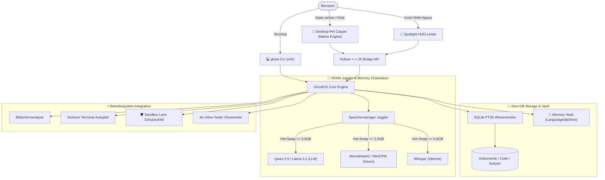

<div align="center">

```
      .---.
     /     \
    | () () |   G H O S T O S   v 2 . 0
     \  -  /    Der lokale Desktop-KI-Copilot & autonomes GhostCode Studio
    /`---'\
   /       \    [ 100% Privat • GhostCode Autonomes IDE • ChatGPT Studio • <35MB RAM ]
  (_/^\_/\_/^)
```

# 👻 GhostOS v2.0
### Der ultraleichte, autonome lokale KI-Assistent und GhostCode Entwicklerstudio

<p align="center">
  <b>🌐 Sprachauswahl / Language Select:</b><br>
  <a href="../README.md"><b>English</b></a> •
  <a href="README_RU.md"><b>Русский</b></a> •
  <a href="README_KK.md"><b>Қазақша</b></a> •
  <a href="README_ZH.md"><b>简体中文</b></a> •
  <a href="README_ES.md"><b>Español</b></a> •
  <a href="README_DE.md"><b>Deutsch</b></a> •
  <a href="README_FR.md"><b>Français</b></a> •
  <a href="README_JA.md"><b>日本語</b></a> •
  <a href="README_PT.md"><b>Português</b></a>
</p>

[](https://opensource.org/licenses/MIT)
[](https://github.com/GhostOS-ai/GhostOS)
[](mailto:GhostOS@kib.best)
[](https://www.python.org/downloads/)
[]()
[]()
[]()
[]()

**Der autonome Desktop-KI-Assistent, der auf normalen Laptops und Basis-Rechnern (4–8 GB RAM) ohne Speicherabstürze (OOM) absolut flüssig läuft.**

[Schnellstart](#-schnellstart) • [Exklusive Funktionen](#-exklusive-funktionen) • [Vergleich](#-warum-ghostos-statt-alternativen) • [Architektur](#-architektur) • [CLI-Befehle](#-cli-befehle-und-tastenkombinationen) • [Datenschutzgarantie](#-100-datenschutzgarantie)

</div>

---

### 💡 Warum GhostOS?

Lokale KI leidet heutzutage unter drei massiven Problemen:
1. **Electron-Speicherfresser:** Viele Desktop-Anwendungen (LM Studio, Jan, AnythingLLM) verschlingen bereits **800–1200 MB RAM**, bevor überhaupt ein einziges neuronales Gewicht geladen wird.
2. **Die Multi-Modell-Falle (OOM):** Der gleichzeitige Betrieb von Text-LLM (3 GB) + Vision-Modell (2 GB) + Whisper (1 GB) bringt Geräte mit 4–8 GB RAM sofort zum Einfrieren oder Absturz.
3. **Aufgeblähte RAG-Systeme:** Für die Suche in lokalen Dokumenten fordern viele Tools schwere Docker-Container, komplexe Vektordatenbanken (Chroma) und Gigabytes an Abhängigkeiten.

**GhostOS löst diese Hürden von Grund auf:**
- **Nativer Casper & HUD:** Entwickelt auf nativen System-Engines (macOS WebKit, Windows WebView2, Linux WebKitGTK) mit einem Ruhe-Verbrauch von lediglich **~35 MB RAM**.
- **Dynamischer VRAM Juggler:** Tauscht Modelle (Text, Vision, Sprache) in weniger als 150 ms nahtlos im Speicher aus. Der VRAM-Verbrauch übersteigt **niemals 3.5 GB**.
- **Zero-DB RAG:** Ziehen Sie Dokumente einfach direkt auf Casper; die Datei wird in Millisekunden über reines **SQLite FTS5** indiziert – ganz ohne externe Vektordatenbank.
- **100% Privat:** Keine Telemetrie, keine Cloud-Server, keine Log-Übertragung. Funktioniert selbst bei komplett gekappter Internetverbindung.

---

### ✨ Exklusive Funktionen

#### 0. ⚡ GhostCode: Autonomer Coding-Agent & ChatGPT Studio (v2.0)
* **Autonome Software-Entwicklungsschleife:** Die private Offline-Alternative zu Claude Code und Cursor. GhostCode formuliert Pläne, durchsucht Codebases, liest und editiert Dateien mit **Unified Diffs**, führt Unit-Tests und sichere Terminalbefehle aus und überwacht den Git-Verlauf.
* **Sofortiges Projekt-Scaffolding in 1 Klick:**
  * `FastAPI`: Asynchrone Hochleistungs-API mit Pydantic-Validierung, CORS-Middleware und Unit-Tests (`TestClient`).
  * `Telegram Bot`: Moderne asynchrone `python-telegram-bot`-Anwendung mit strukturierter Architektur.
  * `HTML / React Landing`: Elegante, konvertierende Landingpage im modernen Glassmorphism-Design.
  * `Python CLI Tool`: Strukturiertes Konsolenprogramm mit Argument-Parser und Test-Suite.
* **ChatGPT & Cursor Split Desktop Studio (`ghost studio`):**
  * **Einklappbare linke Seitenleiste:** Sitzungs- und Projekthistorie („Heute“, „Gestern“, „Projekte“), Modus-Umschaltung zwischen `Ghost Chat` (allgemeine KI) und `GhostCode` (autonomes Programmieren), Zero-DB RAG, OS-Tools, VRAM Juggler, aktives Verzeichnis und Modellanzeige.
  * **Agenten-Ausführungsstream:** Linkes Panel mit Live-Streaming von Gedanken, Tool-Aufrufen und Ergebnissen.
  * **Interaktive Canvas:** Rechtes Panel mit **Projekt-Dateiexplorer** (1-Klick-Öffnen jeder Datei), **Live-Code-Editor** (mit Direktspeicherung), **Unified Diff Viewer** (Farbhervorhebung von Änderungen) und **Interaktivem Workspace-Terminal (`zsh`)**.
* **Nahtlose Umschaltung:** Jederzeit mit dem `◀ В питомца`-Button zum leichten Casper Desktop-Pet zurückkehren oder direkt per `ghost studio` bzw. `ghost code "Aufgabe"` starten.

#### 1. 👻 Interaktives Desktop-Pet Casper
* Ein federleichter, sanft über dem Desktop schwebender kleiner Geist.
* **«Casper frisst Dateien»:** Ziehen Sie Quellcode, PDFs, Logs oder Notizen direkt auf Casper. Er öffnet den Mund, schluckt die Datei und fügt sie unmittelbar der Wissensbasis hinzu (+25 XP!).
* **Zustände und Reaktionen:**
  * 💤 `Ruhezustand`: Sanftes Schweben, 0% CPU-Last.
  * 🔮 `Nachdenken`: Zarter saphirblauer Schein bei lokaler Antwortgenerierung.
  * 🎧 `Zuhören`: Leuchtende Kopfhörer signalisieren das Mitschreiben von Besprechungen.
  * 🍕 `Fressen`: Flüssige Kauschwung-Animation mit Erfahrungsbelohnung.
  * ⚠️ `Warnung`: Visueller Alarm bei Erkennung potenziell gefährlicher Terminal-Befehle.
* Ein Klick löst spielerische Reaktionen aus; ein Doppelklick oder `Cmd+Shift+Space` / `Ctrl+Shift+Space` öffnet das vollständige Steuerzentrum (**Spotlight HUD**).

#### 2. ✍️ «Ghostwriter» (Globaler Schreibassistent in jeder App)
* Markieren Sie Text in beliebigen Apps (Word, Telegram, Browser, VS Code, Terminal) $\rightarrow$ Tastenkombination drücken $\rightarrow$ Text in 1 Sekunde transformieren:
  * ✨ `polish`: Formuliert glasklar, elegant und professionell.
  * 🤝 `polite`: Höflicher, diplomatischer Geschäftston.
  * 📝 `grammar`: Behebt Rechtschreib- und Grammatikfehler ohne Umschweife.
  * 🎯 `summarize`: Kompakte Zusammenfassung auf Kernpunkte.
  * 🌐 `translate`: Blitzschnelle Übersetzung in verschiedene Sprachen.
  * 🛠️ `code_fix`: Findet und repariert Fehler in markierten Code-Abschnitten.
* Aufruf im Terminal: `ghost write --mode polite "Text"` oder automatische Verarbeitung der Zwischenablage!

#### 3. 🧠 «Memory Vault» (Langzeit-Gedächtnisgraph)
* Persistenter persönlicher Kontextspeicher auf Basis von SQLite ohne externe Vektor-DBs.
* Erinnert sich sitzungsübergreifend an Ihren Tech-Stack, Ihren Namen und bevorzugte Kommunikationsstile.
* Injiziert Kontextinformationen mit **0 KB zusätzlichem VRAM-Verbrauch** und minimaler Hintergrundaktivität.
* Befehle: `ghost vault list`, `ghost vault remember tech_stack "Python, Rust, Apple Silicon"`.

#### 4. 🛡️ «Terminal Sandbox Lens» (Schutz vor gefährlichen Befehlen)
* Gründliche Sicherheitsüberprüfung von Konsolenbefehlen vor der Ausführung.
* Blockiert destruktive Befehle (`rm -rf /`, `mkfs`, direktes `dd`, `DROP DATABASE`, `format C:`).
* Erklärt Risiken in verständlicher Sprache und empfiehlt sichere Alternativen.
* Prüfung: `ghost sandbox "rm -rf /"`.

#### 5. 📅 «Daily Standup & Commit Crafter»
* Wertet Tagesänderungen, git diff und Sitzungsprotokolle automatisch aus.
* Erstellt strukturierte Standup-Berichte für Slack / Teams (*«Was heute erledigt wurde», «Woran gerade gearbeitet wird», «Blocker»*).
* Generiert semantische Git-Commits nach dem Conventional Commits-Standard (`feat(...)`, `fix(...)`).
* Startbefehl: `ghost standup`.

#### 6. 🎙️ «Auto-Minutes Meeting Copilot»
* 100% vertraulicher Protokollant für Zoom-, Google Meet-Gespräche und Sprachmemos.
* Erstellt präzise Meeting-Protokolle: **Kernzusammenfassung**, **Wichtige Entscheidungen** und **Aktionspunkte (Action Items) mit Zuständigkeiten**.
* Whisper wird über den VRAM Juggler nur für 5 Sekunden zur Transkription geladen und danach sofort wieder aus dem Speicher entfernt.

#### 7. 🦎 «Memory Chameleon» (Adaptive Energie- und Speicherprofile)
* Reagiert dynamisch auf Akkustand und Arbeitsspeicherauslastung:
  * 🍃 **ÖKO:** Aktiviert bei Akkubetrieb oder RAM-Druck > 82%. 1024 Token Kontext, 2 Threads, Ruhezustand nach 60 Sek.
  * ⚖️ **Ausgewogen:** 2048 Token Kontext, 4 Threads, Ruhezustand nach 180 Sek.
  * ⚡ **Performance:** Am Netzteil mit freiem Speicher. 4096 Token Kontext, maximale GPU-Beschleunigung.

#### 8. 🎮 Casper RPG-Entwicklungssystem
* Ihr Desktop-Begleiter levelt synchron zu Ihrem Arbeitsfortschritt auf:
  * Erfahrungspunkte für gefütterte Dateien (+25 XP), erledigte Aufgaben (+25 XP), Interaktionen (+10 XP).
  * Schaltet optische Upgrades frei (Cyberpunk-Visier, Zauberbuch, Goldene Krone).

#### 9. 🎨 Caspers Kleiderschrank (Skins & visuelle Themes)
* Wählen Sie aus 4 Designs für moderne dunkle Arbeitsumgebungen:
  * 💎 `glass`: Zartes, milchiges Mondschein-Porzellan im Apple-Glass-Stil.
  * ⚡ `cyberpunk`: Leuchtendes Neontürkis mit violetter Aura.
  * 👑 `gold`: Majestätischer Goldglanz mit feinen Lichteffekten.
  * 🟢 `matrix`: Ikonisches Terminal-Hacker-Grün.
* Start: `ghost pet --skin cyberpunk` oder per Mausklick über die Menüleiste wechseln!

#### 10. 🍕 Casper Feeder (Intuitives Drag-and-Drop-Füttern)
* Ziehen Sie beliebige Codedateien (`.py`, `.js`, `.ts`, `.json`), Logs oder PDFs direkt auf Casper.
* Löst eine fröhliche Kauschwung-Animation aus (`@keyframes ghostChewWobble`) mit Reaktionen in Sprechblasen.
* Direktes Einbetten in das Zero-DB RAG ohne störende Datei-Auswahldialoge.

#### 11. 👻 Nativer macOS Menüleisten-Controller
* Federleichtes Menüleistensymbol (`ghost bar` oder `ghost pet --tray`), basierend auf nativem Cocoa `NSStatusBar`.
* 1-Klick-Steuerung zum Ein-/Ausblenden von Casper, schnellen Skin-Wechseln, Modellwechsel und VRAM-Bereinigung mit **0 KB Hintergrund-Overhead**.

#### 12. 🔍 Blitzschnelle Spotlight HUD-Befehlsleiste
* Schwebende, zentrierte Eingabeleiste (`ghost spot`) im Raycast-/Spotlight-Stil für ablenkungsfreie Fragen. Lässt sich mit der `Esc`-Taste sofort schließen.

#### 13. 🤖 Lokaler Modell- & Hardwarekatalog
* Durchsucht den lokalen Ollama-Server, listet installierte Modelle mit GB-Größe auf, erkennt die Beschleunigungsstufe (**Apple Silicon Metal MPS**, **NVIDIA CUDA** oder **CPU**) und empfiehlt leichtgewichtige Modelle für Geräte mit 4GB–8GB RAM (`ghost models`).

#### 14. 💎 Apple Glassmorphism HUD & 1-Klick Code-Blöcke (v1.3.0)
* **Vereinheitlichte 4-Tab-Navigation:** Reduzierung von 9 unübersichtlichen Tabs auf 4 aufgeräumte Bereiche: `💬 Chat`, `📚 Wissensdatenbank (RAG)`, `🛠️ OS-Werkzeuge` (mit Sub-Tools: OS-Agent, Bildschirm-Scan, Zwischenablage, Sicherheits-Terminal, Standup-Journal) und `🧠 VRAM`.
* **Live-Skin- und Themen-Wechsler:** Wechseln Sie direkt im Header zwischen Glass, Cyberpunk, Gold und Matrix mit automatischer Speicherung.
* **Schnellaktions-Chips:** Vordefinierte 1-Klick-Aktionen (`👋 Was kannst du tun?`, `🌤️ Wetterbericht`, `📂 Downloads öffnen`, `📸 Bildschirm analysieren`, `📋 Zwischenablage prüfen`).
* **Syntax-Codeblöcke mit 1-Klick-Kopieren:** Dunkle Codeblöcke mit Sprach-Badge und praktischem Schnellkopier-Button.
* **Universelles Drag-and-Drop im gesamten Fenster:** Ziehen Sie Dokumente auf Casper oder die gesamte HUD-Oberfläche für blitzschnelles Zero-DB RAG-Training (+25 XP!).
* **Natives Apple Retina Dock-Icon:** Hochauflösendes `.icns`-Symbol im macOS Dock und `/Applications/GhostOS.app`.

---

### 📊 Warum GhostOS statt Alternativen?

| Funktion | GhostOS 👻 | Jan.ai / LM Studio | Ollama | AnythingLLM |
| :--- | :---: | :---: | :---: | :---: |
| **GUI-Speicherverbrauch** | **~35 MB** (Native Engine) | ~850 MB (Electron) | Keine (Nur CLI) | ~1.1 GB (Electron + DB) |
| **Autonomer Coding-Agent (GhostCode)** | **Ja (Integriert v2.0)** | ❌ Nein | ❌ Nein | ❌ Nein |
| **ChatGPT & Cursor Studio** | **Ja (1120x740)** | ❌ Nein | ❌ Nein | ❌ Nein |
| **Interaktives Desktop-Pet** | **Ja (Casper RPG)** | ❌ Nein | ❌ Nein | ❌ Nein |
| **RAG durch Drag & Drop**| **Ja (Auf Pet ziehen)** | ❌ Manuelle Uploads | ❌ Manueller Import | ❌ Manuelle Uploads |
| **Dynamischer Modellwechsel**| **Ja (VRAM Juggler)** | ❌ Absturz bei wenig VRAM| ❌ Manuell per CLI | ❌ Absturz bei wenig VRAM |
| **KV-Cache Disk Freeze** | **Ja (0 MB VRAM im Leerlauf)**| ❌ Nein | ❌ Nein | ❌ Nein |
| **Prompt-Kompression (Vacuum)** | **Ja (Spart 40-60%)** | ❌ Nein | ❌ Nein | ❌ Nein |
| **Adaptive Energieprofile**| **Ja (Chameleon Mode)** | ❌ Nein | ❌ Nein | ❌ Nein |
| **Systemweiter Schreibhelfer**| **Ja (In allen Programmen)** | ❌ Nein | ❌ Nein | ❌ Nein |
| **Terminal-Sicherheitslinse**| **Ja (Schutz vor rm -rf)**| ❌ Nein | ❌ Nein | ❌ Nein |
| **Tagesbericht & Commit-Helfer**| **Ja (Integriert)** | ❌ Nein | ❌ Nein | ❌ Nein |
| **Externe Datenbank nötig** | **Null (SQLite FTS5)** | Variiert | Keine | Benötigt Chroma / Vector DB |
| **Plattformübergreifend** | **macOS / Windows / Linux** | Ja | Ja | Ja |
| **100% Offline-Betrieb** | **Ja** | Ja | Ja | Größtenteils |

---

### 🚀 Schnellstart

#### 1. Blitzschnelle Installation

**macOS & Linux (1-Zeilen-Terminal-Installer):**
```bash
curl -fsSL https://raw.githubusercontent.com/GhostOS-ai/GhostOS/main/install.sh | bash
```
*(Auf macOS richtet dies automatisch `/Applications/GhostOS.app` mit Caspers Retina-Icon für Launchpad und Spotlight ein).*

**Oder über Python pip:**
```bash
pip install --upgrade ghostos-ai
```

#### 2. Casper und Oberfläche starten
```bash
ghost pet
```
*Oder auf macOS: Starten Sie `GhostOS` direkt über Spotlight (`Cmd + Leertaste`), das Launchpad oder per Doppelklick auf `/Applications/GhostOS.app`!*

#### 3. Direkte Nutzung über das Terminal (CLI)
```bash
# Vollwertiges ChatGPT & GhostCode Studio starten (1120x740)
ghost studio

# Autonome Software-Entwicklungsaufgabe via GhostCode CLI
ghost code "erstelle ein fastapi projekt namens my_service"
ghost code "fuehre tests aus und behebe fehler"

# Schnelle Frage an das lokale Modell
ghost "Was ist der Unterschied zwischen Prozessen und Threads in Python?"

# Casper starten (mit individuellem Skin und Menüleistensymbol)
ghost pet --skin cyberpunk --tray

# Zentrierte Spotlight HUD-Befehlszeile öffnen
ghost spot

# macOS Menüleisten-Controller starten
ghost bar

# Installierte Modelle und Hardwarebeschleunigung anzeigen
ghost models

# Dokumente oder Code-Ordner an Casper verfüttern (Zero-DB RAG)
ghost eat ~/Documents/meine_notizen.txt
ghost eat ./src/

# Text-Assistent Ghostwriter
ghost write --mode polite "bitte diesen code schneller prüfen"
ghost write --mode grammar

# Langzeitgedächtnis Memory Vault
ghost vault remember tech_stack "Python, Rust, Apple Silicon"
ghost vault list

# Bericht für das Daily Standup und Git-Commit-Nachricht
ghost standup

# Sicherheitsüberprüfung für Konsolenbefehle
ghost sandbox "rm -rf /"

# Durchsuchen der Wissensbasis
ghost rag search "datenbank migration"

# Bildschirmfenster visuell analysieren
ghost screen

# Sichere Systemaufgaben im Betriebssystem ausführen
ghost exec "finde alle dateien größer als 100MB"

# Speicher- und Prozessorstatus anzeigen
ghost status
```

---

### ⌨️ CLI-Befehle und Tastenkombinationen

| Tastenkombination | Aktion |
| :--- | :--- |
| `Cmd + Shift + Space` / `Ctrl + Shift + Space` | Wechsel zwischen Casper-Pet und Spotlight HUD |
| `Einfacher Klick auf das Pet` | Interaktive Reaktion / Spruch |
| `Doppelklick auf das Pet` | Vollständiges Steuerzentrum aufklappen |
| `Escape` | Panel schließen und zurück zum kleinen Begleiter |
| `Enter` | Befehl absenden |
| `Datei herüberziehen` | Casper mit dem Dokument füttern (sofortiges RAG) |

---

### 🏗️ Architektur



---

### 🔒 100% Datenschutzgarantie

GhostOS wurde für kompromisslose Privatsphäre entwickelt:
- **Null Telemetrie:** Keine Analysedaten, keine Hintergrund-Pings oder Nutzungsstatistiken.
- **Keine Cloud-Verbindung:** Sämtliche Berechnungen laufen ausschließlich lokal auf Ihrer eigenen Hardware (Apple Silicon MPS / NVIDIA / CPU).
- **Air-Gap fähig:** Funktioniert auch bei vollständig getrennter Internetverbindung absolut zuverlässig.

---

### 📄 Lizenz und Autorenschaft

- **Autor:** [KIB.best](https://github.com/GhostOS-ai/GhostOS)
- **Email:** [GhostOS@kib.best](mailto:GhostOS@kib.best)
- **Lizenz:** MIT License © 2026 KIB.best. Frei für private und kommerzielle Nutzung.
