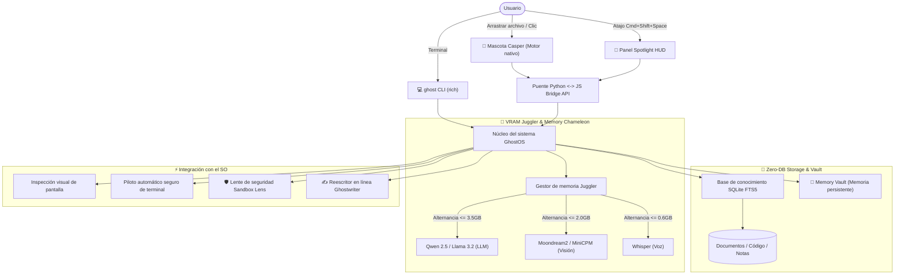

<div align="center">

```
      .---.
     /     \
    | () () |   G H O S T O S
     \  -  /    El copiloto de IA local e invisible, ultraligero y 100% offline
    /`---'\
   /       \    [ 100% Privado • VRAM Juggler • Zero-DB RAG • Mascota Casper ]
  (_/^\_/\_/^)
```

# 👻 GhostOS
### Asistente y compañero de escritorio con IA ultraligero y 100% offline

<p align="center">
  <b>🌐 Selección de idioma / Language Select:</b><br>
  <a href="../README.md"><b>English</b></a> •
  <a href="README_RU.md"><b>Русский</b></a> •
  <a href="README_KK.md"><b>Қазақша</b></a> •
  <a href="README_ZH.md"><b>简体中文</b></a> •
  <a href="README_ES.md"><b>Español</b></a> •
  <a href="README_DE.md"><b>Deutsch</b></a> •
  <a href="README_FR.md"><b>Français</b></a> •
  <a href="README_JA.md"><b>日本語</b></a> •
  <a href="README_PT.md"><b>Português</b></a>
</p>

[](https://opensource.org/licenses/MIT)
[](https://github.com/GhostOS-ai/GhostOS)
[](mailto:GhostOS@kib.best)
[](https://www.python.org/downloads/)
[]()
[]()
[]()
[]()

**El asistente autónomo de escritorio con IA diseñado para portátiles modestos y ordenadores básicos (4–8 GB RAM) sin bloqueos por falta de memoria (OOM).**

[Inicio rápido](#-inicio-rápido) • [Características exclusivas](#-características-exclusivas) • [Comparativa](#-por-qué-ghostos-frente-a-otros) • [Arquitectura](#-arquitectura) • [Comandos CLI](#-comandos-cli-y-atajos) • [Garantía de privacidad](#-100-garantía-de-privacidad)

</div>

---

### 💡 ¿Por qué GhostOS?

Ejecutar IA local hoy en día sufre de 3 problemas fundamentales:
1. **Consumo excesivo de Electron:** La mayoría de aplicaciones de escritorio (LM Studio, Jan, AnythingLLM) devoran entre **800 y 1200 MB de RAM** antes de cargar un solo peso neuronal.
2. **La trampa de múltiples modelos (OOM):** Mantener simultáneamente un LLM de texto (3 GB) + visión (2 GB) + Whisper (1 GB) satura y congela cualquier máquina con 4–8 GB de RAM.
3. **Pilas RAG sobredimensionadas:** Para buscar en unos pocos documentos, obligan a instalar contenedores Docker, bases de datos vectoriales pesadas (Chroma) y gigabytes de dependencias.

**GhostOS resuelve esto desde el núcleo:**
- **Mascota Casper y HUD nativos:** Construidos sobre motores nativos ligeros del sistema operativo (WebKit en macOS, WebView2 en Windows, WebKitGTK en Linux), consumiendo solo **~35 MB de RAM**.
- **VRAM Juggler dinámico:** Alterna modelos (texto, visión, voz) en caliente en menos de 150 ms. El uso máximo de VRAM nunca supera los **3.5 GB**.
- **Zero-DB RAG:** Basta con arrastrar cualquier archivo a Casper; se indexa en milisegundos mediante **SQLite FTS5** puro, sin bases de datos adicionales.
- **100% Privado:** Sin telemetría, sin registros en la nube y sin conexión externa. Funciona incluso con el Wi-Fi apagado.

---

### ✨ Características exclusivas

#### 1. 👻 Mascota de escritorio interactiva Casper
* Un espíritu translúcido y elegante que flota discretamente sobre tu espacio de trabajo.
* **«Casper come archivos»:** Arrastra cualquier archivo PDF, código fuente, registro o nota directamente sobre Casper. Abrirá la boca, devorará el archivo y lo indexará al instante en la base RAG (+25 XP).
* **Estados y reacciones:**
  * 💤 `Reposo`: Suave oscilación flotante, 0% de uso de CPU.
  * 🔮 `Pensando`: Halo de zafiro suave, generación local de respuestas.
  * 🎧 `Escuchando`: Se pone auriculares brillantes para transcribir reuniones.
  * 🍕 `Comiendo`: Animación interactiva de masticación y obtención de experiencia.
  * ⚠️ `Alerta`: Advertencia visual instantánea si detecta comandos destructivos en la terminal.
* Un clic activa frases interactivas; un doble clic o `Cmd+Shift+Space` / `Ctrl+Shift+Space` despliega el panel de control completo (**Spotlight HUD**).

#### 2. ✍️ «Ghostwriter» (Asistente global en cualquier aplicación)
* Selecciona texto en cualquier lugar (Word, Telegram, navegador, VS Code, terminal) $\rightarrow$ pulsa el atajo $\rightarrow$ transforma el texto en 1 segundo:
  * ✨ `polish`: Estilo impecable, claro y profesional.
  * 🤝 `polite`: Tono formal, diplomático y respetuoso.
  * 📝 `grammar`: Corrección ortográfica y gramatical instantánea.
  * 🎯 `summarize`: Resumen ejecutivo en 2-3 puntos clave.
  * 🌐 `translate`: Traducción ultrarrápida a múltiples idiomas.
  * 🛠️ `code_fix`: Detección y solución de errores en fragmentos de código.
* Invocación desde terminal: `ghost write --mode polite "texto"` o directamente desde el portapapeles.

#### 3. 🧠 «Memory Vault» (Grafo de memoria persistente a largo plazo)
* Almacén de contexto personal sobre SQLite sin requerir bases vectoriales complejas.
* Recuerda automáticamente tus preferencias tecnológicas, tu nombre y tu estilo entre reinicios.
* Inyecta contexto con **0 KB de consumo adicional de VRAM** y cero carga de fondo en la CPU.
* Comandos: `ghost vault list`, `ghost vault remember tech_stack "Python, Rust, Apple Silicon"`.

#### 4. 🛡️ «Terminal Sandbox Lens» (Protección contra comandos peligrosos)
* Análisis profundo de comandos de consola antes de su ejecución.
* Intercepta y frena en seco operaciones críticas (`rm -rf /`, `mkfs`, `dd` directo, `DROP DATABASE`, `format C:`).
* Explica los riesgos con claridad y propone alternativas seguras.
* Verificación: `ghost sandbox "rm -rf /"`.

#### 5. 📅 «Daily Standup & Commit Crafter»
* Examina los cambios realizados durante el día, git diff y el historial de la sesión.
* Genera el informe diario de standup para Slack / Teams (*«Qué hice hoy», «Qué estoy haciendo», «Bloqueos»*).
* Redacta mensajes de confirmación semánticos según el estándar Conventional Commits (`feat(...)`, `fix(...)`).
* Comando: `ghost standup`.

#### 6. 🎙️ «Auto-Minutes Meeting Copilot»
* Asistente confidencial 100% offline para llamadas en Zoom, Google Meet y notas de voz.
* Estructura actas de reunión: **Resumen principal**, **Decisiones clave** y **Plan de acción (Action Items) con asignaciones**.
* El modelo Whisper se carga mediante el VRAM Juggler durante solo 5 segundos para procesar el audio y se descarga de inmediato.

#### 7. 🦎 «Memory Chameleon» (Perfiles adaptativos de energía)
* Monitoriza automáticamente el nivel de batería y la presión de memoria RAM:
  * 🍃 **ECO:** Activado con batería o RAM > 82%. Contexto de 1024 tokens, 2 hilos CPU, suspensión a los 60 seg.
  * ⚖️ **Equilibrado:** Contexto de 2048 tokens, 4 hilos, suspensión a los 180 seg.
  * ⚡ **Rendimiento:** Conectado a corriente y memoria holgada. Contexto de 4096 tokens, aceleración GPU total.

#### 8. 🎮 Sistema de progresión RPG de Casper
* Tu compañero digital sube de nivel junto a tu ritmo de trabajo:
  * Ganancia de XP por alimentar archivos (+25 XP), resolver tareas (+25 XP), interactuar (+10 XP).
  * Desbloquea aspectos y accesorios exclusivos (visor ciberpunk, grimorio mágico, corona real).

#### 9. 🎨 Guardarropa de Casper (Temas y aspectos visuales)
* Elige entre 4 atractivos temas visuales diseñados para modo oscuro:
  * 💎 `glass`: Acabado translúcido en cristal blanco estilo Apple.
  * ⚡ `cyberpunk`: Cian de neón con resplandor magenta radiactivo.
  * 👑 `gold`: Elegante aura dorada imperial.
  * 🟢 `matrix`: Resplandor verde fósforo de terminal clásico.
* Invocación: `ghost pet --skin cyberpunk` o cambia con 1 clic desde la barra de menú.

#### 10. 🍕 Casper Feeder (Alimentación física arrastrando archivos)
* Arrastra cualquier archivo con código (`.py`, `.js`, `.ts`, `.json`), registro o PDF directamente sobre Casper.
* Activa una divertida animación de masticación (`@keyframes ghostChewWobble`) con reacciones en bocadillos de diálogo.
* Incorpora el contenido de inmediato a Zero-DB RAG sin complicados cuadros de diálogo.

#### 11. 👻 Controlador nativo en la barra de menú de macOS
* Icono ligero en la barra de estado superior creado sobre Cocoa nativo `NSStatusBar` (`ghost bar` o `ghost pet --tray`).
* Permite mostrar/ocultar a Casper, cambiar de tema, elegir el modelo activo y vaciar la VRAM con **0 KB de consumo en segundo plano**.

#### 12. 🔍 Barra de comandos rápida Spotlight HUD
* Barra de entrada flotante y centrada en pantalla (`ghost spot`) estilo Raycast/Alfred para resolver dudas sin distracciones. Se cierra al instante pulsando `Esc`.

#### 13. 🤖 Catálogo de modelos locales y aceleración por hardware
* Inspecciona tu motor local Ollama, enumera los modelos instalados con su tamaño en GB, detecta el nivel de aceleración (**Apple Silicon Metal MPS**, **NVIDIA CUDA** o **CPU**) y recomienda modelos óptimos para equipos de 4GB–8GB RAM (`ghost models`).

#### 14. 💎 HUD Glassmorphism de Apple y Bloques de Código con 1-Clic (v1.3.0)
* **Navegación Unificada de 4 Pestañas:** Consolidación de 9 pestañas en 4 áreas organizadas: `💬 Chat`, `📚 Conocimiento (RAG)`, `🛠️ Herramientas SO` (con subherramientas: Agente SO, Captura de Pantalla, Portapapeles, Autopiloto de Terminal, Diario Standup) y `🧠 VRAM`.
* **Selector Dinámico de Temas y Aspectos:** Cambia entre los temas Glass, Cyberpunk, Gold y Matrix desde la barra superior con guardado automático.
* **Botones de Sugerencia Rápida:** Acciones instantáneas en 1 clic (`👋 ¿Qué puedes hacer?`, `🌤️ Clima`, `📂 Abrir Descargas`, `📸 Captura de pantalla`, `📋 Inspeccionar portapapeles`).
* **Bloques de Código con Botón de Copiado:** Resaltado de sintaxis moderno con etiqueta de lenguaje y botón para copiar al portapapeles en 1 clic.
* **Arrastrar y Soltar Universal en Toda la Ventana:** Arrastra cualquier archivo sobre Casper o sobre cualquier área del HUD para indexar en RAG al instante (+25 XP!).
* **Icono Nativo Apple Retina en el Dock:** Icono `.icns` de alta resolución integrado en el Dock de macOS y `/Applications/GhostOS.app`.

---

### 📊 ¿Por qué GhostOS frente a otros?

| Característica | GhostOS 👻 | Jan.ai / LM Studio | Ollama | AnythingLLM |
| :--- | :---: | :---: | :---: | :---: |
| **Consumo de RAM de la interfaz** | **~35 MB** (Motor nativo) | ~850 MB (Electron) | No (Solo terminal) | ~1.1 GB (Electron + BD) |
| **Mascota de escritorio** | **Sí (Casper RPG)** | ❌ No | ❌ No | ❌ No |
| **RAG arrastrando archivos**| **Sí (Soltar en la mascota)**| ❌ Subida manual | ❌ Importación manual | ❌ Subida manual |
| **Intercambio dinámico de modelos** | **Sí (VRAM Juggler)** | ❌ Error OOM en baja VRAM| ❌ Manual por CLI | ❌ Error OOM en baja VRAM |
| **Congelación de KV-Cache a disco**| **Sí (0 MB VRAM en reposo)**| ❌ No | ❌ No | ❌ No |
| **Compresión de contexto (Vacuum)** | **Sí (Ahorro del 40-60%)** | ❌ No | ❌ No | ❌ No |
| **Perfiles inteligentes de batería**| **Sí (Modo Chameleon)** | ❌ No | ❌ No | ❌ No |
| **Reescritura global de texto** | **Sí (En cualquier app)** | ❌ No | ❌ No | ❌ No |
| **Lente de seguridad de terminal** | **Sí (Protección rm -rf)**| ❌ No | ❌ No | ❌ No |
| **Generador de standups diarios** | **Sí (Integrado)** | ❌ No | ❌ No | ❌ No |
| **Bases de datos externas requeridas**| **Cero (SQLite FTS5)** | Variable | Ninguna | Requiere Chroma / Vector DB |
| **Soporte multiplataforma** | **macOS / Windows / Linux** | Sí | Sí | Sí |
| **Funcionamiento 100% offline** | **Sí** | Sí | Sí | En su mayoría |

---

### 🚀 Inicio rápido

#### 1. Instalación instantánea

**macOS y Linux (Instalador en 1 línea de terminal):**
```bash
curl -fsSL https://raw.githubusercontent.com/GhostOS-ai/GhostOS/main/install.sh | bash
```
*(En macOS, registra automáticamente `/Applications/GhostOS.app` con el icono Retina de Casper en Launchpad y Spotlight).*

**O mediante Python pip:**
```bash
pip install --upgrade ghostos-ai
```

#### 2. Iniciar Casper y la interfaz
```bash
ghost pet
```
*O en macOS: ¡inicie `GhostOS` directamente desde Spotlight (`Cmd + Espacio`), Launchpad o haciendo doble clic en `/Applications/GhostOS.app`!*

#### 3. Uso directo mediante la terminal (CLI)
```bash
# Pregunta instantánea al modelo local
ghost "¿Cuál es la diferencia entre procesos e hilos en Python?"

# Iniciar la mascota Casper (con skin personalizada e icono en la barra de menú)
ghost pet --skin cyberpunk --tray

# Abrir la barra de consulta rápida Spotlight HUD
ghost spot

# Iniciar el controlador de la barra de menú de macOS
ghost bar

# Consultar modelos locales instalados y aceleración de hardware
ghost models

# Enseñar un archivo o carpeta a Casper (Zero-DB RAG)
ghost eat ~/Documents/mis_notas.txt
ghost eat ./src/

# Asistente de reescritura de texto Ghostwriter
ghost write --mode polite "revisa este código por favor"
ghost write --mode grammar

# Memoria de largo plazo Memory Vault
ghost vault remember tech_stack "Python, Rust, Apple Silicon"
ghost vault list

# Informe para el standup diario y mensaje de commit
ghost standup

# Verificación de seguridad de comandos de terminal
ghost sandbox "rm -rf /"

# Búsqueda en la base de conocimientos
ghost rag search "migración de base de datos"

# Análisis visual de la pantalla activa
ghost screen

# Ejecución segura de tareas en el sistema operativo
ghost exec "encuentra todos los archivos mayores a 100MB"

# Estado de la memoria VRAM y uso de procesador
ghost status
```

---

### ⌨️ Comandos CLI y atajos

| Atajo | Acción |
| :--- | :--- |
| `Cmd + Shift + Space` / `Ctrl + Shift + Space` | Alternar entre la mascota Casper y el panel HUD |
| `Un clic sobre la mascota` | Frase interactiva / reacción espontánea |
| `Doble clic sobre la mascota` | Desplegar el panel de control completo |
| `Escape` | Plegar el panel de vuelta a la mascota pequeña |
| `Enter` | Enviar solicitud |
| `Arrastrar archivo` | Alimentar a Casper con el documento (RAG instantáneo) |

---

### 🏗️ Arquitectura



---

### 🔒 100% Garantía de privacidad

GhostOS está concebido para una confidencialidad inquebrantable:
- **Cero telemetría:** Sin contadores analíticos ni recolección de hábitos de uso.
- **Sin conexiones a servidores en la nube:** Todo el cómputo se realiza estrictamente en tus chips locales (Apple Silicon MPS / NVIDIA / CPU).
- **Listo para entornos Air-Gap:** Funciona plenamente sin conexión a Internet.

---

### 📄 Licencia y autoría

- **Autor:** [KIB.best](https://github.com/GhostOS-ai/GhostOS)
- **Email:** [GhostOS@kib.best](mailto:GhostOS@kib.best)
- **Licencia:** MIT License © 2026 KIB.best. Gratuito para uso personal y comercial.
