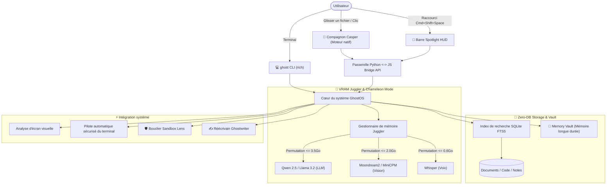

<div align="center">

```
      .---.
     /     \
    | () () |   G H O S T O S
     \  -  /    Le copilote d'IA invisible, ultraléger et 100% hors ligne
    /`---'\
   /       \    [ 100% Privé • VRAM Juggler • Zero-DB RAG • Compagnon Casper ]
  (_/^\_/\_/^)
```

# 👻 GhostOS
### L'assistant IA et compagnon de bureau ultraléger et 100% hors ligne

<p align="center">
  <b>🌐 Sélection de langue / Language Select:</b><br>
  <a href="../README.md"><b>English</b></a> •
  <a href="README_RU.md"><b>Русский</b></a> •
  <a href="README_KK.md"><b>Қазақша</b></a> •
  <a href="README_ZH.md"><b>简体中文</b></a> •
  <a href="README_ES.md"><b>Español</b></a> •
  <a href="README_DE.md"><b>Deutsch</b></a> •
  <a href="README_FR.md"><b>Français</b></a> •
  <a href="README_JA.md"><b>日本語</b></a> •
  <a href="README_PT.md"><b>Português</b></a>
</p>

[](https://opensource.org/licenses/MIT)
[](https://github.com/GhostOS-ai/GhostOS)
[](mailto:GhostOS@kib.best)
[](https://www.python.org/downloads/)
[]()
[]()
[]()
[]()

**L'assistant IA de bureau autonome conçu pour les ordinateurs portables et configurations modestes (4–8 Go de RAM) sans crash par manque de mémoire (OOM).**

[Démarrage rapide](#-démarrage-rapide) • [Fonctionnalités exclusives](#-fonctionnalités-exclusives) • [Comparatif](#-pourquoi-ghostos-face-aux-alternatives) • [Architecture](#-architecture) • [Commandes CLI](#-commandes-cli-et-raccourcis) • [Garantie de confidentialité](#-garantie-de-confidentialité-à-100)

</div>

---

### 💡 Pourquoi GhostOS ?

Exécuter une IA locale aujourd'hui se heurte à 3 problèmes majeurs :
1. **L'encombrement d'Electron :** La plupart des applications de bureau (LM Studio, Jan, AnythingLLM) consomment déjà entre **800 et 1200 Mo de RAM** avant même de charger le moindre modèle neuronal.
2. **Le piège multi-modèles (OOM) :** Tenter de faire tourner simultanément un LLM textuel (3 Go) + un modèle de vision (2 Go) + Whisper (1 Go) fige et plante instantanément toute machine disposant de 4 à 8 Go de mémoire.
3. **Des piles RAG surdimensionnées :** Pour indexer quelques documents, les solutions imposent des conteneurs Docker lourds, des bases de données vectorielles complexes (Chroma) et des gigaoctets de dépendances.

**GhostOS résout ces contraintes à la racine :**
- **Compagnon Casper et HUD natifs :** Conçus sur les moteurs Web natifs du système d'exploitation (WebKit sur macOS, WebView2 sur Windows, WebKitGTK sur Linux), avec une empreinte au repos de seulement **~35 Mo de RAM**.
- **VRAM Juggler dynamique :** Échange à chaud les modèles actifs (texte, vision, voix) en moins de 150 ms. La consommation maximale de mémoire vidéo ne dépasse **jamais 3.5 Go**.
- **Zero-DB RAG :** Glissez simplement un fichier sur Casper ; il est indexé en quelques millisecondes via du pur **SQLite FTS5**, sans base de données tierce.
- **100% Privé :** Zéro télémétrie, zéro appel vers le cloud, aucun journal externe. Fonctionne même avec le Wi-Fi totalement coupé.

---

### ✨ Fonctionnalités exclusives

#### 1. 👻 Compagnon de bureau interactif Casper
* Un petit fantôme de porcelaine translucide flottant délicatement au-dessus de votre espace de travail.
* **« Casper dévore les fichiers » :** Déposez n'importe quel code source, PDF, journal ou note directement sur Casper. Il ouvre la bouche, engloutit le fichier et l'indexe instantanément dans la base RAG (+25 XP !).
* **États et réactions :**
  * 💤 `Repos` : Balancement léger, 0% de charge processeur.
  * 🔮 `Réflexion` : Douce lueur saphir pendant la génération locale.
  * 🎧 `Écoute` : Met des écouteurs lumineux pour transcrire vos réunions.
  * 🍕 `Alimentation` : Animation d'absorption avec bruitage et gain d'expérience RPG.
  * ⚠️ `Alerte` : Signal visuel immédiat en cas de détection de commandes dangereuses.
* Un clic déclenche des interactions spontanées ; un double-clic ou le raccourci `Cmd+Shift+Space` / `Ctrl+Shift+Space` déploie le panneau de contrôle complet (**Spotlight HUD**).

#### 2. ✍️ « Ghostwriter » (Assistant de réécriture dans toutes les applications)
* Sélectionnez du texte dans n'importe quel logiciel (Word, Telegram, navigateur, VS Code, terminal) $\rightarrow$ pressez le raccourci $\rightarrow$ transformez le texte en 1 seconde :
  * ✨ `polish` : Rend le texte élégant, clair et percutant.
  * 🤝 `polite` : Adopte un ton diplomate et professionnel.
  * 📝 `grammar` : Corrige la syntaxe et l'orthographe sans verbiage.
  * 🎯 `summarize` : Résume en 2 ou 3 points clés.
  * 🌐 `translate` : Traduit instantanément dans la langue de votre choix.
  * 🛠️ `code_fix` : Détecte et répare les anomalies dans un extrait de code.
* Appel en ligne de commande : `ghost write --mode polite "mon message"` ou traitement automatique du presse-papiers !

#### 3. 🧠 « Memory Vault » (Graphe de mémoire persistante à long terme)
* Mémoire contextuelle locale stockée dans SQLite, sans base vectorielle externe.
* Mémorise vos préférences de programmation, votre prénom et vos habitudes entre les redémarrages.
* Injecte le contexte avec **0 Ko de VRAM supplémentaire** et une charge CPU quasi nulle.
* Commandes : `ghost vault list`, `ghost vault remember tech_stack "Python, Rust, Apple Silicon"`.

#### 4. 🛡️ « Terminal Sandbox Lens » (Bouclier de sécurité pour la console)
* Analyse en profondeur des commandes shell avant exécution.
* Intercepte et bloque les opérations destructrices (`rm -rf /`, `mkfs`, écriture directe `dd`, `DROP DATABASE`, `format C:`).
* Explique les risques encourus en langage clair et suggère des alternatives sûres.
* Test : `ghost sandbox "rm -rf /"`.

#### 5. 📅 « Daily Standup & Commit Crafter »
* Analyse vos modifications de code, git diff et l'historique du jour.
* Formule un compte-rendu clair pour Slack ou Teams (*« Ce qui a été fait »*, *« En cours »*, *« Points bloquants »*).
* Rédige automatiquement des messages de commit sémantiques conformes au standard Conventional Commits (`feat(...)`, `fix(...)`).
* Lancement : `ghost standup`.

#### 6. 🎙️ « Auto-Minutes Meeting Copilot »
* Secrétaire privé 100% hors ligne pour Zoom, Google Meet et notes vocales.
* Rédige un procès-verbal structuré : **Synthèse globale**, **Décisions clés** et **Plan d'action (Action Items) avec attributions**.
* Le modèle Whisper est chargé via le VRAM Juggler pendant 5 secondes seulement, puis libéré immédiatement.

#### 7. 🦎 « Memory Chameleon » (Gestion adaptative de l'alimentation)
* Ajuste les ressources selon l'état de la batterie et la pression sur la RAM :
  * 🍃 **ÉCO :** Sur batterie ou si la RAM dépasse 82%. Contexte de 1024 tokens, 2 threads CPU, mise en veille à 60s.
  * ⚖️ **Équilibré :** Contexte de 2048 tokens, 4 threads, mise en veille à 180s.
  * ⚡ **Performance :** Sur secteur avec mémoire disponible. Contexte de 4096 tokens, accélération GPU maximale.

#### 8. 🎮 Système d'évolution RPG de Casper
* Votre compagnon virtuel progresse au fil de vos accomplissements :
  * Points d'expérience pour chaque fichier absorbé (+25 XP), tâche accomplie (+25 XP), échange (+10 XP).
  * Débloque des accessoires de personnalisation (visière cyberpunk, grimoire magique, couronne dorée).

#### 9. 🎨 La Garde-robe de Casper (Thèmes et skins visuels)
* Personnalisez l'apparence de Casper parmi 4 thèmes raffinés :
  * 💎 `glass` : Porcelaine blanche translucide style Apple Glass.
  * ⚡ `cyberpunk` : Cyan néon éclatant bordé d'un halo magenta.
  * 👑 `gold` : Lueur dorée royale éclatante.
  * 🟢 `matrix` : Teinte vert phosphore façon terminal pirate.
* Commande : `ghost pet --skin cyberpunk` ou changement en 1 clic depuis la barre des menus !

#### 10. 🍕 Casper Feeder (Absorption physique de documents par glisser-déposer)
* Glissez directement vos codes (`.py`, `.js`, `.ts`, `.json`), logs ou PDF sur Casper.
* Déclenche une animation de mastication entraînante (`@keyframes ghostChewWobble`) et des répliques joviales.
* Intègre instantanément les données au Zero-DB RAG sans formulaires d'importation superflus.

#### 11. 👻 Contrôleur natif pour la barre des menus macOS
* Icône discrète dans la barre d'état système (`ghost bar` ou `ghost pet --tray`), reposant sur le composant natif Cocoa `NSStatusBar`.
* 1 clic pour afficher/masquer Casper, changer de skin, choisir le modèle actif et purger la VRAM sans **aucun octet superflu en arrière-plan (0 Ko)**.

#### 12. 🔍 Barre Spotlight HUD instantanée
* Barre de recherche flottante et centrée (`ghost spot`) inspirée de Raycast et Spotlight pour poser vos questions sans vous déconcentrer. Se referme immédiatement avec la touche `Échap`.

#### 13. 🤖 Catalogue des modèles locaux et accélération matérielle
* Analyse votre instance Ollama locale, répertorie les modèles installés avec leur taille en Go, identifie l'accélération matérielle (**Apple Silicon Metal MPS**, **NVIDIA CUDA** ou **CPU**) et recommande les modèles les plus véloces pour 4Go–8Go de RAM (`ghost models`).

---

### 📊 Pourquoi GhostOS face aux alternatives ?

| Fonctionnalité | GhostOS 👻 | Jan.ai / LM Studio | Ollama | AnythingLLM |
| :--- | :---: | :---: | :---: | :---: |
| **Empreinte RAM de l'interface** | **~35 Mo** (Moteur natif) | ~850 Mo (Electron) | Aucune (CLI seul) | ~1.1 Go (Electron + BDD) |
| **Compagnon interactif** | **Oui (Casper RPG)** | ❌ Non | ❌ Non | ❌ Non |
| **RAG par glisser-déposer** | **Oui (Déposer sur le familier)**| ❌ Téléversement manuel | ❌ Importation manuelle | ❌ Téléversement manuel |
| **Changement dynamique de modèle** | **Oui (VRAM Juggler)** | ❌ Crash OOM sur faible VRAM| ❌ Manuel via CLI | ❌ Crash OOM sur faible VRAM |
| **Gel du KV-Cache sur disque** | **Oui (0 Mo VRAM au repos)**| ❌ Non | ❌ Non | ❌ Non |
| **Compression de contexte (Vacuum)** | **Oui (Gain de 40 à 60%)** | ❌ Non | ❌ Non | ❌ Non |
| **Gestion intelligente de l'énergie** | **Oui (Mode Chameleon)** | ❌ Non | ❌ Non | ❌ Non |
| **Réécriture globale de texte** | **Oui (Dans toute application)**| ❌ Non | ❌ Non | ❌ Non |
| **Protection de terminal (Sandbox)** | **Oui (Bloque rm -rf)** | ❌ Non | ❌ Non | ❌ Non |
| **Générateur de standups et commits** | **Oui (Intégré)** | ❌ Non | ❌ Non | ❌ Non |
| **Base de données externe requise** | **Zéro (SQLite FTS5)** | Variable | Aucune | Nécessite Chroma / Vector DB |
| **Support multiplateforme** | **macOS / Windows / Linux** | Oui | Oui | Oui |
| **Fonctionnement 100% hors ligne** | **Oui** | Oui | Oui | Partiel |

---

### 🚀 Démarrage rapide

#### 1. Installation instantanée

**macOS & Linux (Installateur en 1 ligne de commande) :**
```bash
curl -fsSL https://raw.githubusercontent.com/GhostOS-ai/GhostOS/main/install.sh | bash
```
*(Sur macOS, cela crée automatiquement `/Applications/GhostOS.app` avec l'icône Retina de Casper dans le Launchpad et Spotlight).*

**Ou via Python pip :**
```bash
pip install --upgrade ghostos-ai
```

#### 2. Lancement de Casper et de l'interface
```bash
ghost pet
```
*Ou sur macOS : lancez `GhostOS` directement depuis Spotlight (`Cmd + Espace`), le Launchpad ou en double-cliquant sur `/Applications/GhostOS.app` !*

#### 3. Utilisation directe dans le terminal (CLI)
```bash
# Poser une question rapide au modèle local
ghost "Quelle est la différence entre processus et threads en Python ?"

# Lancer Casper (avec un thème cyberpunk et l'icône dans la barre des menus)
ghost pet --skin cyberpunk --tray

# Ouvrir la barre d'accès rapide Spotlight HUD
ghost spot

# Démarrer le contrôleur de barre des menus macOS
ghost bar

# Examiner les modèles installés et l'accélération matérielle
ghost models

# Faire ingérer un fichier ou dossier à Casper (Zero-DB RAG)
ghost eat ~/Documents/mes_notes.txt
ghost eat ./src/

# Assistant de réécriture Ghostwriter
ghost write --mode polite "merci de vérifier ce code rapidement"
ghost write --mode grammar

# Coffre de mémoire persistante Memory Vault
ghost vault remember tech_stack "Python, Rust, Apple Silicon"
ghost vault list

# Générer le rapport de standup et le message de commit du jour
ghost standup

# Audit de sécurité d'une commande shell
ghost sandbox "rm -rf /"

# Rechercher dans la base documentaire
ghost rag search "migration de base de données"

# Analyse visuelle de la fenêtre d'écran active
ghost screen

# Exécuter une tâche système en toute sécurité
ghost exec "trouve tous les fichiers de plus de 100Mo"

# Afficher l'état de la VRAM et du processeur
ghost status
```

---

### ⌨️ Commandes CLI et raccourcis

| Combinaison | Action |
| :--- | :--- |
| `Cmd + Shift + Space` / `Ctrl + Shift + Space` | Basculer entre Casper et la barre Spotlight HUD |
| `Simple clic sur le familier` | Réplique interactive spontanée |
| `Double-clic sur le familier` | Déployer le panneau de commande complet |
| `Échap` | Replier le panneau vers la mascotte flottante |
| `Entrée` | Envoyer la requête |
| `Glisser un fichier` | Nourrir Casper avec le document (RAG instantané) |

---

### 🏗️ Architecture



---

### 🔒 Garantie de confidentialité à 100%

GhostOS est conçu pour préserver votre vie privée sans aucun compromis :
- **Zéro télémétrie :** Aucun pistage, aucune sonde de mesure ni collecte d'usage.
- **Zéro connexion cloud :** Tous les calculs s'exécutent strictement sur vos processeurs locaux (Apple Silicon MPS / NVIDIA / CPU).
- **Paré pour l'Air-Gap :** Reste totalement opérationnel lorsque le Wi-Fi est déconnecté.

---

### 📄 Licence et crédits

- **Auteur :** [KIB.best](https://github.com/GhostOS-ai/GhostOS)
- **Email :** [GhostOS@kib.best](mailto:GhostOS@kib.best)
- **Licence :** MIT License © 2026 KIB.best. Gratuit pour usages personnels et commerciaux.
