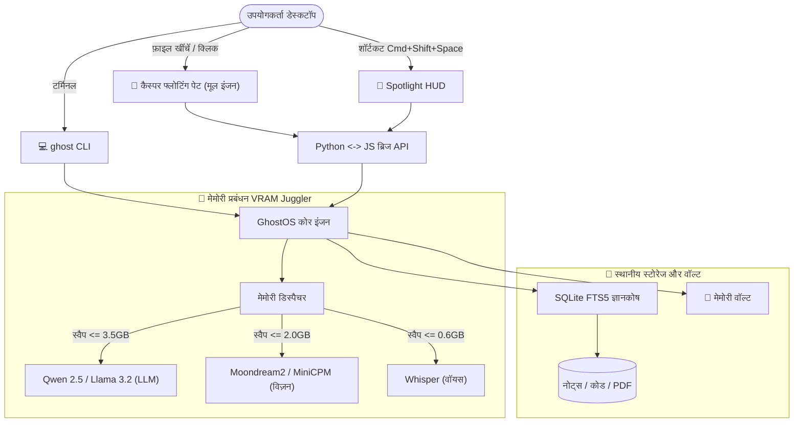

<div align="center">

```
      .---.
     /     \
    | () () |   G H O S T O S   v 2 . 1
     \  -  /    हाइब्रिड ब्रेन डेस्कटॉप एआई साथी और GhostCode स्टूडियो
    /`---'\
   /       \    [ 100% निजी • स्थानीय और क्लाउड हाइब्रिड ब्रेन • ChatGPT स्टूडियो • <35MB RAM ]
  (_/^\_/\_/^)
```

# 👻 GhostOS v2.1
### सुपर-लाइटवेट डेस्कटॉप एआई साथी और स्वायत्त कोडिंग स्टूडियो (Hybrid Brain)

<p align="center">
  <b>🌐 भाषा चयन / Language Select / Выбор языка / Тілді таңдау:</b><br>
  <a href="../README.md"><b>English</b></a> •
  <a href="README_RU.md"><b>Русский</b></a> •
  <a href="README_KK.md"><b>Қазақша</b></a> •
  <a href="README_ZH.md"><b>简体中文</b></a> •
  <a href="README_ES.md"><b>Español</b></a> •
  <a href="README_DE.md"><b>Deutsch</b></a> •
  <a href="README_FR.md"><b>Français</b></a> •
  <a href="README_JA.md"><b>日本語</b></a> •
  <a href="README_PT.md"><b>Português</b></a> •
  <a href="README_AR.md"><b>العربية</b></a> •
  <a href="README_HI.md"><b>हिन्दी</b></a>
</p>

[](https://pypi.org/project/ghostos-ai/)
[](https://github.com/GhostOS-ai/GhostOS/releases/latest)
[](https://www.producthunt.com/products/ghostos)
[](https://github.com/GhostOS-ai/GhostOS)
[](https://opensource.org/licenses/MIT)
[](https://github.com/GhostOS-ai/GhostOS)
[](mailto:GhostOS@kib.best)
[]()
[]()
[]()
[]()

**एक एकीकृत, बेहद हल्का डेस्कटॉप एआई साथी जो सामान्य लैपटॉप और बुनियादी कंप्यूटरों (4GB–8GB RAM) पर बिना मेमोरी आउट (OOM) क्रैश के पूरी तरह स्थानीय रूप से काम करता है।**

[त्वरित शुरुआत](#-त्वरित-शुरुआत) • [विशेष विशेषताएं](#-विशेष-फीचर्स) • [तुलना](#-ghostos-ही-क्यों) • [सिस्टम आर्किटेक्चर](#-सिस्टम-आर्किटेक्चर) • [CLI चीटशीट](#-cli-चीटशीट-और-शॉर्टकट) • [गोपनीयता संकल्प](#-100-गोपनीयता-संकल्प)

</div>

---

### 💡 GhostOS ही क्यों?

आज स्थानीय स्तर पर AI चलाने में 3 प्रमुख समस्याएं आती हैं:
1. **Electron का भारी मेमोरी उपभोग:** अधिकांश डेस्कटॉप AI ऐप्स (LM Studio, Jan, AnythingLLM) किसी भी न्यूरल वेट को लोड करने से पहले ही केवल यूआई के लिए **800MB–1.2GB RAM** खर्च कर देते हैं।
2. **मल्टी-मॉडल OOM का जाल:** टेक्स्ट मॉडल (3GB) + विज़न मॉडल (2GB) + Whisper (1GB) को एक साथ चलाने पर 4GB–8GB RAM वाले डिवाइस तुरंत क्रैश हो जाते हैं।
3. **अत्यधिक जटिल RAG स्टैक:** दस्तावेज़ खोजने के लिए उपयोगकर्ताओं को भारी Docker कंटेनर, जटिल वेक्टर डेटाबेस (Chroma, Qdrant) और गीगाबाइट की निर्भरताएं स्थापित करनी पड़ती हैं।

**GhostOS इन समस्याओं को जड़ से हल करता है:**
- **कैस्पर पेट और HUD:** ऑपरेटिंग सिस्टम के मूल वेब इंजनों (macOS पर WebKit, Windows पर WebView2, Linux पर WebKitGTK) पर काम करता है, जो केवल **~35MB RAM** खर्च करता है।
- **डायनामिक VRAM जगलर:** सक्रिय मॉडल (टेक्स्ट, विज़न, वॉयस) को 150ms से भी कम समय में बदल देता है। अधिकतम VRAM कभी भी **3.5GB** से अधिक नहीं होती।
- **Zero-DB RAG:** कैस्पर पर कोई भी फ़ाइल खींचकर छोड़ें — बिना किसी बाहरी डेटाबेस के शुद्ध **SQLite FTS5** के माध्यम से मिलीसेकंड में अनुक्रमित हो जाती है।
- **100% स्थानीय और निजी:** कोई डेटा ट्रैकिंग नहीं, कोई क्लाउड सर्वर नहीं। इंटरनेट बंद होने पर भी पूरी तरह से काम करता है।

---

### ✨ विशेष फीचर्स

#### 🌟 v2.1 में नया: हाइब्रिड ब्रेन और मल्टी-प्रोवाइडर एआई हब
* **एकीकृत मॉडल और क्लाउड प्रोवाइडर स्विचर:** इनके बीच आसानी से स्विच करें:
  * 👻 **Ghost बिल्ट-इन इंजन:** 100% ऑफ़लाइन, शून्य सेटअप, <35MB RAM।
  * 🦙 **स्थानीय Ollama:** `qwen2.5:1.5b`, `qwen2.5-coder:7b`, `llama3.2:3b`, `deepseek-r1:1.5b`, `mistral` का स्वचालित पता लगाना।
  * ✨ **Google Gemini:** `gemini-2.5-flash`, `gemini-1.5-flash`, `gemini-1.5-pro` का मूल REST एकीकरण (Google AI Studio में पर्याप्त निःशुल्क सीमा, अत्यधिक तेज़ गति)।
  * 🧠 **OpenAI क्लाउड:** सुरक्षित स्थानीय कुंजियों के साथ `gpt-4o`, `gpt-4o-mini`, `o1`, `o3-mini` का समर्थन।
  * ⚡ **DeepSeek AI:** `deepseek-chat` (V3) और तर्क श्रृंखला युक्त `deepseek-reasoner` (R1) का पूर्ण समर्थन।
  * 🟣 **Anthropic Claude:** `claude-3-5-sonnet` और `claude-3-5-haiku` का सीधा उपयोग।
  * 🖥️ **कस्टम / LM Studio:** कोई भी OpenAI-संगत एंडपॉइंट (`http://localhost:1234/v1`, vLLM, LocalAI)।
* **टॉपबार में त्वरित `[ ⚙️ API ]` बटन:** 1-क्लिक में API कुंजियां दर्ज करें, मॉडल बदलें और लाइव कनेक्शन की जांच करें।
* **ChatGPT-शैली का मल्टी-सेशन चैट इतिहास:**
  * वार्तालाप स्वचालित रूप से `~/.ghostos/studio_sessions.json` में सहेजे जाते हैं।
  * साइडबार में वास्तविक बातचीत की सूची, स्वतः उत्पन्न शीर्षक, दिनांक, संदर्भ खोए बिना स्विचिंग और 1-क्लिक में हटाना।
* **विशिष्ट एआई व्यक्तित्व (1-क्लिक स्विचर):**
  * 👻 **कैस्पर (Casper):** चतुर, संक्षिप्त और निजी डेस्कटॉप साथी।
  * 💻 **GhostCode:** स्वच्छ कोड, आर्किटेक्चर और टेस्ट के विशेषज्ञ सीनियर सॉफ्टवेयर इंजीनियर।
  * ✍️ **Ghostwriter:** दस्तावेज़, ईमेल और लेख लिखने के महारथी।
  * 🧠 **Deep Think:** चरण-दर-चरण तार्किक सोच वाला विश्लेषणात्मक मोड।
  * 🌐 **Web Live:** मौसम, मुद्रा विनिमय दर और लाइव खोज के लिए इंटरनेट-सक्षम सहायक।
* **तह होने वाले डीप रीजनिंग कार्ड (CoT):**
  * `<think>...</think>` तर्क श्रृंखला (DeepSeek-R1, OpenAI reasoning) का फ्रॉस्टेड चमकते कार्डों में सुंदर रेंडरिंग।

#### 0. ⚡ GhostCode: स्वायत्त कोडिंग एजेंट और ChatGPT स्टूडियो (v2.0)
* **स्वायत्त सॉफ्टवेयर इंजीनियरिंग लूप:** Claude Code और Cursor का संपूर्ण ऑफ़लाइन विकल्प। GhostCode कदम-दर-कदम योजना बनाता है, कोड का निरीक्षण करता है, **Unified Diffs** के साथ फ़ाइलों को ठीक से संपादित करता है, टेस्ट और टर्मिनल कमांड चलाता है, और Git इतिहास की निगरानी करता है।
* **1-क्लिक में तैयार प्रोडक्शन प्रोजेक्ट्स:**
  * `FastAPI`: Pydantic मॉडल, CORS और टेस्ट के साथ उच्च-प्रदर्शन एसिंक्रोनस बैकएंड।
  * `Telegram Bot`: स्वच्छ संरचना और हैंडलर के साथ आधुनिक टेलीग्राम बॉट।
  * `HTML / React Landing`: आधुनिक ग्लासमोर्फिज्म शैली में रिस्पॉन्सिव लैंडिंग पेज।
  * `Python CLI Tool`: आर्ग्युमेंट पार्सर और ऑटो-टेस्ट के साथ कंसोल टूल।
* **ChatGPT और Cursor स्प्लिट डेस्कटॉप स्टूडियो (`ghost studio`):**
  * **कोलैप्सिबल साइडबार:** सत्र और प्रोजेक्ट इतिहास, चैट और कोडिंग मोड के बीच त्वरित स्विच।
  * **एजेंट एक्ज़ीक्यूशन स्ट्रीम:** एजेंट के विचारों और निष्पादन चरणों का लाइव प्रदर्शन।
  * **इंटरएक्टिव कैनवास:** फ़ाइल एक्सप्लोरर, लाइव कोड एडिटर, रंगीन डिफ़ व्यूअर और इंटरएक्टिव टर्मिनल (`zsh`)।

#### 1. 👻 कैस्पर: इंटरएक्टिव डेस्कटॉप पेट
* कार्यक्षेत्र पर तैरने वाला एक पारदर्शी, सुंदर पोर्सिलेन भूत।
* **«कैस्पर फ़ाइलें खाता है»:** किसी भी PDF, कोड फ़ाइल या दस्तावेज़ को कैस्पर पर खींचकर छोड़ें — यह तुरंत स्थानीय ज्ञानकोष में अनुक्रमित हो जाता है (+15 XP!)।
* **इंटरएक्टिव भाव और अवस्थाएं:**
  * 💤 `आइडल`: शांत तैरना, 0% CPU खपत।
  * 🔮 `सोचना`: स्थानीय प्रतिक्रिया उत्पन्न करते समय नीली आभा।
  * 🎧 `सुनना`: बैठकों को रिकॉर्ड करते समय चमकते हेडफ़ोन।
  * 🍕 `खाना`: दस्तावेज़ निगलने का सुंदर एनीमेशन और XP अर्जन।
  * ⚠️ `चेतावनी`: खतरनाक कमांड का पता चलने पर दृश्य चेतावनी।

#### 2. ✍️ Ghostwriter (किसी भी ऐप में इनलाइन एआई संपादन)
* टेक्स्ट चुनें $\rightarrow$ शॉर्टकट दबाएं $\rightarrow$ 1 सेकंड में परिवर्तन:
  * ✨ `polish`: स्पष्ट, पेशेवर और सटीक सुधार।
  * 🤝 `polite`: विनम्र और सम्मानजनक व्यावसायिक भाषा।
  * 📝 `grammar`: बिना किसी अतिरिक्त बात के व्याकरण और वर्तनी सुधार।
  * 🎯 `summarize`: मुख्य बिंदुओं में संक्षिप्त सारांश।
  * 🌐 `translate`: सभी समर्थित भाषाओं में त्वरित अनुवाद।
  * 🛠️ `code_fix`: कोड में त्रुटियों का पता लगाना और समाधान।

#### 3. 🧠 Memory Vault (दीर्घकालिक मेमोरी वॉल्ट)
* SQLite में स्थानीय ज्ञान ग्राफ जो आपके पसंदीदा तकनीकी स्टैक और परियोजनाओं को याद रखता है।

#### 4. 🛡️ Terminal Sandbox Lens (टर्मिनल सुरक्षा लेंस)
* शेल कमांड निष्पादित करने से पहले हानिकारक कमांड (`rm -rf /` आदि) को रोकता है और सुरक्षित विकल्प सुझाता है।

#### 5. 📅 Daily Standup & Commit Crafter
* दैनिक कार्य का विश्लेषण करता है और स्टैंडअप रिपोर्ट और Conventional Commits प्रारूप में Git संदेश तैयार करता है।

#### 6. 🎙️ Auto-Minutes Meeting Copilot
* Zoom, Google Meet और वॉयस नोट्स के लिए 100% निजी ऑफ़लाइन सचिव।

#### 7. 🦎 Memory Chameleon (अनुकूली ऊर्जा प्रोफाइल)
* बैटरी और रैम की स्थिति की निगरानी करता है और ऊर्जा बचाने के लिए संदर्भ और थ्रेड्स को स्वचालित रूप से समायोजित करता है।

---

### 📊 GhostOS ही क्यों? (तुलना)

| फ़ीचर | GhostOS 👻 | Jan.ai / LM Studio | Ollama | AnythingLLM |
| :--- | :---: | :---: | :---: | :---: |
| **GUI मेमोरी उपयोग** | **~35 MB** (मूल इंजन) | ~850 MB (Electron) | कोई नहीं (केवल CLI) | ~1.1 GB (Electron + DB) |
| **स्वायत्त कोडिंग एजेंट (GhostCode)** | **हाँ (बिल्ट-इन v2.0)** | ❌ नहीं | ❌ नहीं | ❌ नहीं |
| **स्प्लिट स्टूडियो (ChatGPT / Cursor)** | **हाँ (1160x780)** | ❌ नहीं | ❌ नहीं | ❌ नहीं |
| **डेस्कटॉप पेट साथी** | **हाँ (Casper RPG)** | ❌ नहीं | ❌ नहीं | ❌ नहीं |
| **ड्रैग-एंड-ड्रॉप फ़ाइल RAG** | **हाँ (पेट पर छोड़ें)** | ❌ मैन्युअल अपलोड | ❌ मैन्युअल आयात | ❌ मैन्युअल अपलोड |
| **डायनामिक VRAM स्वैपिंग** | **हाँ (VRAM Juggler)** | ❌ कम VRAM पर OOM | ❌ केवल मैन्युअल CLI | ❌ कम VRAM पर OOM |
| **बाहरी डेटाबेस आवश्यकता** | **शून्य (SQLite FTS5)** | भिन्न | कोई नहीं | Chroma/Vector DB आवश्यक |
| **100% ऑफ़लाइन काम** | **हाँ** | हाँ | हाँ | आंशिक |

---

### 🚀 त्वरित शुरुआत

#### 1. त्वरित स्थापना

**macOS और Linux (एक-पंक्ति टर्मिनल इंस्टॉलर):**
```bash
curl -fsSL https://raw.githubusercontent.com/GhostOS-ai/GhostOS/main/install.sh | bash
```

**या Python pip के माध्यम से स्थापित करें:**
```bash
pip install --upgrade ghostos-ai
```

#### 2. कैस्पर पेट और स्टूडियो प्रारंभ करें
```bash
# स्प्लिट कोडिंग स्टूडियो लॉन्च करें (1160x780)
ghost studio

# कैस्पर डेस्कटॉप पेट प्रारंभ करें
ghost pet
```

---

### 💻 Ollama के साथ 100% मुफ़्त और स्थानीय एआई कोडिंग (बिना API कुंजी और बिना इंटरनेट)

GhostOS आपके Mac या PC को एक स्वायत्त एआई सॉफ्टवेयर इंजीनियर में बदल देता है — **100% ऑफ़लाइन, पूरी तरह मुफ़्त और पूर्ण गोपनीयता के साथ**।

#### 1. 2 मिनट में त्वरित सेटअप:
1. **Ollama इंस्टॉल करें:**
   - macOS: `brew install ollama` (या [ollama.com](https://ollama.com) से डाउनलोड करें)
   - Windows/Linux: [ollama.com](https://ollama.com) से डाउनलोड करें
2. **कोडिंग मॉडल डाउनलोड करें:**
   ```bash
   # 🏆 दुनिया का सर्वश्रेष्ठ कॉम्पैक्ट कोडिंग मॉडल (16GB RAM के लिए अनुशंसित):
   ollama run qwen2.5-coder:7b

   # 🍃 अल्ट्रा-लाइटवेट कोडिंग मॉडल (4GB–8GB RAM के लिए, केवल ~1.8GB आकार):
   ollama run qwen2.5-coder:1.5b

   # 🧠 <think> तर्क श्रृंखला वाला डीप रीजनिंग मॉडल:
   ollama run deepseek-r1:7b
   ```
3. **GhostOS खोलें:** कैस्पर स्थानीय रूप से चल रहे Ollama (`http://localhost:11434`) का तुरंत पता लगा लेता है और Apple Silicon Metal GPU त्वरण के साथ स्थानीय कोड लिखना शुरू करता है!

#### 2. GhostOS में व्यावहारिक कोडिंग उदाहरण:

| विकास कार्य | कैस्पर / GhostCode से क्या पूछें | GhostOS क्या प्रदान करता है |
| :--- | :--- | :--- |
| **पूरा प्रोजेक्ट तैयार करना** | *«FastAPI, JWT प्रमाणीकरण और SQLite के साथ REST API बनाएं»* | मॉडल, एंडपॉइंट्स, Pydantic स्कीमा और निर्भरता फ़ाइल के साथ पूरा ढांचा। |
| **बग फिक्स और ऑप्टिमाइज़ेशन** | *«इस कोड में मेमोरी लीक और रेस कंडीशंस का पता लगाएं»* | मूल कारण बताता है और अनुकूलित, टाइप-सुरक्षित कोड प्रदान करता है। |
| **वेब यूआई जनरेशन** | *«HTML, Tailwind CSS और शुद्ध JS में आधुनिक रिस्पॉन्सिव डैशबोर्ड बनाएं»* | आधुनिक स्टाइलिंग और गणना तर्क के साथ तैयार घटक। |
| **यूनिट टेस्ट जनरेशन** | *«इस मॉड्यूल के सभी एज केस के लिए व्यापक pytest टेस्ट लिखें»* | फिक्स्चर और मॉक के साथ 100% टेस्ट कवरेज। |
| **सुरक्षित टर्मिनल ऑटोमेशन** | *«7 दिन से पुराने सभी अनकंप्रेस्ड लॉग ढूंढें और उन्हें zip करें»* | Sandbox Lens में सुरक्षा की पुष्टि करता है और टर्मिनल में निष्पादित करता है। |

---

### ⌨️ कीबोर्ड शॉर्टकट

| शॉर्टकट | क्रिया |
| :--- | :--- |
| `Cmd + Shift + Space` / `Ctrl + Shift + Space` | Spotlight HUD टॉगल करें |
| `कैस्पर पर क्लिक` | बातचीत / प्रतिक्रिया |
| `कैस्पर पर डबल क्लिक` | क्विक कमांड HUD खोलें |
| `Escape` | फ्लोटिंग कैस्पर में वापस जाएं |
| `Enter` | प्रश्न सबमिट करें |
| `फ़ाइल ड्रैग और ड्रॉप` | कैस्पर को दस्तावेज़ खिलाएं (त्वरित RAG) |

---

### 🏗️ सिस्टम आर्किटेक्चर



---

### 🔒 100% गोपनीयता संकल्प

GhostOS को पूर्ण गोपनीयता के साथ डिज़ाइन किया गया है:
- **शून्य डेटा ट्रैकिंग:** कोई एनालिटिक्स नहीं, कोई ट्रैकिंग नहीं।
- **शून्य क्लाउड निर्भरता (स्थानीय मोड में):** हर गणना आपके कंप्यूटर पर होती है।
- **इंटरनेट के बिना काम (Air-Gapped):** वाई-फाई बंद होने पर भी पूर्ण कार्यक्षमता।

---

### 📄 लाइसेंस और निर्माता

- **निर्माता:** [KIB.best](https://github.com/GhostOS-ai/GhostOS)
- **ईमेल:** [GhostOS@kib.best](mailto:GhostOS@kib.best)
- **लाइसेंस:** MIT License © 2026 KIB.best. व्यक्तिगत और व्यावसायिक उपयोग के लिए मुफ़्त।
