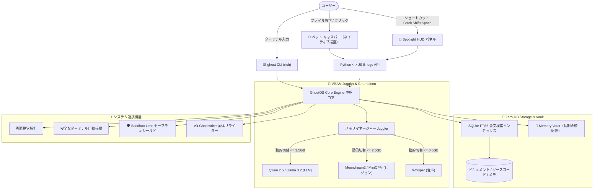

<div align="center">

```
      .---.
     /     \
    | () () |   G H O S T O S   v 2 . 0
     \  -  /    完全オフラインAIコパイロット＆GhostCode自律開発スタジオ
    /`---'\
   /       \    [ 100% プライベート • GhostCode 自律型IDE • ChatGPT スタイルスタジオ • <35MB RAM ]
  (_/^\_/\_/^)
```

# 👻 GhostOS v2.0
### 超軽量・完全オフライン対応のデスクトップAIアシスタント＆GhostCode自律開発スタジオ

<p align="center">
  <b>🌐 言語を選択 / Language Select:</b><br>
  <a href="../README.md"><b>English</b></a> •
  <a href="README_RU.md"><b>Русский</b></a> •
  <a href="README_KK.md"><b>Қазақша</b></a> •
  <a href="README_ZH.md"><b>简体中文</b></a> •
  <a href="README_ES.md"><b>Español</b></a> •
  <a href="README_DE.md"><b>Deutsch</b></a> •
  <a href="README_FR.md"><b>Français</b></a> •
  <a href="README_JA.md"><b>日本語</b></a> •
  <a href="README_PT.md"><b>Português</b></a>
</p>

[](https://opensource.org/licenses/MIT)
[](https://github.com/GhostOS-ai/GhostOS)
[](mailto:GhostOS@kib.best)
[](https://www.python.org/downloads/)
[]()
[]()
[]()
[]()

**一般的なノートPCや標準的な端末（4–8 GB RAM）でもメモリ不足（OOM）でクラッシュすることなく、快適に動作する完全自立型ローカルAIアシスタント。**

[クイックスタート](#-クイックスタート) • [独自機能](#-独自の主要機能) • [他社比較](#-ghostosが選ばれる理由) • [アーキテクチャ](#-システム設計) • [ショートカット](#-ショートカット一覧) • [プライバシー保証](#-100-プライバシー保証)

</div>

---

### 💡 GhostOSが選ばれる理由

現代のローカルAI実行環境には、主に3つの重大な課題が存在します：
1. **Electronによる過剰なメモリ消費：** 従来のデスクトップAIツール（LM Studio、Jan、AnythingLLMなど）は、ニューラルネットワークを読み込む前から **800–1200 MBものRAM** を浪費します。
2. **複数モデルによるOOMトラップ：** テキスト言語モデル（3 GB）＋ビジョンモデル（2 GB）＋Whisper音声モデル（1 GB）を同時に保持しようとすると、4–8 GB搭載端末は瞬時にフリーズまたは強制終了します。
3. **過大で複雑なRAGスタック：** 数件のファイルを検索するためだけに、重厚なDockerコンテナや外部ベクトルDB（Chromaなど）、ギガバイト規模の依存パッケージの導入を強いられます。

**GhostOSはこれらの問題を根本から解決します：**
- **ネイティブエンジン採用のキャスパー＆HUD：** OS標準の軽量ブラウザコンポーネント（macOS WebKit、Windows WebView2、Linux WebKitGTK）で駆動し、アイドル時のメモリ消費量はわずか **~35 MB** です。
- **動的VRAMジャグラー（VRAM Juggler）：** テキスト・視覚・音声モデルを150ミリ秒未満でシームレスに入れ替え。最大消費VRAMを常に **3.5 GB以内** に抑制します。
- **Zero-DB RAG：** ファイルをキャスパーの上にドラッグ＆ドロップするだけ。純粋な **SQLite FTS5** による全文検索で、外部データベースなしに高速検索を可能にします。
- **100% オフライン＆プライベート：** テレメトリの送信やクラウド通信は一切行いません。インターネット接続を遮断した状態でも完全に動作します。

---

### ✨ 独自の主要機能

#### 0. ⚡ GhostCode: 自律型コーディングエージェント＆ChatGPTスタイルスタジオ (v2.0)
* **自律型ソフトウェアエンジニアリング実行ループ：** Claude Code や Cursor に対する完全オフラインのプライベートな代替ツール。GhostCode は計画の立案、リポジトリ全体の探索、**Unified Diff** を用いた安全で正確なコード変更、単体テストの実行、安全な端末コマンドの実行、Git 履歴の追跡をすべて自律的に行います。
* **ワンクリックで本番向け完全プロジェクトを自動生成：**
  * `FastAPI`: Pydantic バリデーション、CORS ミドルウェア、単体テスト（`TestClient`）を備えた非同期高性能 API。
  * `Telegram Bot`: コマンドハンドラーと明確なアーキテクチャを持つ最新の `python-telegram-bot` アプリケーション。
  * `HTML / React ランディングページ`: 美しいグラスモーフィズムデザインのレスポンシブ製品紹介ページ。
  * `Python CLI ツール`: 引数パーサーとテストスイートを備えた構造化コマンドラインツール。
* **ChatGPT＆Cursor 分割デスクトップスタジオ (`ghost studio`):**
  * **折りたたみ可能な左サイドバー：** セッションとプロジェクトの履歴（「今日」「昨日」「プロジェクト」）、`Ghost Chat`（一般的な対話型AI）と `GhostCode`（自律プログラマー）の即時切り替え、Zero-DB RAG、システムツール、VRAM監視。
  * **エージェント実行ログストリーム：** GhostCode の思考プロセス、ツール呼び出し、結果をリアルタイム表示する左側ペイン。
  * **インタラクティブ・キャンバス (Canvas)：** 右側ペインには**プロジェクトファイル探索**（1クリックでファイルオープン）、**リアルタイムコードエディタ**（直接ディスク保存）、**Unified Diff ビューア**（変更箇所のカラーハイライト）、**対話型端末コンソール (`zsh`)** を搭載。
* **瞬時のモード切り替え：** いつでも `◀ В питомца` ボタンで軽量なキャスパーペットに戻ることができ、ターミナルから `ghost studio` や `ghost code "タスク"` で直接起動することも可能です。

#### 1. 👻 デスクトップ常駐型AIコンパニオン「キャスパー」
* デスクトップ上に静かに浮かぶ、愛らしく半透明な磁器質のゴースト型コンパニオン。
* **「キャスパーにごはんをあげる」：** PDF、ソースコード、メモ、ログなどをキャスパーに直接ドロップ。パクッと食べて即座にナレッジベースへ学習させます（+25 XP！）。
* **状態表現とリアクション：**
  * 💤 `待機`：ゆらゆらと優しく浮遊し、CPU負荷は0%。
  * 🔮 `思考`：サファイアブルーの柔らかな光を帯びてローカル推論中。
  * 🎧 `リスニング`：蛍光ヘッドホンを装着し、音声会議を記録・要約。
  * 🍕 `咀嚼`：ゆらゆら揺れながらファイルを噛み砕くアニメーションと経験値獲得。
  * ⚠️ `アラート`：ターミナルで危険なコマンドを検知した際に即座に警告。
* 1クリックでユニークな台詞を楽しめ、ダブルクリックまたは `Cmd+Shift+Space` / `Ctrl+Shift+Space` で本格的な操作盤（**Spotlight HUD**）を展開できます。

#### 2. ✍️ «Ghostwriter»（あらゆるアプリ上で使えるAIリライト）
* Word、Slack、ブラウザ、VS Code、ターミナルなど、任意の場所でテキストを選択 $\rightarrow$ ショートカットを押す $\rightarrow$ 1秒で文章をスマートに変革：
  * ✨ `polish`：洗練された明確でプロフェッショナルな表現に。
  * 🤝 `polite`：丁寧で礼儀正しいビジネス文面に整形。
  * 📝 `grammar`：誤字脱字や文法ミスを一瞬で校正。
  * 🎯 `summarize`：重要な2〜3箇条にスマート要約。
  * 🌐 `translate`：多言語への瞬時翻訳。
  * 🛠️ `code_fix`：コード断片の不具合を診断して自動修正。
* ターミナル実行：`ghost write --mode polite "文章"`、またはクリップボードを直接リライト可能！

#### 3. 🧠 «Memory Vault»（長期永続記憶グラフ）
* 外部ベクトルDBを必要とせず、SQLite上で完結するプライベートなコンテキスト保管庫。
* 利用者の技術スタック、名前、回答の好みなどを再起動後も記憶し続けます。
* **追加VRAM 0 KB** かつ背景CPU負荷ゼロで、必要な文脈をプロンプトへ自動付与します。
* コマンド：`ghost vault list`, `ghost vault remember tech_stack "Python, Rust, Apple Silicon"`。

#### 4. 🛡️ «Terminal Sandbox Lens»（危険コマンド検知セーフティ）
* 実行前のシェルコマンドをリアルタイムで安全診断。
* システム破壊につながる危険な操作（`rm -rf /`、生の `dd`、`mkfs`、`DROP DATABASE` など）を未然に阻止。
* 直感的な言葉でリスクを解説し、安全な代替コマンドを提案します。
* 診断：`ghost sandbox "rm -rf /"`。

#### 5. 📅 «Daily Standup & Commit Crafter»
* その日のコード変更差分、git diff、セッション履歴を自動解析。
* SlackやTeams向けのスタンドアップ報告文（*「今日やったこと」「現在対応中」「課題・ブロッカー」*）を一括出力。
* Conventional Commits基準に準拠したセマンティックなGitコミットメッセージを自動生成（`feat(...)`、`fix(...)`）。
* 起動コマンド：`ghost standup`。

#### 6. 🎙️ «Auto-Minutes Meeting Copilot»
* オンライン会議（Zoom、Google Meet）や音声メモを完全ローカルで書き起こすAI秘書。
* 構造化された議事録を瞬時に作成：**要点サマリー**、**決定事項**、**担当者付きアクションアイテム**。
* Whisperモデルは音声処理時のみVRAMジャグラーにより5秒間だけ起動し、終了後は直ちに解放されます。

#### 7. 🦎 «Memory Chameleon»（電力・メモリ適応型プロファイル）
* バッテリー残量とシステムメモリの負荷状況を自動検知：
  * 🍃 **ECOモード：** バッテリー駆動時またはRAM消費率 > 82%で発動。コンテキスト1024トークン、2スレッド、60秒無操作で省電力スリープ。
  * ⚖️ **バランスモード：** コンテキスト2048トークン、4スレッド、180秒でスリープ。
  * ⚡ **パフォーマンスモード：** 電源接続かつメモリ潤沢時。コンテキスト4096トークン、GPUアクセラレーションをフル活用。

#### 8. 🎮 キャスパーRPG育成・進化システム
* 日常の業務を進めることで、デスクトップコンパニオンも共にレベルアップ：
  * ファイル学習（+25 XP）、タスク完了（+25 XP）、日常会話（+10 XP）。
  * サイバーパンクバイザー、魔導書、王冠などの限定アクセサリーを獲得可能。

#### 9. 🎨 キャスパーのクローゼット（外観スキンとテーマ）
* ダークモードやモダンな作業環境にマッチする4種類の美しいスキン：
  * 💎 `glass`：Apple Glassのような透明感あふれるホワイト磁器。
  * ⚡ `cyberpunk`：ネオンシアンと妖艶なマゼンタのオーラ。
  * 👑 `gold`：高貴に輝くロイヤルゴールド。
  * 🟢 `matrix`：ハッカーライクなクラシック蛍光グリーン。
* 起動：`ghost pet --skin cyberpunk`、またはメニューバーから1クリックで瞬時に変更！

#### 10. 🍕 Casper Feeder（ドラッグ＆ドロップによる直感的学習）
* コード（`.py`、`.js`、`.ts`、`.json`）、ログ、PDFファイルを直接キャスパーへドラッグ。
* 愛らしく首を振ってモグモグ噛み砕くアニメーション（`@keyframes ghostChewWobble`）が作動。
* アップロード画面などを介さず、瞬時にZero-DB RAGへインデックス化されます。

#### 11. 👻 ネイティブ macOS メニューバーコントローラー
* macOSのステータスバーに常駐する軽量なメニューバートレイ（`ghost bar` または `ghost pet --tray`）。
* キャスパーの表示切替、スキン変更、使用モデル選択、VRAM解放を **バックグラウンドメモリ0 KB** で実行可能。

#### 12. 🔍 即時起動 Spotlight HUD
* RaycastやSpotlightのように画面中央へ瞬時に浮遊するコマンドバー（`ghost spot`）。作業を邪魔することなく質問でき、`Esc` キーで瞬時に閉じます。

#### 13. 🤖 ローカルモデル＆ハードウェアカタログ
* ローカルのOllamaインスタンスを自動診断し、導入済みモデルとGB容量を一覧化。現在のハードウェア種別（**Apple Silicon Metal MPS**、**NVIDIA CUDA**、**CPU**）を判別し、4GB–8GB RAM端末に最適な軽量モデルを推薦します（`ghost models`）。

#### 14. 💎 Apple風グラスモフィズムHUDと1クリックコードブロック (v1.3.0)
* **4タブへの統合ナビゲーション:** 乱立していた9つのタブを4つの洗練されたワークスペースに再編: `💬 チャット`、`📚 ナレッジベース (RAG)`、`🛠️ OSツール`（内包ツール: OSエージェント、画面解析、クリップボード、安全ターミナル、日報スタンドアップ）、`🧠 VRAM管理`。
* **リアルタイムテーマ・スキン切替:** ヘッダーのドロップダウンからGlass、Cyberpunk、Gold、Matrixを即座に切り替え可能（設定は自動保存）。
* **クイックアクションチップ:** よく使う操作をワンタップで実行（`👋 何ができる？`、`🌤️ 天気予報`、`📂 ダウンロードを開く`、`📸 画面キャプチャ`、`📋 クリップボード確認`）。
* **1クリックコピー対応コードブロック:** 言語バッジとクリップボード即時コピーボタンを備えた高コントラストなコード表示。
* **ウィンドウ全域ドラッグ＆ドロップ対応:** キャスパー上またはHUD画面のどこにでもファイルをドロップするだけで即座にZero-DB RAGへ学習完了（+25 XP!）。
* **macOS Dock対応のネイティブRetinaアイコン:** macOSのDock、Appスイッチャー、`/Applications/GhostOS.app`に公式のRetina `.icns`アイコンを完全統合。

---

### 📊 GhostOSが選ばれる理由

| 機能項目 | GhostOS 👻 | Jan.ai / LM Studio | Ollama | AnythingLLM |
| :--- | :---: | :---: | :---: | :---: |
| **GUIのメモリ消費量** | **~35 MB**（ネイティブ設計）| ~850 MB（Electron）| なし（CLIのみ）| ~1.1 GB（Electron + DB）|
| **自律型コーディングエージェント** | **あり（標準搭載 v2.0）** | ❌ なし | ❌ なし | ❌ なし |
| **ChatGPT / Cursor 分割スタジオ** | **あり（1120x740）** | ❌ なし | ❌ なし | ❌ なし |
| **常駐型デスクトップペット**| **あり（キャスパー育成）**| ❌ なし | ❌ なし | ❌ なし |
| **ドラッグ＆ドロップRAG** | **対応（ペットに直接投下）**| ❌ 面倒な手動アップロード | ❌ 手動インポート | ❌ 面倒な手動アップロード |
| **動的モデル切り替え** | **あり（VRAM Juggler）**| ❌ メモリ不足でクラッシュ | ❌ 手動CLI切り替え | ❌ メモリ不足でクラッシュ |
| **KVキャッシュのディスク保存**| **あり（アイドル時VRAM 0MB）**| ❌ なし | ❌ なし | ❌ なし |
| **プロンプト真空圧縮** | **あり（40〜60%節約）** | ❌ なし | ❌ なし | ❌ なし |
| **電力・メモリ適応モード** | **あり（Chameleonモード）**| ❌ なし | ❌ なし | ❌ なし |
| **全アプリ共通リライター** | **あり（Ghostwriter）** | ❌ なし | ❌ なし | ❌ なし |
| **ターミナル保護サンドボックス**| **あり（rm -rf 等の阻止）**| ❌ なし | ❌ なし | ❌ なし |
| **日報＆コミット自動作成** | **標準搭載** | ❌ なし | ❌ なし | ❌ なし |
| **外部データベース依存** | **完全不要（SQLite FTS5）**| 設定により異なる | なし | Chroma等のベクトルDB必須 |
| **マルチプラットフォーム** | **macOS / Windows / Linux** | 対応 | 対応 | 対応 |
| **100% オフライン完全動作** | **完全対応** | 対応 | 対応 | 一部外部通信あり |

---

### 🚀 クイックスタート

#### 1. 即時インストール

**macOS & Linux（ターミナル1行インストーラー）：**
```bash
curl -fsSL https://raw.githubusercontent.com/GhostOS-ai/GhostOS/main/install.sh | bash
```
*(macOSでは自動的にRetina対応キャスパーアイコン付きの `/Applications/GhostOS.app` が生成され、LaunchpadやSpotlightから起動可能になります)*

**または Python pip での導入：**
```bash
pip install --upgrade ghostos-ai
```

#### 2. キャスパーとUIの起動
```bash
ghost pet
```
*または macOS では Spotlight（`Cmd + Space`）、Launchpad、または `/Applications/GhostOS.app` をダブルクリックして起動できます！*

#### 3. ターミナルから直接利用する（CLI）
```bash
# 本格的な ChatGPT & GhostCode 分割スタジオを起動 (1120x740)
ghost studio

# GhostCode CLI による自律ソフトウェア開発タスクの実行
ghost code "my_service という名前の fastapi プロジェクトを作成して"
ghost code "テストを実行して失敗したアサーションを修正して"

# ローカルモデルへ即座に質問
ghost "Pythonにおけるプロセスとスレッドの違いを分かりやすく解説して"

# スキンを指定し、メニューバー連携付きでキャスパーを起動
ghost pet --skin cyberpunk --tray

# 画面中央のSpotlight HUD検索バーを即時起動
ghost spot

# macOSメニューバーコントローラーを起動
ghost bar

# 導入済みモデルとハードウェアアクセラレーション情報を確認
ghost models

# ファイルやコードのフォルダをキャスパーに学習させる（Zero-DB RAG）
ghost eat ~/Documents/my_notes.txt
ghost eat ./src/

# 文章リライトアシスタント Ghostwriter
ghost write --mode polite "このコードを至急確認してください"
ghost write --mode grammar

# 長期記憶保管庫 Memory Vault
ghost vault remember tech_stack "Python, Rust, Apple Silicon"
ghost vault list

# 本日のスタンドアップ日報とコミットメッセージを自動生成
ghost standup

# コマンドの危険性をサンドボックスで診断
ghost sandbox "rm -rf /"

# ナレッジベース内を検索
ghost rag search "データベースマイグレーション"

# アクティブウィンドウの視覚的解析
ghost screen

# システムタスクを安全に自動実行
ghost exec "100MB以上のファイルをすべて検索して"

# VRAMおよびプロセッサの健康状態を確認
ghost status
```

---

### ⌨️ ショートカット一覧

| キー操作 | 動作内容 |
| :--- | :--- |
| `Cmd + Shift + Space` / `Ctrl + Shift + Space` | キャスパーとSpotlight HUDの表示切替 |
| `ペットを1クリック` | ランダムな台詞やリアクション |
| `ペットをダブルクリック` | コントロールセンターを全画面展開 |
| `Escape` | パネルを閉じて小さなペット形態に戻す |
| `Enter` | 指示を送信 |
| `ファイルをドラッグ` | キャスパーにファイルを学習させる（即時RAG） |

---

### 🏗️ システム設計



---

### 🔒 100% プライバシー保証

GhostOSは一切の妥協のないプライバシー保護を目的に設計されています：
- **ゼロ・テレメトリ：** アクセス解析、トラッキング、利用データ収集は一切行いません。
- **外部クラウド通信なし：** すべてのAI推論はご自身の端末（Apple Silicon MPS / NVIDIA / CPU）のみで完結します。
- **Air-Gap完全対応：** 物理的にインターネットを切断した環境でも全機能が動作します。

---

### 📄 ライセンスと開発者情報

- **開発チーム：** [KIB.best](https://github.com/GhostOS-ai/GhostOS)
- **連絡先メール：** [GhostOS@kib.best](mailto:GhostOS@kib.best)
- **ライセンス：** MIT License © 2026 KIB.best。個人利用・商用利用ともに完全無料です。
