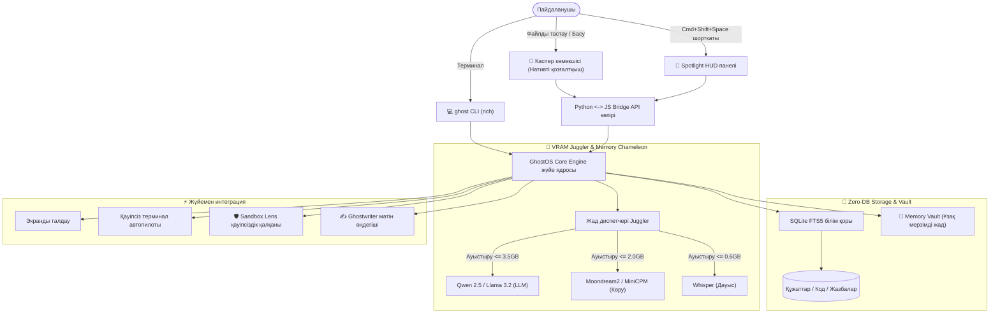

<div align="center">

```
      .---.
     /     \
    | () () |   G H O S T O S
     \  -  /    Көрінбейтін, аса жеңіл, дербес жергілікті AI-көмекші
    /`---'\
   /       \    [ 100% Құпия • VRAM Juggler • Zero-DB RAG • Каспер көмекшісі ]
  (_/^\_/\_/^)
```

# 👻 GhostOS
### Компьютерге арналған аса жеңіл, оффлайн AI-көмекші және десктоп серігі

<p align="center">
  <b>🌐 Тілді таңдау / Language Select:</b><br>
  <a href="../README.md"><b>English</b></a> •
  <a href="README_RU.md"><b>Русский</b></a> •
  <a href="README_KK.md"><b>Қазақша</b></a> •
  <a href="README_ZH.md"><b>简体中文</b></a> •
  <a href="README_ES.md"><b>Español</b></a> •
  <a href="README_DE.md"><b>Deutsch</b></a> •
  <a href="README_FR.md"><b>Français</b></a> •
  <a href="README_JA.md"><b>日本語</b></a> •
  <a href="README_PT.md"><b>Português</b></a>
</p>

[](https://opensource.org/licenses/MIT)
[](https://github.com/GhostOS-ai/GhostOS)
[](mailto:GhostOS@kib.best)
[](https://www.python.org/downloads/)
[]()
[]()
[]()
[]()

**Қуаты аз ноутбуктер мен қарапайым компьютерлерде (4–8 ГБ RAM) жады жетпей тоқтап қалмай (OOM), толық жергілікті жұмыс істейтін десктоптық AI-көмекші.**

[Жылдам бастау](#-жылдам-бастау) • [Ерекше мүмкіндіктер](#-ерекше-мүмкіндіктер) • [Салыстыру](#-неліктен-ghostos) • [Архитектура](#-архитектура) • [CLI анықтамалығы](#-cli-пәрмендері) • [Құпиялылық кепілі](#-100-құпиялылық-кепілі)

</div>

---

### 💡 Неліктен дәл GhostOS?

Қазіргі дербес жергілікті AI бағдарламалары 3 негізгі кемшілікке ие:
1. **Electron жадысының ауырлығы:** Көптеген қосымшалар (LM Studio, Jan, AnythingLLM) нейрожелі салмақтарын жүктемей тұрып-ақ **800–1200 МБ жедел жадты** босқа жалмап қояды.
2. **Бірнеше модель тұзағы (OOM):** Тілдік модельді (3 ГБ) + көру моделін (2 ГБ) + Whisper (1 ГБ) бір уақытта қосқанда 4–8 ГБ жады бар компьютер бірден қатып қалады.
3. **Күрделі дерекқорлар:** Құжаттар бойынша іздеу жасау үшін ауыр Docker-контейнерлерді, векторлық базаларды (Chroma) орнатуды талап етеді.

**GhostOS бұл мәселені түбегейлі шешеді:**
- **Каспер және HUD интерфейсі:** Жүйенің нативті компоненттерінде жұмыс істейді (macOS WebKit, Windows WebView2, Linux WebKitGTK) және бар болғаны **~35 МБ RAM** жұмсайды.
- **Динамикалық VRAM Juggler:** Модельдерді (мәтін, көру, дауыс) 150 миллисекунд ішінде ауыстырып отырады. Бейнежад шығыны ешқашан **3.5 ГБ-тан аспайды**.
- **Zero-DB RAG:** Файлды Касперге тастасаңыз болғаны — таза **SQLite FTS5** арқылы миллисекундтар ішінде іздеу базасына қосылады.
- **100% Құпия:** Ешқандай телеметрия, серверлер және бұлтты логтар жоқ. Интернетсіз толық жұмыс істейді.

---

### ✨ Ерекше мүмкіндіктер

#### 1. 👻 Интерактивті десктоп питомцы Каспер
* Жұмыс үстеліңіздің үстінде қалықтап жүретін жеңіл әрі сүйкімді рух.
* **«Каспер файлдарды жейді»:** Кез келген PDF, код, жазба немесе құжатты Каспердің үстіне тастаңыз. Ол аузын ашып құжатты жұтып алады да, жедел түрде RAG базасына қосады (+15 XP!).
* **Күйлер мен реакциялар:**
  * 💤 `Тыныштық`: Баяу тербелу, процессорға 0% жүктеме.
  * 🔮 `Ойлану`: Жарық сапфир шапағы, жауапты жергілікті генерациялау.
  * 🎧 `Тыңдау`: Жарқыраған құлаққап киіп, онлайн кездесулерді жазады.
  * 🍕 `Тамақтану`: Құжаттарды жұту анимациясы және тәжірибе ұпайлары.
  * ⚠️ `Дабыл`: Қауіпті пәрмен анықталғанда ескерту беру.
* Бір рет басу интерактивті фразаларды шақырады; екі рет басу немесе `Cmd+Shift+Space` / `Ctrl+Shift+Space` шорткаты басқару пультін (**Spotlight HUD**) ашады.

#### 2. ✍️ «Ghostwriter» (Кез келген бағдарламадағы AI-редактор)
* Мәтінді кез келген жерде белгілеңіз (Word, Telegram, шолғыш, VS Code, терминал) $\rightarrow$ жылдам пернені басыңыз $\rightarrow$ 1 секундта түрлендіріңіз:
  * ✨ `polish`: Мәтінді мінсіз әрі кәсіби ету.
  * 🤝 `polite`: Дипломатиялық, сыпайы іскерлік мәнер.
  * 📝 `grammar`: Барлық қателер мен жазу кемшіліктерін түзету.
  * 🎯 `summarize`: Ең негізгі 2-3 ойға дейін қысқарту.
  * 🌐 `translate`: Қазақ, орыс, ағылшын, қытай тілдеріне жедел аудару.
  * 🛠️ `code_fix`: Код үзіндісіндегі қателерді тауып жөндеу.
* Терминалдан шақыру: `ghost write --mode polite "хат мәтіні"` немесе алмасу буферінен автоматты түрде өңдеу!

#### 3. 🧠 «Memory Vault» (Ұзақ мерзімді жад графы)
* Сыртқы векторлық базасыз SQLite негізінде жасалған дербес мәнмәтін қоймасы.
* Каспер қайта іске қосылғанда да сіздің технологиялық стекіңізді, атыңызды және сұраныс стиліңізді ұмытпайды.
* **0 КБ қосымша VRAM** шығынымен жұмыс істейді.
* Пәрмендер: `ghost vault list`, `ghost vault remember tech_stack "Python, Rust, Apple Silicon"`.

#### 4. 🛡️ «Terminal Sandbox Lens» (Қауіпті пәрмендерден қорғаныс)
* Терминал пәрмендерін орындалмас бұрын терең талдау.
* Қауіпті операцияларды бірден тоқтатады (`rm -rf /`, `mkfs`, тікелей `dd`, `DROP DATABASE`, `format C:`).
* Тәуекелдерді адам тілінде түсіндіріп, қауіпсіз баламаларын ұсынады.
* Тексеру: `ghost sandbox "rm -rf /"`.

#### 5. 📅 «Daily Standup & Commit Crafter»
* Күн бойы өзгертілген файлдарды, git diff және сессия тарихын талдайды.
* Slack / Telegram үшін дайын стендап-есебін шығарады (*«Бүгін не істелді», «Қазір не істеліп жатыр», «Қиындықтар»*).
* Conventional Commits стандарты бойынша семантикалық коммиттер дайындайды (`feat(...)`, `fix(...)`).
* Шақыру: `ghost standup`.

#### 6. 🎙️ «Auto-Minutes Meeting Copilot»
* Zoom, Google Meet қоңырауларына және дауыстық жазбаларға арналған 100% құпия хатшы.
* Кездесудің құрылымдалған хаттамасын жасайды: **Негізгі қорытынды**, **Басты шешімдер** және **Тапсырмалар (Action Items)**.
* Whisper моделі VRAM Juggler арқылы тек протокол жасау кезінде 5 секундқа ғана іске қосылып, жадтан бірден босатылады.

#### 7. 🦎 «Memory Chameleon» (Бейімделгіш қуат профильдері)
* Батарея заряды мен жедел жад қысымын автоматты түрде бақылайды:
  * 🍃 **ЭКО:** Батареядан жұмыс істегенде немесе RAM > 82% болғанда. 1024 токендік контекст, 2 CPU ағыны, 60 секундта ұйқыға кету.
  * ⚖️ **Баланс:** 2048 токен, 4 ағын, 180 секундта ұйқы режимі.
  * ⚡ **Жыртқыш:** Желіден қуат алғанда. 4096 токен, GPU максималды үдеткіші.

#### 8. 🎮 Касперді RPG дамыту жүйесі
* Сіздің жұмыс прогресіңізбен бірге питомцыңыз да өседі:
  * Файлдарды тамақтандыру (+25 XP), тапсырмаларды орындау (+25 XP), сұрақ қою (+10 XP).
  * Жаңа деңгейлер мен аксессуарлар (киберпанк-визор, сиқырлы кітап, алтын тәж).

#### 9. 🎨 Каспер киімдері (Визуалды скиндер мен тақырыптар)
* Касперді қараңғы режимге арналған 4 әдемі стильде іске қосыңыз:
  * 💎 `glass`: Apple Glass стиліндегі мөлдір фарфор.
  * ⚡ `cyberpunk`: Қанық көгілдір неон және күлгін шапақ.
  * 👑 `gold`: Патшалық алтын шұғыласы.
  * 🟢 `matrix`: Хакерлік терминалдық жасыл жарқыл.
* Шақыру: `ghost pet --skin cyberpunk` немесе Меню-бардан 1 кликпен ауыстыру!

#### 10. 🍕 Casper Feeder (Құжаттарды физикалық сүйреп тастау)
* Кез келген код файлын (`.py`, `.js`, `.ts`, `.json`), журналды немесе PDF-ті тікелей Касперге сүйреп апарыңыз.
* Арнайы шайнау қимылы қосылады (`@keyframes ghostChewWobble`) және ой бұлтында қуанышты реакциялар пайда болады.
* Қосымша жүктеу терезелерінсіз дереу Zero-DB RAG базасына енгізіледі.

#### 11. 👻 macOS Меню-барының нативті контроллері
* Жүйелік меню-барда нативті Cocoa `NSStatusBar` арқылы жұмыс істейтін жеңіл белгіше (`ghost bar` немесе `ghost pet --tray`).
* Касперді шақыру/жасыру, скинді өзгерту, модельді таңдау және VRAM-ды жедел тазалау **0 КБ фонық оверхедпен** орындалады.

#### 12. 🔍 Жылдам Spotlight HUD
* Экранның дәл ортасында ашылатын жылдам Raycast/Alfred стиліндегі пәрмендер жолағы (`ghost spot`). Жұмыстан алаңдамай сұрақ қоюға арналған, `Esc` пернесімен бірден жабылады.

#### 13. 🤖 Жергілікті модельдер мен үдеткіштер каталогы
* Жергілікті Ollama серверін тексереді, жүктелген модельдердің салмағын (ГБ) есептейді, аппараттық деңгейді (**Apple Silicon Metal MPS**, **NVIDIA CUDA** немесе **CPU**) анықтайды және 4ГБ–8ГБ жады бар компьютерлерге ең қолайлы модельдерді ұсынады (`ghost models`).

#### 14. 💎 Apple Glassmorphism интерфейсі және 1-шертумен кодты көшіру (v1.3.0)
* **4 қойындыдан тұратын бірыңғай навигация:** 9 шашыраңқы қойынды 4 негізгі бөлімге біріктірілді: `💬 Чат`, `📚 Білім қоры (RAG)`, `🛠️ OS Құралдары` (ішкі құралдар: OS Агенті, Экранды талдау, Алмасу буфері, Қауіпсіз терминал, Стендап-журнал) және `🧠 VRAM`.
* **Тақырыптар мен терілерді лезде ауыстыру:** Glass, Cyberpunk, Gold және Matrix дизайндарын терезе тақырыбынан бір шертумен ауыстыру.
* **Жылдам әрекет батырмалары:** Дайын ұсыныстар (`👋 Не істей аласың?`, `🌤️ Алматыдағы ауа райы`, `📂 Жүктеулерді аш`, `📸 Экран суреті`, `📋 Буферді тексеру`).
* **Көшіру батырмасы бар әдемі код блоктары:** Синтаксисті бояу, бағдарламалау тілінің белгісі және мәтінді бір шертумен алмасу буферіне көшіру.
* **Терезе бойынша әмбебап Drag-and-Drop:** Файлдарды Каспердің үстіне немесе терезенің кез келген жеріне тастап, RAG жүйесін лезде оқыту (+25 XP!).
* **Dock-тағы нативті Apple Retina белгішесі:** macOS Dock, бағдарлама терезесі және `/Applications/GhostOS.app` үшін арнайы жасалған жоғары сапалы `.icns` белгішесі.

---

### 📊 Неліктен GhostOS?

| Мүмкіндік | GhostOS 👻 | Jan.ai / LM Studio | Ollama | AnythingLLM |
| :--- | :---: | :---: | :---: | :---: |
| **GUI-дің RAM шығыны** | **~35 МБ** (Нативті қозғалтқыш) | ~850 МБ (Electron) | Жоқ (тек CLI) | ~1.1 ГБ (Electron + DB) |
| **Десктоп питомцы** | **Иә (Каспер RPG)** | ❌ Жоқ | ❌ Жоқ | ❌ Жоқ |
| **Файлды тастап RAG жасау**| **Иә (Касперге тастау)**| ❌ Қолмен жүктеу | ❌ Қолмен импорт | ❌ Қолмен жүктеу |
| **Модельдерді динамикалық ауыстыру** | **Иә (VRAM Juggler)** | ❌ Жады жетпей қату| ❌ Қолмен CLI | ❌ Жады жетпей қату |
| **KV-кэшті дискіге мұздату**| **Иә (Тынышта 0 МБ VRAM)**| ❌ Жоқ | ❌ Жоқ | ❌ Жоқ |
| **Промпттарды қысу (Vacuum)** | **Иә (40-60% үнемдейді)** | ❌ Жоқ | ❌ Жоқ | ❌ Жоқ |
| **Бейімделгіш қуат режимдері**| **Иә (Chameleon Mode)** | ❌ Жоқ | ❌ Жоқ | ❌ Жоқ |
| **Мәтінді тікелей өңдегіш** | **Иә (Кез келген қолданбада)** | ❌ Жоқ | ❌ Жоқ | ❌ Жоқ |
| **Терминал қауіпсіздік қалқаны** | **Иә (rm -rf қорғанысы)**| ❌ Жоқ | ❌ Жоқ | ❌ Жоқ |
| **Стендап генераторы** | **Иә (Кірістірілген)** | ❌ Жоқ | ❌ Жоқ | ❌ Жоқ |
| **Сыртқы ДБ талап ету** | **Нөл (SQLite FTS5)** | Әртүрлі | Жоқ | Chroma / Vector DB қажет |
| **Барлық платформалар** | **macOS / Windows / Linux** | Иә | Иә | Иә |
| **100% Оффлайн жұмыс** | **Иә** | Иә | Иә | Жартылай |

---

### 🚀 Жылдам бастау

#### 1. Жедел орнату

**macOS және Linux үшін (терминалда бір пәрменмен орнату):**
```bash
curl -fsSL https://raw.githubusercontent.com/GhostOS-ai/GhostOS/main/install.sh | bash
```
*(macOS жүйесінде бұл пәрмен Launchpad және Spotlight-қа Каспердің нативті Retina белгішесі бар `/Applications/GhostOS.app` қосымшасын автоматты түрде тіркейді).*

**Немесе Python pip арқылы:**
```bash
pip install --upgrade ghostos-ai
```

#### 2. Каспер мен интерфейсті іске қосу
```bash
ghost pet
```
*Немесе macOS-та `GhostOS`-ты тікелей Spotlight (`Cmd + Space`), Launchpad арқылы немесе `/Applications/GhostOS.app` үстіне екі рет басып іске қосыңыз!*
*Каспер экраныңызда пайда болады. Оған құжаттарды сүйреп тастаңыз немесе басқару панелін ашу үшін екі рет басыңыз!*

#### 3. Терминалдан (CLI) пайдалану
```bash
# Жергілікті модельге жылдам сұрақ қою
ghost "Python-да процестер мен ағындардың айырмашылығы неде?"

# Каспер питомцын іске қосу (сәнді скинмен және меню-бар трейімен)
ghost pet --skin cyberpunk --tray

# Spotlight HUD жедел іздеу жолағын ашу
ghost spot

# macOS Меню-барының контроллерін ашу
ghost bar

# Орнатылған модельдер мен аппараттық үдеткішті қарау
ghost models

# Касперге файл немесе код қалтасын үйрету (Zero-DB RAG)
ghost eat ~/Documents/my_notes.txt
ghost eat ./src/

# Мәтінді жақсарту (Ghostwriter)
ghost write --mode polite "мына кодты тезірек қарашы"
ghost write --mode grammar

# Ұзақ мерзімді жад қоймасы (Memory Vault)
ghost vault remember tech_stack "Python, Rust, Apple Silicon"
ghost vault list

# Күнделікті стендап-есеп және коммит хабарламасы
ghost standup

# Пәрмен қауіпсіздігін тексеру (Sandbox Lens)
ghost sandbox "rm -rf /"

# Білім қорынан іздеу
ghost rag search "дерекқорды көшіру"

# Белсенді экранды көзбен талдау
ghost screen

# Жүйедегі тапсырманы қауіпсіз орындау
ghost exec "көлемі 100МБ-тан асатын барлық файлдарды тап"

# Видеожад және процессор күйін көру
ghost status
```

---

### ⌨️ CLI пәрмендері мен пернелер

| Перне | Әрекет |
| :--- | :--- |
| `Cmd + Shift + Space` / `Ctrl + Shift + Space` | Каспер мен Spotlight HUD арасында ауысу |
| `Питомды бір рет басу` | Интерактивті реплика / жауап |
| `Екі рет басу` | Басқару пультін толық ашу |
| `Escape` | Пультті жауып, қайтадан кішкентай питомға айналдыру |
| `Enter` | Сұранысты жіберу |
| `Файлды сүйреп тастау` | Касперге құжатты жегізу (жылдам RAG) |

---

### 🏗️ Архитектура



---

### 🔒 100% Құпиялылық кепілі

GhostOS толықтай қауіпсіздік үшін жасалған:
- **Нөлдік телеметрия:** Ешқандай аналитикалық есептегіштер мен дерек жинау жоқ.
- **Бұлтқа қосылмау:** Барлық есептеулер тек сіздің жергілікті процессорыңызда/видеокартаңызда орындалады.
- **Air-Gap дайындығы:** Wi-Fi желісі толық сөндірілген кезде де мінсіз жұмыс істейді.

---

### 📄 Лицензия және авторлық құқық

- **Автор:** [KIB.best](https://github.com/GhostOS-ai/GhostOS)
- **Email:** [GhostOS@kib.best](mailto:GhostOS@kib.best)
- **Лицензия:** MIT License © 2026 KIB.best. Жеке және коммерциялық мақсатта қолдану тегін.
