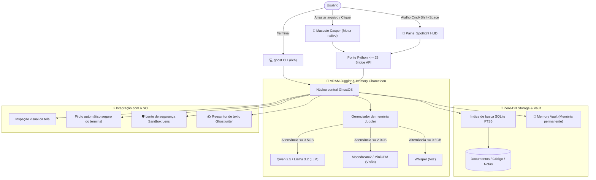

<div align="center">

```
      .---.
     /     \
    | () () |   G H O S T O S
     \  -  /    O copiloto de IA local e invisível, ultraleve e 100% offline
    /`---'\
   /       \    [ 100% Privado • VRAM Juggler • Zero-DB RAG • Mascote Casper ]
  (_/^\_/\_/^)
```

# 👻 GhostOS
### Assistente e companheiro de desktop com IA ultraleve e 100% offline

<p align="center">
  <b>🌐 Seleção de idioma / Language Select:</b><br>
  <a href="../README.md"><b>English</b></a> •
  <a href="README_RU.md"><b>Русский</b></a> •
  <a href="README_KK.md"><b>Қазақша</b></a> •
  <a href="README_ZH.md"><b>简体中文</b></a> •
  <a href="README_ES.md"><b>Español</b></a> •
  <a href="README_DE.md"><b>Deutsch</b></a> •
  <a href="README_FR.md"><b>Français</b></a> •
  <a href="README_JA.md"><b>日本語</b></a> •
  <a href="README_PT.md"><b>Português</b></a>
</p>

[](https://opensource.org/licenses/MIT)
[](https://github.com/GhostOS-ai/GhostOS)
[](mailto:GhostOS@kib.best)
[](https://www.python.org/downloads/)
[]()
[]()
[]()
[]()

**O assistente autônomo de desktop com IA projetado para notebooks modestos e computadores básicos (4–8 GB de RAM) sem travamentos por falta de memória (OOM).**

[Início rápido](#-início-rápido) • [Recursos exclusivos](#-recursos-exclusivos) • [Comparativo](#-por-que-o-ghostos-em-vez-de-outros) • [Arquitetura](#-arquitetura) • [Comandos CLI](#-comandos-cli-e-atalhos) • [Garantia de privacidade](#-100-garantia-de-privacidade)

</div>

---

### 💡 Por que o GhostOS?

Executar IA local hoje em dia enfrenta 3 grandes obstáculos:
1. **Consumo excessivo do Electron:** A maioria das ferramentas de desktop (LM Studio, Jan, AnythingLLM) consome entre **800 e 1200 MB de RAM** antes mesmo de carregar qualquer peso de rede neural.
2. **A armadilha de múltiplos modelos (OOM):** Manter simultaneamente um modelo de linguagem (3 GB) + modelo de visão (2 GB) + Whisper (1 GB) trava e encerra qualquer máquina com 4–8 GB de memória.
3. **Pilhas RAG inchadas:** Para pesquisar em alguns documentos, exigem contêineres Docker, bancos de dados vetoriais pesados (Chroma) e gigabytes de dependências externas.

**O GhostOS soluciona esses problemas de raiz:**
- **Mascote Casper e HUD nativos:** Desenvolvidos sobre os motores nativos do sistema operacional (WebKit no macOS, WebView2 no Windows, WebKitGTK no Linux), consumindo apenas **~35 MB de RAM** em repouso.
- **VRAM Juggler dinâmico:** Alterna modelos (texto, visão, voz) em tempo real em menos de 150 ms. O consumo máximo de VRAM **nunca excede 3.5 GB**.
- **Zero-DB RAG:** Basta arrastar qualquer arquivo para o Casper; a indexação ocorre em milissegundos através de **SQLite FTS5** puro, sem bancos de dados externos.
- **100% Privado:** Sem telemetria, sem servidores em nuvem e sem envio de logs. Funciona perfeitamente mesmo com a internet desconectada.

---

### ✨ Recursos exclusivos

#### 1. 👻 Mascote de desktop interativo Casper
* Um fantasma translúcido e elegante que flutua suavemente sobre a sua área de trabalho.
* **«Casper devora arquivos»:** Arraste qualquer arquivo PDF, código-fonte, registro ou anotação diretamente para o Casper. Ele abre a boca, engole o arquivo e o indexa imediatamente na base RAG (+25 XP!).
* **Estados e reações:**
  * 💤 `Repouso`: Flutuação suave, 0% de uso de CPU.
  * 🔮 `Pensando`: Brilho suave de safira durante a geração local de respostas.
  * 🎧 `Ouvindo`: Coloca fones brilhantes para transcrever reuniões.
  * 🍕 `Comendo`: Animação interativa de mastigação e ganho de experiência RPG.
  * ⚠️ `Alerta`: Aviso visual instantâneo se detectar comandos perigosos no terminal.
* Um clique dispara frases interativas; um clique duplo ou o atalho `Cmd+Shift+Space` / `Ctrl+Shift+Space` abre o painel de controle completo (**Spotlight HUD**).

#### 2. ✍️ «Ghostwriter» (Assistente de escrita global em qualquer aplicativo)
* Selecione texto em qualquer programa (Word, Telegram, navegador, VS Code, terminal) $\rightarrow$ pressione o atalho $\rightarrow$ transforme o texto em 1 segundo:
  * ✨ `polish`: Torna a redação impecável, clara e profissional.
  * 🤝 `polite`: Converte para um tom diplomático e corporativo.
  * 📝 `grammar`: Corrige erros gramaticais e ortográficos instantaneamente.
  * 🎯 `summarize`: Sintetiza em 2 a 3 pontos essenciais.
  * 🌐 `translate`: Tradução instantânea para múltiplos idiomas.
  * 🛠️ `code_fix`: Localiza e corrige falhas em trechos de código.
* Execução pelo terminal: `ghost write --mode polite "mensagem"` ou processamento automático da área de transferência!

#### 3. 🧠 «Memory Vault» (Grafo de memória persistente a longo prazo)
* Armazenamento de contexto pessoal persistente em SQLite sem requerer bancos vetoriais.
* Lembra suas preferências técnicas, seu nome e estilo de resposta entre inicializações.
* Adiciona contexto com **0 KB de consumo extra de VRAM** e impacto nulo de CPU em segundo plano.
* Comandos: `ghost vault list`, `ghost vault remember tech_stack "Python, Rust, Apple Silicon"`.

#### 4. 🛡️ «Terminal Sandbox Lens» (Escudo contra comandos perigosos)
* Verificação aprofundada de comandos de terminal antes de sua execução.
* Intercepta e barra operações destrutivas (`rm -rf /`, `mkfs`, `dd` direto, `DROP DATABASE`, `format C:`).
* Explica os riscos em linguagem simples e sugere alternativas seguras.
* Teste: `ghost sandbox "rm -rf /"`.

#### 5. 📅 «Daily Standup & Commit Crafter»
* Analisa as alterações do dia, git diff e histórico de comandos da sessão.
* Gera relatórios de standup prontos para Slack / Teams (*«O que fiz hoje», «No que estou trabalhando», «Impedimentos»*).
* Redige mensagens semânticas de commit seguindo o padrão Conventional Commits (`feat(...)`, `fix(...)`).
* Invocação: `ghost standup`.

#### 6. 🎙️ «Auto-Minutes Meeting Copilot»
* Secretário 100% offline para reuniões no Zoom, Google Meet e notas de voz.
* Estrutura atas completas: **Resumo executivo**, **Decisões-chave** e **Plano de ação (Action Items) com responsáveis**.
* O modelo Whisper é acionado pelo VRAM Juggler por apenas 5 segundos durante o áudio e descarregado em seguida.

#### 7. 🦎 «Memory Chameleon» (Perfis adaptativos de energia)
* Monitora automaticamente a bateria e a pressão na memória RAM:
  * 🍃 **ECO:** Ativado na bateria ou se a RAM ultrapassar 82%. Contexto de 1024 tokens, 2 threads de CPU, suspensão após 60s.
  * ⚖️ **Equilibrado:** Contexto de 2048 tokens, 4 threads, suspensão após 180s.
  * ⚡ **Performance:** Conectado à tomada com memória livre. Contexto de 4096 tokens, aceleração total de GPU.

#### 8. 🎮 Sistema de progressão RPG do Casper
* Seu mascote evolui conforme o seu ritmo diário de trabalho:
  * Ganho de XP por alimentar arquivos (+25 XP), concluir tarefas (+25 XP), interagir (+10 XP).
  * Desbloqueia temas visuais e acessórios (visor cyberpunk, grimório de magia, coroa real).

#### 9. 🎨 Guarda-roupa do Casper (Skins e temas visuais)
* Escolha entre 4 visuais elegantes pensados para modo escuro:
  * 💎 `glass`: Acabamento translúcido em porcelana branca estilo Apple Glass.
  * ⚡ `cyberpunk`: Ciano neon vibrante com aura magenta radiante.
  * 👑 `gold`: Brilho nobre em ouro real.
  * 🟢 `matrix`: Verde fósforo clássico de terminal hacker.
* Iniciar: `ghost pet --skin cyberpunk` ou altere com 1 clique pela barra de menus!

#### 10. 🍕 Casper Feeder (Alimentação física por arrastar e soltar)
* Arraste qualquer arquivo de código (`.py`, `.js`, `.ts`, `.json`), log ou PDF diretamente para o Casper.
* Ativa uma animação animada de mastigação (`@keyframes ghostChewWobble`) e balões de pensamento alegres.
* Incorpora os dados ao Zero-DB RAG sem telas ou modais de upload.

#### 11. 👻 Controlador nativo na barra de menus do macOS
* Ícone leve na barra de status superior desenvolvido com Cocoa `NSStatusBar` nativo (`ghost bar` ou `ghost pet --tray`).
* 1 clique para exibir/ocultar o Casper, trocar de skin, escolher o modelo ativo e limpar a VRAM com **0 KB de consumo em segundo plano**.

#### 12. 🔍 Barra de comando rápida Spotlight HUD
* Barra de entrada flutuante centralizada (`ghost spot`) no estilo Raycast/Spotlight para consultas sem distrações. Pressione `Esc` para fechar imediatamente.

#### 13. 🤖 Catálogo de modelos locais e aceleração de hardware
* Analisa seu ambiente local Ollama, lista modelos instalados com tamanho em GB, identifica o nível de hardware (**Apple Silicon Metal MPS**, **NVIDIA CUDA** ou **CPU**) e recomenda modelos ideais para dispositivos com 4GB–8GB de RAM (`ghost models`).

---

### 📊 Por que o GhostOS em vez de outros?

| Funcionalidade | GhostOS 👻 | Jan.ai / LM Studio | Ollama | AnythingLLM |
| :--- | :---: | :---: | :---: | :---: |
| **Consumo de RAM da interface** | **~35 MB** (Motor nativo) | ~850 MB (Electron) | Nenhuma (Apenas CLI) | ~1.1 GB (Electron + BD) |
| **Mascote interativo de desktop** | **Sim (Casper RPG)** | ❌ Não | ❌ Não | ❌ Não |
| **RAG arrastando arquivos** | **Sim (Soltar no mascote)**| ❌ Upload manual | ❌ Importação manual | ❌ Upload manual |
| **Troca dinâmica de modelos** | **Sim (VRAM Juggler)** | ❌ Falha OOM em pouca VRAM| ❌ Manual via CLI | ❌ Falha OOM em pouca VRAM |
| **Congelamento de KV-Cache em disco**| **Sim (0 MB VRAM ocioso)**| ❌ Não | ❌ Não | ❌ Não |
| **Compressão de contexto (Vacuum)** | **Sim (Economiza 40-60%)**| ❌ Não | ❌ Não | ❌ Não |
| **Perfis inteligentes de bateria** | **Sim (Modo Chameleon)**| ❌ Não | ❌ Não | ❌ Não |
| **Reescrita global de texto** | **Sim (Em qualquer app)** | ❌ Não | ❌ Não | ❌ Não |
| **Proteção de segurança no terminal**| **Sim (Protege contra rm -rf)**| ❌ Não | ❌ Não | ❌ Não |
| **Gerador de standup e commits** | **Sim (Integrado)** | ❌ Não | ❌ Não | ❌ Não |
| **Banco de dados externo necessário**| **Zero (SQLite FTS5)** | Varia | Nenhum | Requer Chroma / Vector DB |
| **Suporte multiplataforma** | **macOS / Windows / Linux** | Sim | Sim | Sim |
| **Operação 100% offline** | **Sim** | Sim | Sim | Parcialmente |

---

### 🚀 Início rápido

#### 1. Instalação instantânea

**macOS e Linux (Instalador em 1 linha de terminal):**
```bash
curl -fsSL https://raw.githubusercontent.com/GhostOS-ai/GhostOS/main/install.sh | bash
```
*(No macOS, registra automaticamente o `/Applications/GhostOS.app` com o ícone Retina do Casper no Launchpad e Spotlight).*

**Ou através do Python pip:**
```bash
pip install --upgrade ghostos-ai
```

#### 2. Iniciar o Casper e a interface
```bash
ghost pet
```
*Ou no macOS: inicie o `GhostOS` diretamente pelo Spotlight (`Cmd + Espaço`), Launchpad ou clicando duas vezes em `/Applications/GhostOS.app`!*

#### 3. Uso direto pelo terminal (CLI)
```bash
# Pergunta instantânea para o modelo local
ghost "Qual a diferença entre processos e threads em Python?"

# Iniciar o mascote Casper (com tema cyberpunk e ícone na barra de menus)
ghost pet --skin cyberpunk --tray

# Abrir a barra de pesquisa rápida Spotlight HUD
ghost spot

# Iniciar o controlador da barra de menus do macOS
ghost bar

# Consultar modelos instalados e aceleração de hardware
ghost models

# Ensinar um arquivo ou pasta para o Casper (Zero-DB RAG)
ghost eat ~/Documents/minhas_notas.txt
ghost eat ./src/

# Assistente de escrita Ghostwriter
ghost write --mode polite "por favor analise este código com brevidade"
ghost write --mode grammar

# Cofre de memória de longo prazo Memory Vault
ghost vault remember tech_stack "Python, Rust, Apple Silicon"
ghost vault list

# Relatório diário de standup e mensagem semântica de commit
ghost standup

# Verificação de segurança de comandos de terminal
ghost sandbox "rm -rf /"

# Pesquisa na base de conhecimento
ghost rag search "migração de banco de dados"

# Análise visual da tela ativa
ghost screen

# Execução segura de tarefas no sistema operacional
ghost exec "encontre todos os arquivos maiores que 100MB"

# Diagnóstico de memória VRAM e processador
ghost status
```

---

### ⌨️ Comandos CLI e atalhos

| Atalho | Ação |
| :--- | :--- |
| `Cmd + Shift + Space` / `Ctrl + Shift + Space` | Alternar entre o Casper e a barra Spotlight HUD |
| `Clique simples no mascote` | Frase interativa / reação espontânea |
| `Clique duplo no mascote` | Abrir o painel de controle completo |
| `Escape` | Recolher o painel de volta ao pequeno mascote |
| `Enter` | Enviar comando |
| `Arrastar arquivo` | Alimentar o Casper com o documento (RAG instantâneo) |

---

### 🏗️ Arquitetura



---

### 🔒 100% Garantia de privacidade

O GhostOS foi projetado para assegurar confidencialidade absoluta:
- **Zero telemetria:** Sem contadores analíticos ou coleta de padrões de uso.
- **Sem conexões com a nuvem:** Todas as computações ocorrem estritamente no seu hardware local (Apple Silicon MPS / NVIDIA / CPU).
- **Pronto para Air-Gap:** Funciona plenamente mesmo em ambientes completamente desconectados da internet.

---

### 📄 Licença e autoria

- **Autor:** [KIB.best](https://github.com/GhostOS-ai/GhostOS)
- **Email:** [GhostOS@kib.best](mailto:GhostOS@kib.best)
- **Licença:** MIT License © 2026 KIB.best. Gratuito para uso pessoal e comercial.
