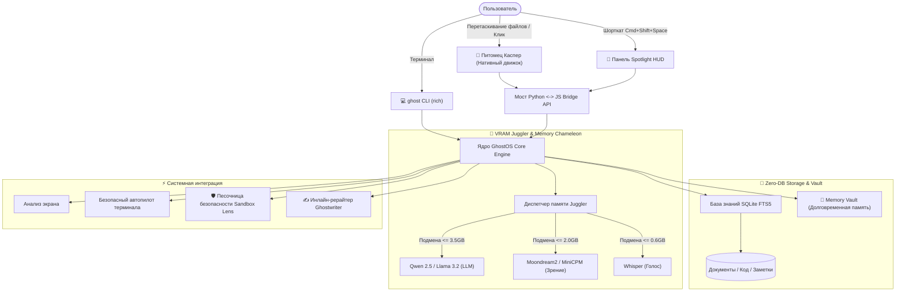

<div align="center">

```
      .---.
     /     \
    | () () |   G H O S T O S
     \  -  /    Невидимый, сверхлёгкий локальный AI-ассистент и десктопный копайлот
    /`---'\
   /       \    [ 100% Приватно • VRAM Juggler • Zero-DB RAG • Питомец Каспер ]
  (_/^\_/\_/^)
```

# 👻 GhostOS
### Сверхлёгкий, автономный локальный AI-ассистент и десктопный компаньон

<p align="center">
  <b>🌐 Выбор языка / Language Select:</b><br>
  <a href="../README.md"><b>English</b></a> •
  <a href="README_RU.md"><b>Русский</b></a> •
  <a href="README_KK.md"><b>Қазақша</b></a> •
  <a href="README_ZH.md"><b>简体中文</b></a> •
  <a href="README_ES.md"><b>Español</b></a> •
  <a href="README_DE.md"><b>Deutsch</b></a> •
  <a href="README_FR.md"><b>Français</b></a> •
  <a href="README_JA.md"><b>日本語</b></a> •
  <a href="README_PT.md"><b>Português</b></a>
</p>

[](https://opensource.org/licenses/MIT)
[](https://github.com/GhostOS-ai/GhostOS)
[](mailto:GhostOS@kib.best)
[](https://www.python.org/downloads/)
[]()
[]()
[]()
[]()

**Единый, автономный десктопный AI-ассистент, который плавно работает на слабых ноутбуках и базовых компьютерах (4–8 ГБ RAM) без Out-Of-Memory (OOM) зависаний.**

[Быстрый старт](#-быстрый-старт) • [Эксклюзивные функции](#-эксклюзивные-функции) • [Сравнение](#-почему-ghostos-а-не-аналоги) • [Архитектура](#-архитектура) • [Шпаргалка CLI](#-шпаргалка-команд-cli) • [Гарантия приватности](#-100-гарантия-приватности)

</div>

---

### 💡 Почему именно GhostOS?

Запуск локального ИИ сегодня сопряжён с тремя ключевыми болями:
1. **Жор памяти Electron-оболочками:** Большинство десктопных приложений (LM Studio, Jan, AnythingLLM) сжирают **800–1200 МБ оперативной памяти** ещё до того, как в память загружен хотя бы один вес нейросети.
2. **Ловушка нескольких моделей (OOM):** Попытка одновременно держать в памяти языковую модель (3 ГБ) + модель зрения (2 ГБ) + Whisper (1 ГБ) моментально роняет систему с 4–8 ГБ памяти.
3. **Перегруженные RAG-стеки:** Для поиска по документам разработчики заставляют поднимать Docker-контейнеры, тяжеленные векторные базы (Chroma, Qdrant) и ставить гигабайты зависимостей.

**GhostOS решает эти проблемы на фундаментальном уровне:**
- **Компаньон Каспер и HUD:** Работают на нативных движках операционной системы (WebKit на macOS, Edge WebView2 на Windows, WebKitGTK на Linux), потребляя всего **~35 МБ RAM**.
- **Динамический VRAM Juggler:** Мгновенно подменяет активную модель (текст, зрение, голос) за <150 мс. Пиковый расход видеопамяти никогда не превышает **3.5 ГБ**.
- **Zero-DB RAG:** Перетащите файл на Каспера — он индексируется за миллисекунды через чистый **SQLite FTS5** без сторонних БД.
- **100% Приватно:** Никаких логов, никакой телеметрии, никаких облачных серверов. Работает даже с полностью выключенным интернетом.

---

### ✨ Эксклюзивные функции

#### 1. 👻 Интерактивный рабочий питомец Каспер
* Невесомый фарфоровый призрак, тихо парящий над вашим рабочим столом.
* **«Каспер ест файлы»:** Перетащите любой PDF, исходный код, заметку или таблицу прямо на Каспера. Он откроет рот, проглотит файл и моментально проиндексирует его в базу знаний (+15 XP!).
* **Реакции и состояния:**
  * 💤 `Покой`: Плавное покачивание, 0% нагрузки на процессор.
  * 🔮 `Мышление`: Мягкий сапфировый ореол, локальная генерация ответа.
  * 🎧 `Прослушивание`: Каспер надевает светящиеся наушники, записывая встречу.
  * 🍕 `Поедание`: Анимация затягивания документов со звуковым эффектом и начислением опыта.
  * ⚠️ `Тревога`: Визуальное предупреждение при обнаружении опасных команд.
* Одиночный клик вызывает интерактивные фразы; двойной клик или шорткат `Cmd+Shift+Space` / `Ctrl+Shift+Space` раскрывает полноразмерный пульт управления (**Spotlight HUD**).

#### 2. ✍️ «Ghost Ghostwriter» (Глобальный AI-помощник в любом приложении)
* Выделите текст в любом месте (Word, Telegram, браузер, VS Code, терминал) $\rightarrow$ нажмите горячую клавишу $\rightarrow$ преобразуйте текст за 1 секунду:
  * ✨ `polish`: Сделать текст ясным, чистым и профессиональным.
  * 🤝 `polite`: Дипломатичный, уважительный деловой тон.
  * 📝 `grammar`: Исправление всех ошибок и опечаток без лишней «воды».
  * 🎯 `summarize`: Выжимка в 2-3 главных тезиса.
  * 🌐 `translate`: Мгновенный перевод на русский, английский, казахский, китайский.
  * 🛠️ `code_fix`: Поиск и исправление ошибок в фрагменте кода.
* Запуск из терминала: `ghost write --mode polite "текст сообщения"` или автоматическая трансформация текста из буфера обмена!

#### 3. 🧠 «Memory Vault» (Локальный граф долговременной памяти)
* Постоянная база персонального контекста в SQLite без внешних векторных БД.
* Каспер автоматически запоминает ваш стек технологий, имя, текущий проект и стиль ответов между перезапусками.
* Добавляет контекст в запросы с **0 КБ дополнительного расхода VRAM** и нулевой фоновой нагрузкой на CPU.
* Команды: `ghost vault list`, `ghost vault remember tech_stack "Python, Rust, Apple Silicon"`.

#### 4. 🛡️ «Terminal Sandbox Lens» (Защита от опасных команд)
* Глубокая проверка консольных команд перед их запуском.
* Перехватывает и блокирует критические операции (`rm -rf /`, `mkfs`, прямое `dd`, `DROP DATABASE`, `format C:`).
* Человеческим языком объясняет риски и предлагает безопасные альтернативы.
* Проверка команд: `ghost sandbox "rm -rf /"`.

#### 5. 📅 «Daily Standup & Commit Crafter»
* Анализирует изменённые за день файлы, git diff и историю сессии.
* Генерирует готовый текст для стендапа в Slack / Telegram / Teams (*«Что сделал сегодня», «Что делаю сейчас», «Блокеры»*).
* Автоматически составляет семантические коммиты по стандарту Conventional Commits (`feat(...)`, `fix(...)`, `refactor(...)`).
* Вызов: `ghost standup`.

#### 6. 🎙️ «Auto-Minutes Meeting Copilot»
* 100% приватный секретарь для звонков в Zoom, Google Meet и голосовых заметок.
* Формирует структурированный протокол встречи: **Главное саммари**, **Ключевые решения** и **Задачи (Action Items) с дедлайнами и ответственными**.
* Whisper подключается через `VRAM Juggler` только на 5 секунд в момент формирования протокола и сразу выгружается из памяти.

#### 7. 🦎 «Memory Chameleon» (Адаптивные профили питания)
* Автоматически следит за зарядом батареи и давлением на оперативную память:
  * 🍃 **ЭКО:** Включается при работе от батареи или занятости RAM > 82%. Контекст 1024 токена, 2 потока CPU, засыпание через 60 сек.
  * ⚖️ **Баланс:** Контекст 2048 токенов, 4 потока, засыпание через 180 сек.
  * ⚡ **Зверь:** При питании от сети. Контекст 4096 токенов, максимальное ускорение GPU.

#### 8. 🎮 Система RPG-прокачки Каспера
* Ваш питомец растёт вместе с вашим рабочим прогрессом:
  * Опыт за скармливание файлов (+25 XP), выполнение задач (+25 XP), диалоги (+10 XP).
  * Открывает новые уровни и визуальные аксессуары (киберпанк-визор, магическая книга, золотая корона).

#### 9. 🎨 Гардероб Каспера (Скины и темы оформления)
* Запуск Каспера в уникальных темах, созданных под темный режим и современные мониторы:
  * 💎 `glass`: Стандартный полупрозрачный лунный фарфор в стиле Apple Glass.
  * ⚡ `cyberpunk`: Яркий неоновый циан с радиоактивной пурпурной аурой.
  * 👑 `gold`: Благородная золотая аура и мягкие переливы света.
  * 🟢 `matrix`: Атмосферное терминальное свечение зелёного люминофора.
* Вызов: `ghost pet --skin cyberpunk` или смена в 1 клик прямо из Меню-бара!

#### 10. 🍕 Casper Feeder (Физическое скармливание файлов Drag-and-Drop)
* Просто перетащите любой файл с кодом (`.py`, `.js`, `.ts`, `.json`), лог или PDF прямо на Каспера.
* Запускается интерактивная анимация жевания (`@keyframes ghostChewWobble`) и реплики в облачках мыслей.
* Файлы мгновенно попадают в Zero-DB RAG без всплывающих окон и модалок загрузки.

#### 11. 👻 Нативный контроллер в Меню-баре macOS
* Легковесная иконка в строке состояния (`ghost bar` или `ghost pet --tray`), созданная на нативном Cocoa `NSStatusBar`.
* 1 клик для вызова/скрытия Каспера, быстрой смены скинов, выбора активной модели и сброса VRAM без потребления ресурсов в фоне (**0 КБ оверхеда**).

#### 12. 🔍 Мгновенный Spotlight HUD
* Быстрая плавающая строка команд по центру экрана (`ghost spot`) в стиле Raycast/Alfred для мгновенных вопросов и команд без отвлечения от работы. Закрывается по клавише `Esc`.

#### 13. 🤖 Каталог локальных моделей и аппаратного ускорения
* Сканирует локальный сервер Ollama, находит установленные модели с размером в ГБ, определяет уровень оборудования (**Apple Silicon Metal MPS**, **NVIDIA CUDA** или **CPU**) и рекомендует оптимальные легковесные модели для Mac и ПК с 4ГБ–8ГБ RAM (`ghost models`).

---

### 📊 Почему GhostOS, а не аналоги?

| Возможность | GhostOS 👻 | Jan.ai / LM Studio | Ollama | AnythingLLM |
| :--- | :---: | :---: | :---: | :---: |
| **Расход RAM на GUI** | **~35 МБ** (Нативный движок) | ~850 МБ (Electron) | Нет (только CLI) | ~1.1 ГБ (Electron + DB) |
| **Десктопный питомец** | **Да (Каспер RPG)** | ❌ Нет | ❌ Нет | ❌ Нет |
| **RAG перетаскиванием файлов**| **Да (Бросить на призрака)**| ❌ Ручная загрузка | ❌ Ручной импорт | ❌ Ручная загрузка |
| **Динамический свап моделей** | **Да (VRAM Juggler)** | ❌ OOM на слабом железе| ❌ Ручной CLI | ❌ OOM на слабом железе |
| **Заморозка KV-кэша на диск**| **Да (0 МБ VRAM в простое)**| ❌ Нет | ❌ Нет | ❌ Нет |
| **Сжатие промптов (Vacuum)** | **Да (Экономит 40-60%)** | ❌ Нет | ❌ Нет | ❌ Нет |
| **Адаптивные профили питания**| **Да (Chameleon Mode)** | ❌ Нет | ❌ Нет | ❌ Нет |
| **Инлайн-рерайтер текста** | **Да (В любых программах)** | ❌ Нет | ❌ Нет | ❌ Нет |
| **Песочница терминала** | **Да (Защита от rm -rf)**| ❌ Нет | ❌ Нет | ❌ Нет |
| **Авто-генератор стендапов** | **Да (Встроено)** | ❌ Нет | ❌ Нет | ❌ Нет |
| **Требование сторонних БД** | **Ноль (SQLite FTS5)** | Различается | Нет | Требует Chroma / Vector DB |
| **Кроссплатформенность** | **macOS / Windows / Linux** | Да | Да | Да |
| **100% Офлайн работа** | **Да** | Да | Да | Частично |

---

### 🚀 Быстрый старт

#### 1. Клонирование и установка
```bash
git clone https://github.com/GhostOS-ai/GhostOS.git
cd GhostOS
pip install -e .
```

#### 2. Запуск Каспера и интерфейса
```bash
ghost pet
```
*Каспер появится на вашем экране. Перетащите в него файлы для обучения или кликните дважды для открытия командного центра!*

#### 3. Использование из терминала (CLI)
```bash
# Мгновенный вопрос к локальной модели
ghost "В чем разница между процессами и потоками в Python?"

# Запуск питомца Каспера (с кастомным скином и иконкой в трее macOS)
ghost pet --skin cyberpunk --tray

# Запуск строки быстрого доступа Spotlight HUD
ghost spot

# Запуск контроллера в строке меню macOS (меню-бар)
ghost bar

# Просмотр установленных моделей и типа аппаратного ускорения
ghost models

# Скормить файл или папку с кодом Касперу (Zero-DB RAG)
ghost eat ~/Documents/my_notes.txt
ghost eat ./src/

# Инлайн-рерайтер текста Ghostwriter
ghost write --mode polite "посмотри код быстрее"
ghost write --mode grammar

# Долговременная память Memory Vault
ghost vault remember tech_stack "Python, Rust, Apple Silicon"
ghost vault list

# Отчёт для дейли-стендапа и сообщение для коммита
ghost standup

# Проверка безопасности команды песочницей
ghost sandbox "rm -rf /"

# Поиск по базе знаний
ghost rag search "миграция базы данных"

# Анализ активного окна на экране
ghost screen

# Безопасное выполнение задачи в ОС
ghost exec "найди все файлы больше 100МБ"

# Проверка статуса видеопамяти и процессора
ghost status
```

---

### ⌨️ Горячие клавиши

| Сочетание | Действие |
| :--- | :--- |
| `Cmd + Shift + Space` / `Ctrl + Shift + Space` | Переключение между Каспером и пультом HUD |
| `Одиночный клик на призрака` | Интерактивная реплика / реакция питомца |
| `Двойной клик на призрака` | Открыть командную панель управления |
| `Escape` | Свернуть панель обратно в маленького питомца |
| `Enter` | Отправить запрос |
| `Перетаскивание файла` | Скормить документ Касперу (мгновенный RAG) |

---

### 🏗️ Архитектура



---

### 🔒 100% Гарантия приватности

GhostOS спроектирован для бескомпромиссной конфиденциальности:
- **Ноль телеметрии:** Никаких аналитических счетчиков, пингов и сбора пользовательских данных.
- **Ноль обращений к облаку:** Все вычисления производятся исключительно на вашем локальном процессоре/видеокарте.
- **Готовность к Air-Gap:** Программа полностью функциональна при выключенном Wi-Fi.

---

### 📄 Лицензия и авторство

- **Автор:** [KIB.best](https://github.com/GhostOS-ai/GhostOS)
- **Email:** [GhostOS@kib.best](mailto:GhostOS@kib.best)
- **Лицензия:** MIT License © 2026 KIB.best. Бесплатно для личного и коммерческого использования.
