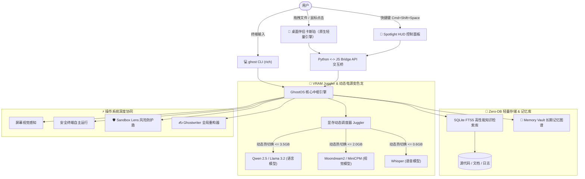

<div align="center">

```
      .---.
     /     \
    | () () |   G H O S T O S
     \  -  /    无形、超轻量、100% 离线桌面 AI 助手与伴侣
    /`---'\
   /       \    [ 100% 隐私安全 • 动态显存调度 • Zero-DB RAG • 卡斯珀桌面伴侣 ]
  (_/^\_/\_/^)
```

# 👻 GhostOS
### 超轻量、纯离线桌面级 AI 助手与伴侣

<p align="center">
  <b>🌐 语言选择 / Language Select:</b><br>
  <a href="../README.md"><b>English</b></a> •
  <a href="README_RU.md"><b>Русский</b></a> •
  <a href="README_KK.md"><b>Қазақша</b></a> •
  <a href="README_ZH.md"><b>简体中文</b></a> •
  <a href="README_ES.md"><b>Español</b></a> •
  <a href="README_DE.md"><b>Deutsch</b></a> •
  <a href="README_FR.md"><b>Français</b></a> •
  <a href="README_JA.md"><b>日本語</b></a> •
  <a href="README_PT.md"><b>Português</b></a>
</p>

[](https://opensource.org/licenses/MIT)
[](https://github.com/GhostOS-ai/GhostOS)
[](mailto:GhostOS@kib.best)
[](https://www.python.org/downloads/)
[]()
[]()
[]()
[]()

**专为普通电脑与低配轻薄本（4–8 GB RAM）打造的完全离线自主桌面 AI 助手，绝不产生内存溢出（OOM）崩溃。**

[快速开始](#-快速开始) • [核心特性](#-独家核心特性) • [竞品对比](#-为什么选择-ghostos) • [架构设计](#-系统架构) • [快捷键一览](#-快捷键指南) • [隐私保证](#-100-隐私保证)

</div>

---

### 💡 为什么选择 GhostOS？

当前在本地运行 AI 面临三大不可忽视的痛点：
1. **Electron 内存膨胀：** 大多数主流桌面 AI 工具（如 LM Studio、Jan、AnythingLLM）在加载任何神经网络权重之前，就已白白占用 **800–1200 MB 内存**。
2. **多模型内存溢出陷阱（OOM）：** 当尝试同时加载语言大模型（3 GB）、视觉模型（2 GB）和 Whisper 语音模型（1 GB）时，配置 4–8 GB 内存的设备会瞬间卡死或闪退。
3. **繁琐沉重的 RAG 向量栈：** 为了检索几篇文档，许多工具强制用户部署复杂的 Docker 容器、沉重的外部向量数据库（Chroma 等）并安装数吉字节的依赖。

**GhostOS 从底层彻底解决了这些痛点：**
- **原生极轻伴侣与 HUD：** 采用操作系统原生轻量引擎（macOS 原生 WebKit、Windows Edge WebView2、Linux WebKitGTK），日常待机内存仅占用 **~35 MB**。
- **动态显存调度器（VRAM Juggler）：** 在 150 毫秒内无缝热替换活跃模型（文本、视觉、语音），系统峰值显存始终控制在 **≤3.5 GB** 以内。
- **Zero-DB RAG：** 只需要将文件直接拖放到卡斯珀身上——依托底层纯正 **SQLite FTS5**，在毫秒内完成全文检索与知识问答，告别外部数据库。
- **100% 离线与隐私：** 零数据遥测、零监控打点、绝不向云端外发任何字节，即使拔掉网线也能顺畅运行。

---

### ✨ 独家核心特性

#### 1. 👻 极简灵动的桌面伙伴卡斯珀（Casper）
* 一只轻盈漂浮在桌面上的半透明瓷光小幽灵伴侣。
* **「喂食学习」：** 直接将任意 PDF、源代码文件、日志或表格拖入卡斯珀，他会自动张嘴“吞下”文件并瞬间构建离线知识库索引（+25 RPG 经验！）。
* **丰富状态与情绪反馈：**
  * 💤 `静息`：轻柔上下浮动，CPU 占用率接近 0%。
  * 🔮 `思考`：周身散发柔和的蓝宝石光晕，进行本地推理生成。
  * 🎧 `聆听`：戴上荧光耳机，实时记录并转写语音会议纪要。
  * 🍕 `进食`：伴随吞咽律动动画与音效，实时吸纳文档并累加经验。
  * ⚠️ `警报`：当命令行检测到破坏性危险指令时立即发出视觉警示。
* 单击卡斯珀可触发趣味互动，双击或按下快捷键 `Cmd+Shift+Space` / `Ctrl+Shift+Space` 可瞬间展开全尺寸控制面板（**Spotlight HUD**）。

#### 2. ✍️ «Ghostwriter»（全局桌面任意应用文本重构）
* 在任何应用（Word、Telegram、浏览器、VS Code、终端）中选中文字 $\rightarrow$ 按下快捷键 $\rightarrow$ 1 秒内智能润色重构：
  * ✨ `polish`：使表述更加流畅、专业、精炼。
  * 🤝 `polite`：转换为得体优雅的商务外交措辞。
  * 📝 `grammar`：一键修正错别字与语法语病。
  * 🎯 `summarize`：提取提炼出核心摘要与要点。
  * 🌐 `translate`：多语种极速互译（支持中、英、俄、哈等）。
  * 🛠️ `code_fix`：快速诊断修复选中的代码片段漏洞。
* 终端调用：`ghost write --mode polite "请尽快修复"` 或直接智能读取剪贴板！

#### 3. 🧠 «Memory Vault»（长期记忆持久化存储）
* 基于 SQLite 的持久化个性化记忆图谱，无需安装复杂外部数据库。
* 跨会话自动记住你的个人技术栈偏好、常用称呼以及回答风格习惯。
* 注入上下文信息时**完全不消耗额外显存（0 KB VRAM）**，背景 CPU 占用近乎于零。
* 快捷指令：`ghost vault list`, `ghost vault remember tech_stack "Python, Rust, Apple Silicon"`。

#### 4. 🛡️ «Terminal Sandbox Lens»（终端高危指令安全沙盒）
* 实时分析即将执行的控制台命令。
* 深度拦截毁灭性危险操作（如 `rm -rf /`、直接 `dd` 破坏引导、`mkfs`、`DROP DATABASE`）。
* 用通俗平实的语言向用户解释潜在风险，并给出安全的替代建议。
* 诊断指令：`ghost sandbox "rm -rf /"`。

#### 5. 📅 «Daily Standup & Commit Crafter»（每日站会与语义提交）
* 全自动扫描当天的工作变更、代码 git diff 及操作历史。
* 一键生成用于 Slack / 微信 / 飞书的结构化站会汇报（*“今日完成”、“进行中”、“遇到阻碍”*）。
* 严格遵循 Conventional Commits 规范，自动输出规整的 Git Commit Message（`feat(...)`、`fix(...)`）。
* 启动命令：`ghost standup`。

#### 6. 🎙️ «Auto-Minutes Meeting Copilot»（会议离线智能秘书）
* 100% 本地运行的会议速记秘书，适配腾讯会议、Zoom、飞书会议及语音备忘录。
* 自动生成结构化纪要：**核心概括**、**关键决议** 以及带有责任人的 **待办任务清单（Action Items）**。
* Whisper 模型通过显存调度器按需加载 5 秒，纪要输出完毕后立即从显存中彻底卸载。

#### 7. 🦎 «Memory Chameleon»（自适应功耗动态感知）
* 智能感知笔记本电池电量与系统运行内存负载：
  * 🍃 **ECO 节能模式：** 电池供电或可用内存紧张（>82%）时自动开启，上下文限制至 1024 tokens，2 线程运行，闲置 60 秒自动深度休眠。
  * ⚖️ **均衡模式：** 上下文 2048 tokens，4 线程，闲置 180 秒休眠。
  * ⚡ **性能模式：** 接通电源充电且内存充裕时自动激活，上下文拉满至 4096 tokens，全速启用 GPU 硬件加速。

#### 8. 🎮 卡斯珀 RPG 成长进化系统
* 你的桌面小伴侣将与你的工作生产力一同成长进化：
  * 喂食文件（+25 XP）、执行系统任务（+25 XP）、日常提问对话（+10 XP）。
  * 升级解锁个性化装扮与外观部件（赛博朋克目镜、魔法秘典、黄金皇冠）。

#### 9. 🎨 卡斯珀更衣室（丰富主题外观皮肤）
* 专为深色模式与现代办公桌面精心雕琢的 4 套独特质感外观：
  * 💎 `glass`：默认纯净通透的苹果瓷光半透明质感。
  * ⚡ `cyberpunk`：耀眼荧光青与霓虹紫晕染赛博风格。
  * 👑 `gold`：高贵华丽的纯金皇室微光浮雕。
  * 🟢 `matrix`：经典终端极客荧光绿代码流。
* 启动：`ghost pet --skin cyberpunk` 或在状态栏菜单中一键即时切换！

#### 10. 🍕 Casper Feeder（直觉式拖拽进食索引）
* 将任意代码文件（`.py`、`.js`、`.ts`、`.json`）、文本日志或 PDF 文档直接拖放到卡斯珀身上。
* 立即触发卡斯珀独有的咀嚼摇晃动画（`@keyframes ghostChewWobble`）与开心的思考气泡。
* 文件瞬间注入 Zero-DB RAG 离线索引库，无需面对冗长繁琐的上传弹窗。

#### 11. 👻 原生 macOS 状态栏菜单栏控制器
* 驻留在系统顶部菜单栏的状态栏图标（`ghost bar` 或 `ghost pet --tray`），基于 macOS 原生 Cocoa `NSStatusBar` 构建。
* 支持一键显示/隐藏卡斯珀、秒切皮肤、更换当前推理模型及一键释放 VRAM，**后台额外内存消耗为 0 KB**。

#### 12. 🔍 瞬时 Spotlight HUD 搜索指令栏
* 居中悬浮的沉浸式极速指令搜索栏（`ghost spot`），形如 Raycast / Spotlight。专注提问，按 `Esc` 键即刻优雅隐藏。

#### 13. 🤖 本地模型与硬件加速全景图谱
* 自动扫描本地 Ollama 引擎，盘点已安装模型的磁盘与显存体积（GB），精准识别当前的硬件加速层级（**Apple Silicon Metal MPS**、**NVIDIA CUDA** 或 **CPU 兜底**），并为 4GB–8GB 设备推荐轻巧敏捷的模型（`ghost models`）。

---

### 📊 为什么选择 GhostOS？

| 功能维度 | GhostOS 👻 | Jan.ai / LM Studio | Ollama | AnythingLLM |
| :--- | :---: | :---: | :---: | :---: |
| **界面内存开销** | **~35 MB**（原生轻量引擎）| ~850 MB（Electron）| 无（仅 CLI 终端）| ~1.1 GB（Electron + 数据库）|
| **互动桌面伴侣** | **有（卡斯珀 RPG 进化）**| ❌ 无 | ❌ 无 | ❌ 无 |
| **拖拽即索引 RAG** | **支持（直接投喂伴侣）**| ❌ 繁琐手动导入 | ❌ 手动导入 | ❌ 繁琐手动导入 |
| **模型动态热切换** | **支持（显存调度 Juggler）**| ❌ 低配设备直接崩掉 | ❌ 需手动终端切换 | ❌ 低配设备直接崩掉 |
| **KV-Cache 内存冻结** | **支持（待机显存 0 MB）**| ❌ 不支持 | ❌ 不支持 | ❌ 不支持 |
| **Prompt 智能真空抽吸** | **支持（节省 40-60%）**| ❌ 不支持 | ❌ 不支持 | ❌ 不支持 |
| **自适应电量感知** | **支持（Chameleon 变色龙）**| ❌ 不支持 | ❌ 不支持 | ❌ 不支持 |
| **全局任意应用改写** | **支持（Ghostwriter 全局生效）**| ❌ 不支持 | ❌ 不支持 | ❌ 不支持 |
| **终端危险指令沙盒** | **支持（拦截 rm -rf 等风险）**| ❌ 不支持 | ❌ 不支持 | ❌ 不支持 |
| **每日站会与提交助手** | **内置集成** | ❌ 无 | ❌ 无 | ❌ 无 |
| **外部向量数据库依赖** | **完全零依赖（SQLite FTS5）**| 因配置而异 | 无 | 强制依赖 Chroma 向量库 |
| **全平台跨系统支持** | **macOS / Windows / Linux** | 支持 | 支持 | 支持 |
| **100% 离线自主可用** | **完美支持** | 支持 | 支持 | 部分依赖外网 |

---

### 🚀 快速开始

#### 1. 克隆代码与依赖安装
```bash
git clone https://github.com/GhostOS-ai/GhostOS.git
cd GhostOS
pip install -e .
```

#### 2. 唤醒桌面伴侣卡斯珀
```bash
ghost pet
```
*卡斯珀将浮现在桌面上。直接拖动文件投喂给他，或双击唤出 HUD 控制中心！*

#### 3. 终端命令行直观调用（CLI）
```bash
# 直接向本地离线大模型提问
ghost "Python 中的进程与线程有什么本质区别？"

# 启动卡斯珀桌面伴侣（指定赛博朋克皮肤并挂载菜单栏托盘）
ghost pet --skin cyberpunk --tray

# 瞬时唤起极简 Spotlight HUD 悬浮指令框
ghost spot

# 启动原生系统顶部菜单栏控制器
ghost bar

# 查看当前本地模型分布与硬件加速状态
ghost models

# 投喂文档或代码库给卡斯珀学习（Zero-DB RAG）
ghost eat ~/Documents/my_notes.txt
ghost eat ./src/

# 全局文本写作助手 Ghostwriter
ghost write --mode polite "帮我尽快看看这段代码"
ghost write --mode grammar

# 长期记忆保险库（Memory Vault）
ghost vault remember tech_stack "Python, Rust, Apple Silicon"
ghost vault list

# 生成今日站会工作汇报与语义提交信息
ghost standup

# 终端高危指令安全沙盒诊断
ghost sandbox "rm -rf /"

# 快速检索离线知识库
ghost rag search "数据库迁移"

# 截屏视觉理解当前屏幕窗口
ghost screen

# 在操作系统中安全执行复杂自动化任务
ghost exec "查找所有大于 100MB 的文件"

# 实时监测显存调度器与处理器健康状态
ghost status
```

---

### ⌨️ 快捷键指南

| 键位组合 | 功能说明 |
| :--- | :--- |
| `Cmd + Shift + Space` / `Ctrl + Shift + Space` | 在卡斯珀浮窗与 Spotlight HUD 搜索栏之间切换 |
| `单击小幽灵` | 触发趣味台词与随机互动回复 |
| `双击小幽灵` | 完整展开桌面控制管理中心 |
| `Escape` | 优雅收起面板，缩回灵动小幽灵形态 |
| `Enter` | 快速提交输入指令 |
| `拖入任何文件` | 直接投喂卡斯珀学习并建立知识索引 |

---

### 🏗️ 系统架构



---

### 🔒 100% 隐私保证

GhostOS 自诞生之初便秉持零妥协的私密安全原则：
- **零数据上报与遥测：** 没有任何后台跟踪计数器、遥测数据包或行为分析埋点。
- **绝不连接云端计算：** 所有模型推理均完全在你的本地芯片（Apple Silicon MPS / NVIDIA 显卡 / CPU）上私密计算。
- **严苛物理隔绝（Air-Gap）：** 拔掉网线、置身完全断网环境，各项核心功能依旧完美运转。

---

### 📄 开源许可证与创作者

- **主创团队：** [KIB.best](https://github.com/GhostOS-ai/GhostOS)
- **联系邮箱：** [GhostOS@kib.best](mailto:GhostOS@kib.best)
- **开源许可证：** MIT License © 2026 KIB.best。自由用于个人与商业用途。
